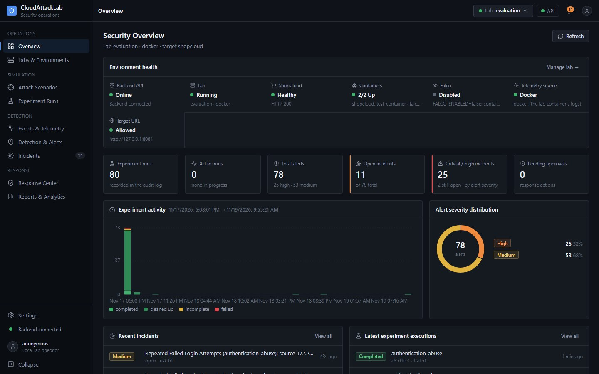
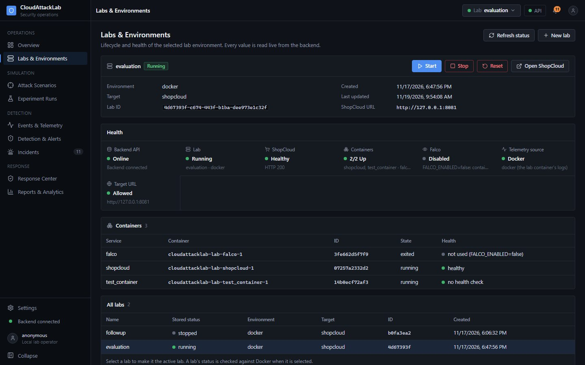
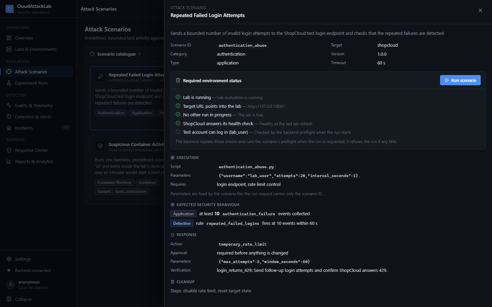
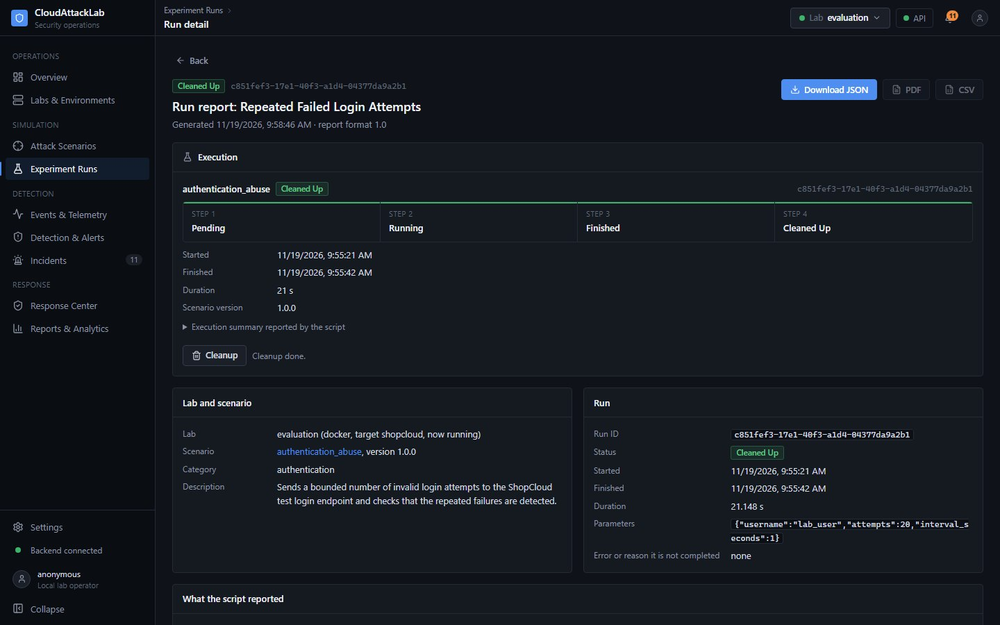
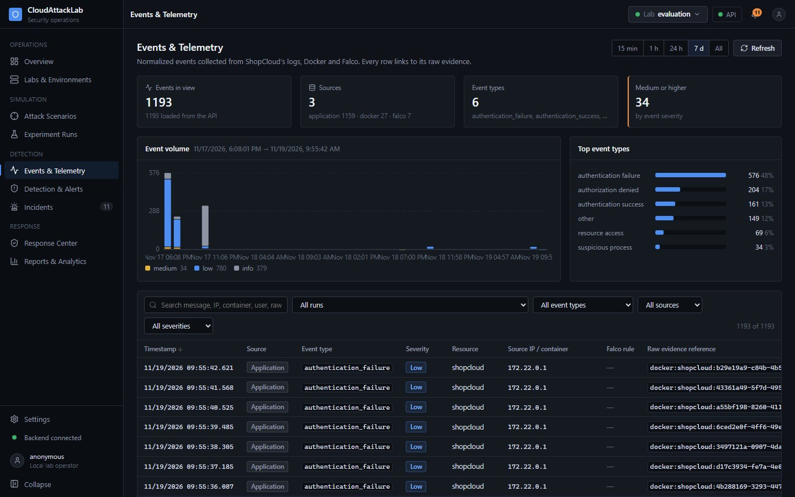
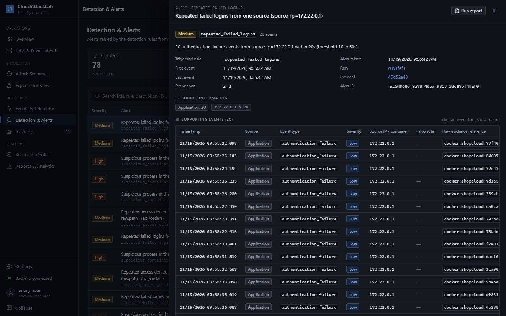
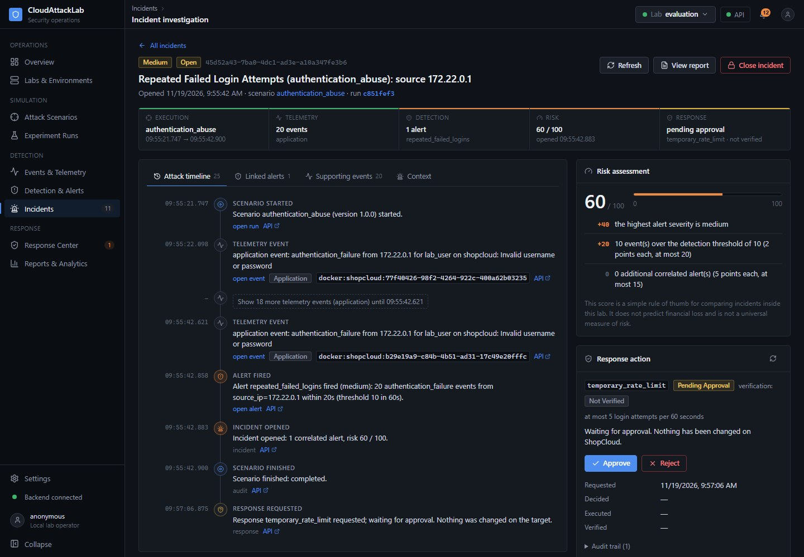
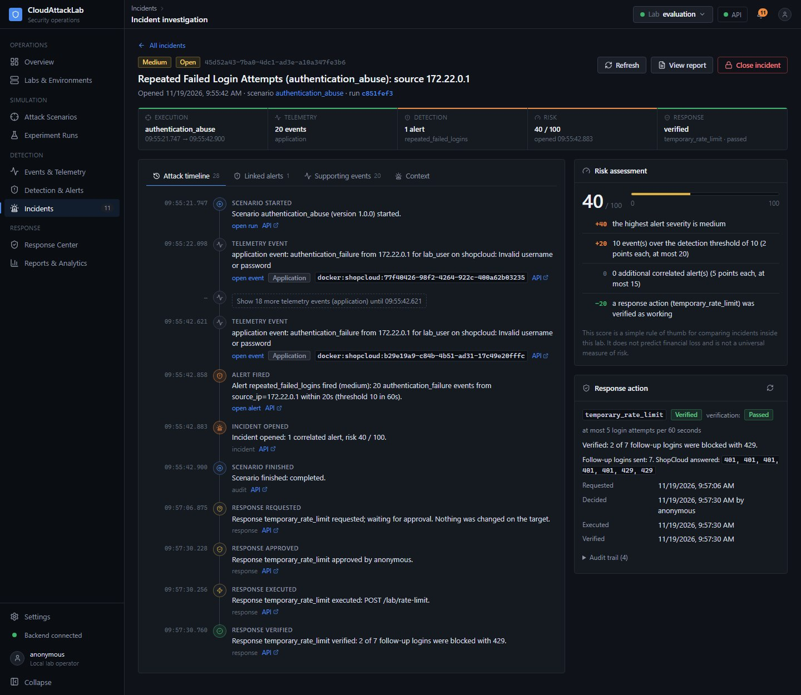
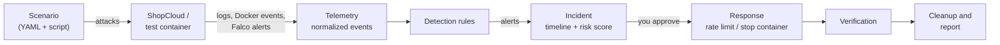

# CloudAttackLab

CloudAttackLab is a local lab for running controlled attacks against a small containerized web application and following each attack through telemetry, detection, investigation, response and verification. It runs on one computer with Docker.

Security tooling is usually studied one piece at a time: a log pipeline here, a detection rule there. It is hard to see, on one machine and with real evidence, how an attack turns into log lines, how those become an alert and an incident, and whether a response actually stopped the attack. CloudAttackLab connects those steps in one reproducible workflow.

It is a student project built to demonstrate one complete, evidence-based workflow. It is not a production security tool.

## Contents

- [Overview](#overview)
- [Features](#features)
- [Screenshots](#screenshots)
- [Architecture](#architecture)
- [Technology stack](#technology-stack)
- [Prerequisites](#prerequisites)
- [Installation (first time)](#installation-first-time)
- [Starting the project](#starting-the-project)
- [Accessing the application](#accessing-the-application)
- [Running your first experiment](#running-your-first-experiment)
- [Monitoring](#monitoring)
- [Stopping and resetting](#stopping-and-resetting)
- [Troubleshooting](#troubleshooting)
- [Project evaluation](#project-evaluation)
- [Documentation](#documentation)
- [Repository structure](#repository-structure)
- [Development and tests](#development-and-tests)
- [Security and safety](#security-and-safety)
- [Known limitations and future scope](#known-limitations-and-future-scope)

## Overview

CloudAttackLab starts an isolated copy of a small web shop, **ShopCloud**, together with a test container. From a web dashboard you run a predefined attack scenario against it. The platform collects the real logs and Docker events the attack produces, stores them as normalized security events, checks them against detection rules, and groups the resulting alerts into an incident with an evidence timeline and an explained risk score. You can then request a response, approve it, and see whether it worked.

The workflow is:

1. **Start the lab**: ShopCloud and the test container start in Docker.
2. **Select a scenario** from the scenario catalogue.
3. **Execute it**: the scenario's script sends bounded test activity to the lab.
4. **Collect telemetry**: ShopCloud's logs, Docker events and (optionally) Falco alerts are read and normalized during the run.
5. **Detect suspicious activity**: when the script has finished, the run's events are checked against detection rules. Detection runs once per run, not as a continuous stream.
6. **Investigate the incident**: alerts are grouped into an incident with a timeline, linked evidence and a risk score.
7. **Approve a response**: a response is only requested and executed with your approval.
8. **Verify the outcome**: the platform checks that the response worked, and cleanup reverts it afterwards.

Every action is recorded in an audit log, and the lab can be reset to its starting state.

## Features

Implemented in version 1.0:

| Area | What is implemented |
|---|---|
| Attack scenarios | Three attack scenarios, each with a detection rule and cleanup: `authentication_abuse` (repeated failed logins), `unauthorized_resource_access` (reading data a user may not see), `suspicious_container_activity` (a shell started in a container). A fourth, `benign_baseline`, attacks nothing and is used to measure false positives |
| Target application | ShopCloud, a FastAPI web shop in its own container, plus an isolated test container with no network |
| Telemetry | ShopCloud's own logs (read from Docker, or from Loki), Docker events and, optionally, Falco alerts, all normalized into one event schema |
| Detection | YAML rules with thresholds and time windows, evaluated over the events of each scenario run |
| Correlation and investigation | Alerts grouped into incidents, each with an evidence timeline from the first event to the response |
| Risk assessment | A fixed, explained risk score per incident; every factor is shown |
| Response | `temporary_rate_limit` and `stop_container`, each needing your approval, then verified, then reverted by cleanup |
| Dashboard and reports | Pages for overview, labs, scenarios, runs, events, alerts, incidents, responses and reports; JSON run reports |
| Safety | Fixed commands, bounded parameters, lab-only targets, approval before any change, an audit log of every action; all ports bound to `127.0.0.1` |

Optional, off by default:

- **Full monitoring mode**: Loki, Alloy and Grafana, with a provisioned Grafana dashboard. See [Monitoring](#monitoring).
- **Falco**: runtime alerts from the test container. Needs a privileged container and a kernel with BTF.

Planned features that are **not** implemented are listed under [Known limitations and future scope](#known-limitations-and-future-scope).

## Screenshots

All screenshots were taken from the running application (version 1.0 dashboard) during an `authentication_abuse` run.

**Overview.** Environment health, counts of runs, alerts and incidents, and recent activity.



**Labs & Environments.** The lab's status, health checks and containers, with Start, Stop and Reset.



**Attack Scenarios.** A scenario's definition, the environment checks that must pass, and the **Run scenario** button.



**Experiment Runs.** The run report of a finished run: execution steps, timing and parameters.



**Events & Telemetry.** Normalized events with filters; each row links to its raw evidence.



**Detection & Alerts.** An alert and the 20 events that triggered it.



**Incidents: response waiting for approval.** The incident's timeline, risk assessment and a requested response with **Approve** and **Reject**.



**Incidents: response verified.** After approval the response was executed and verified (2 of 7 follow-up logins blocked with HTTP 429), and the risk score dropped from 60 to 40.



A screenshot of the optional Grafana dashboard is not included yet.

## Architecture



Two Docker Compose projects run on the machine:

- **The platform** (`docker-compose.yml`): PostgreSQL, the FastAPI backend and the React dashboard. With the `monitoring` profile it also starts Loki, Alloy and Grafana.
- **The lab** (`lab/docker-compose.lab.yml`): ShopCloud, the test container and optional Falco. You never start it by hand: the backend's Lab Manager starts, stops and resets it through the Docker socket.

Main components:

| Component | Responsibility |
|---|---|
| Backend (FastAPI) | Lab Manager, Scenario Engine, telemetry collection and normalization, Detection Engine, incidents and risk scoring, Response Manager, reports and the audit log |
| Dashboard (React) | The web interface. It only talks to the backend API |
| PostgreSQL | Stores the application's data: labs, runs, **normalized security events**, alerts, incidents, responses and the audit log |
| ShopCloud | The lab target. It writes one JSON log line per request |
| Test container | An isolated container with no network, used by the container scenario and the `stop_container` response |
| Docker | Source of ShopCloud's logs and of container events (for example `exec_start`) |
| Loki, Alloy, Grafana (optional) | Alloy ships every container's raw logs to Loki, which stores them; Grafana visualizes them. The backend can also read ShopCloud's logs from Loki instead of Docker |

The detection engine is part of the backend and works on the normalized events in PostgreSQL. Grafana only displays raw logs from Loki; it does not detect anything.

**Why host networking.** The backend and the dashboard run with `network_mode: host`, so the backend reaches ShopCloud (`127.0.0.1:8081`) and Loki (`127.0.0.1:3100`) through ports published on the Docker host. This only works as intended where the containers share the network of a Linux Docker host, which is why Docker Desktop is not supported. Moving to a bridge network is planned for after version 1.0.

The [architecture guide](docs/architecture.md) covers the modules, networks, event schema and the full data flow, and [why the backend still uses host networking](docs/architecture.md#why-the-backend-still-uses-host-networking).

## Technology stack

| Part | Technology |
|---|---|
| Backend | Python 3, FastAPI, Alembic migrations, pytest |
| Database | PostgreSQL |
| Dashboard | React with Vite, `lucide-react` icons, plain SVG charts; served by nginx in its container |
| Target application | ShopCloud: FastAPI with SQLite |
| Containers | Docker Engine and the Docker Compose v2 plugin |
| Scenarios and rules | YAML definitions, Python scenario scripts |
| Optional monitoring | Grafana Loki, Grafana Alloy, Grafana |
| Optional runtime detection | Falco |

## Prerequisites

**Supported setup:** Linux Docker Engine running inside Ubuntu on WSL 2.

| | Version 1.0 |
|---|---|
| Tested on | Windows 11, WSL 2, Ubuntu, Docker Engine and the Docker Compose v2 plugin installed **inside** Ubuntu |
| Should work, not tested | Windows 10 with WSL 2; native Linux with Docker Engine |
| Not supported | Docker Desktop (the backend uses host networking), macOS, native Windows |
| Memory | 16 GB RAM recommended. The platform and lab use about 190 MiB, about 810 MiB with monitoring and Falco |
| Disk | 30–50 GB free |
| Tools | `git`, `curl` and `python3` inside Ubuntu (the setup script checks for `curl` and `python3`) |

Ports used (all bound to `127.0.0.1`; they must be free):

| Port | Service | Mode |
|---|---|---|
| 5173 | Dashboard | Always |
| 8000 | Backend API | Always |
| 5432 | PostgreSQL | Always |
| 8081 | ShopCloud | Always (when the lab runs) |
| 3000 | Grafana | Full monitoring mode |
| 3100 | Loki | Full monitoring mode |
| 12345 | Alloy | Full monitoring mode |

## Installation (first time)

> Run every command in this section **inside Ubuntu (WSL)**, not in Windows PowerShell. The only exception is step 1a.

**1a. Install WSL 2 with Ubuntu** (Windows, once). In an **administrator PowerShell**:

```powershell
wsl --install -d Ubuntu
```

Restart Windows when asked, then open **Ubuntu** from the Start menu and create your Linux user.

**1b. Install Docker Engine inside Ubuntu** (once). Follow [Docker's guide for Ubuntu](https://docs.docker.com/engine/install/ubuntu/). Then allow your user to run Docker without `sudo`:

```bash
sudo usermod -aG docker $USER
```

Close and reopen Ubuntu, then check that this works **without** `sudo`:

```bash
docker compose version
```

If Docker later reports that the daemon is not running (this happens when your WSL setup does not use systemd), start it with:

```bash
sudo service docker start
```

**2. Clone the repository.** By default this clones into your Linux home directory. You can also clone onto a Windows drive, which Ubuntu sees as `/mnt/d/...` (for `D:\`); that works too, with one caveat for frontend development described in [troubleshooting](docs/troubleshooting.md#vite-does-not-notice-saved-files-on-a-windows-drive).

```bash
git clone https://github.com/SaiyamKamate/CloudAttackLabs.git
```

**3. Enter the repository directory.**

```bash
cd CloudAttackLabs
```

**4. Run the setup script.**

```bash
scripts/setup.sh
```

The script:

1. Checks Docker, Docker Compose, `curl` and `python3`, and that the ports are free.
2. Creates `.env` from `.env.example` with random passwords, **only if there is no `.env` yet**. An existing `.env` is never changed.
3. Builds the images and starts the platform (PostgreSQL, backend, dashboard).
4. Waits until the backend, database and dashboard answer.
5. Creates a lab named `default` if there is none, and starts it.

It never deletes containers, volumes or data, and it is safe to run again. Options:

- `scripts/setup.sh --monitoring` also starts Loki, Alloy and Grafana.
- `scripts/setup.sh --no-lab` does not create or start a lab.

**5. Wait for setup to finish.** The first run downloads and builds images and can take several minutes. It ends by printing the dashboard URL. If it stops with an error, it says which step failed; see [Troubleshooting](#troubleshooting).

**6. Open the dashboard** at <http://127.0.0.1:5173> in your Windows browser, then continue with [Running your first experiment](#running-your-first-experiment).

<details>
<summary>Manual installation without the script</summary>

```bash
[ -f .env ] || cp .env.example .env
```

Edit `.env` and set `POSTGRES_PASSWORD`, `LAB_CONTROL_TOKEN` and `GF_SECURITY_ADMIN_PASSWORD`. Set `POSTGRES_PASSWORD` before the first start: the database keeps the password it was created with.

```bash
docker compose up -d --build
```

```bash
curl -s http://127.0.0.1:8000/api/v1/health    # {"status":"ok","database":"ok"}
```

Then open <http://127.0.0.1:5173>, go to **Labs & Environments**, create a lab and click **Start**.
</details>

The [installation guide](docs/install.md) explains every step in detail, plus Falco, uninstalling, upgrading from the old `cloudattacklab/` layout, and a checklist for a new machine.

## Starting the project

After the first-time setup, for example after restarting your computer, start the project from the repository directory **inside Ubuntu**:

```bash
scripts/start.sh --lab
```

This starts the platform and the newest lab without rebuilding, and waits until everything answers. It only starts what is not running and never deletes data. Options:

| Command | What it starts |
|---|---|
| `scripts/start.sh` | The platform only: database, backend, dashboard |
| `scripts/start.sh --lab` | Also the newest lab (ShopCloud, test container) |
| `scripts/start.sh --monitoring` | Also Loki, Alloy and Grafana |
| `scripts/start.sh --build` | Rebuilds the images first (use after `git pull`) |

Options can be combined, for example `scripts/start.sh --monitoring --lab`. You can also start the lab later from the dashboard's **Labs & Environments** page.

Keep an Ubuntu window open while you use the lab: WSL shuts down a while after the last WSL window closes, and that stops every container.

## Accessing the application

| Service | URL | Notes |
|---|---|---|
| Dashboard | <http://127.0.0.1:5173> | The main interface |
| Backend API | <http://127.0.0.1:8000/api/v1/health> | Health check; the API is described in [api-contract.md](docs/api-contract.md) |
| ShopCloud | <http://127.0.0.1:8081> | The lab target; also opened by **Open ShopCloud** on the Labs page |
| Grafana | <http://127.0.0.1:3000> | Full monitoring mode only; sign in as `admin` with `GF_SECURITY_ADMIN_PASSWORD` from `.env` |

To check that everything is running:

```bash
scripts/status.sh
```

It is read-only and shows the containers, health endpoints and the lab's status. It exits with 0 when the platform is healthy. You can also check the backend directly:

```bash
curl -s http://127.0.0.1:8000/api/v1/health
```

A healthy backend answers `{"status":"ok","database":"ok"}`. In the dashboard, the sidebar shows **Backend connected** and the **Overview** page shows the health of every part.

## Running your first experiment

This walkthrough uses the `authentication_abuse` scenario (repeated failed logins). Page names and buttons are as they appear in the dashboard's sidebar.

1. **Check the lab.** Open **Labs & Environments**. The lab should show **Running** and ShopCloud **Healthy**. If it is stopped, click **Start** and wait about a minute.
2. **Select a scenario.** Open **Attack Scenarios** and click **Repeated Failed Login Attempts** (`authentication_abuse`). A panel shows the scenario's definition and the **Required environment status** checks.
3. **Run it.** Click **Run scenario**, then confirm with **Run scenario** in the dialog. The **Current execution** panel shows the steps Pending → Running → Completed. This run takes about 20 seconds.
4. **Inspect the events.** Open **Events & Telemetry**. The newest rows are the run's `authentication_failure` events from ShopCloud. Click a row to see its raw record.
5. **Inspect the alert.** Open **Detection & Alerts** and click the newest **Repeated failed logins** alert. The drawer lists the events that triggered it.
6. **Investigate the incident.** Open **Incidents** and click the newest incident. The **Attack timeline** tab shows the run from scenario start to incident; **Risk assessment** explains the score.
7. **Request a response.** In the incident's **Response action** panel, click **Request response** and confirm. The response `temporary_rate_limit` is created with status **Pending Approval**. Nothing has changed in the lab yet.
8. **Approve and verify.** Click **Approve**, then **Approve and execute**. The backend turns on ShopCloud's login rate limit and verifies it by sending follow-up logins. The panel shows **Verified** and **Passed**, and the risk score drops by 20.
9. **Clean up.** Open **Experiment Runs**, open the run, and click **Cleanup**, then **Run cleanup**. This turns the rate limit off, resets ShopCloud's state and marks the response as reverted. Because the response is no longer applied, the incident's risk score goes back up by 20.

The run report (**Experiment Runs**, or **Reports & Analytics**) can be downloaded as JSON with **Download JSON**. The [user guide](docs/user-guide.md) covers the other scenarios, closing incidents and resetting the lab.

## Monitoring

CloudAttackLab has two modes. The core workflow (scenarios, telemetry, detection, incidents, responses) works in both.

| | Basic mode (default) | Full monitoring mode |
|---|---|---|
| Start | `scripts/start.sh --lab` | `scripts/start.sh --monitoring --lab` |
| Services | PostgreSQL, backend, dashboard; the lab (ShopCloud, test container) | The same, plus Loki, Alloy and Grafana |
| Where telemetry comes from | Docker (`TELEMETRY_SOURCE=docker`) | Docker, or Loki with `TELEMETRY_SOURCE=loki` |
| Needs | Nothing beyond `.env` | `GF_SECURITY_ADMIN_PASSWORD` in `.env` |

Without the scripts, `docker compose up -d` (basic) or `docker compose --profile monitoring up -d` (full) start the platform only; start the lab from the **Labs & Environments** page.

The roles of the monitoring services:

- **Alloy** collects every container's logs and ships them to Loki.
- **Loki** stores the raw container logs.
- **Grafana** visualizes them. Its provisioned dashboard, **CloudAttackLab - Lab activity**, shows failed logins, 403 denials and 429 rate-limit hits per minute, container exec events per minute, and the latest ShopCloud log lines. The panels fill once you run scenarios.

Grafana is an optional observability layer, **not** the detection engine. Detection, incidents and responses are handled by the backend, which stores normalized security events and incidents in PostgreSQL.

To enable monitoring:

```bash
scripts/start.sh --monitoring
```

Then open <http://127.0.0.1:3000> and sign in as `admin` with the `GF_SECURITY_ADMIN_PASSWORD` from your `.env`. Loki needs about 20 seconds after start before it reports ready.

Set `COMPOSE_PROFILES=monitoring` in `.env` to make full mode the default. To have the backend read ShopCloud's logs from Loki instead of Docker, set `TELEMETRY_SOURCE=loki` in `.env` and recreate the backend with `docker compose up -d backend`. With `TELEMETRY_SOURCE=loki` and Loki down, runs fail with a clear message; there is no fallback to Docker.

**Falco** is independent of both modes: set `FALCO_ENABLED=true` in `.env` and reset the lab. It needs a privileged container and a kernel with BTF; see [install §10](docs/install.md#10-turn-falco-on-optional).

## Stopping and resetting

There are three different operations. Only the last one deletes data.

**Stop** (keeps everything):

```bash
scripts/stop.sh
```

Stops the lab, the monitoring stack and the platform. Containers are stopped, not removed; the database, your `.env` and the built images stay. Start again with `scripts/start.sh --lab` (add `--monitoring` if you use it).

**Reset the lab** (keeps history): the **Reset** button on the **Labs & Environments** page recreates the lab's containers, resets ShopCloud's state and reverts applied responses. Incidents and reports are kept.

**Factory reset** (deletes data):

```bash
scripts/reset.sh
```

> **Warning: this cannot be undone.** It asks you to type `delete` before it continues.

| Deleted | Kept |
|---|---|
| The database volume (normally `cloudattacklab_pgdata`): every lab, run, event, alert, incident, response and audit record | Your `.env` |
| The lab's containers, including ShopCloud's own data | The code |
| The monitoring containers and their logs | The built images (unless you add `--images`) |

Options: `--yes` skips the question (for scripts); `--images` also removes the images built from this repository. Afterwards, run `scripts/setup.sh` to start again with an empty database. The database volume is shared by every checkout of this repository on the same Docker host.

## Troubleshooting

The scripts stop at the first step that fails and say which one. None of them deletes data, so after fixing the cause you run the same script again.

| Problem | Fix |
|---|---|
| "This is a Windows shell" | You ran the script in PowerShell or Git Bash. Open Ubuntu (WSL) and run it there |
| "The Docker daemon is not running" | `sudo service docker start` |
| "Docker refused access" | `sudo usermod -aG docker $USER`, then close and reopen Ubuntu |
| A port is "already used by another program" | Stop the program using it (for example `sudo service postgresql stop` for port 5432, or find the container with `docker ps`) |
| `password authentication failed` in `docker compose logs backend` | The database was created with a different `POSTGRES_PASSWORD`. Put the old password back in `.env` and run `scripts/start.sh`, or, if you do not need the data, run `scripts/reset.sh` and then `scripts/setup.sh` |
| Grafana does not start, log says `GF_SECURITY_ADMIN_PASSWORD is empty` | Set it in `.env`, then `scripts/start.sh --monitoring` |
| The lab shows "running" after restarting WSL or Docker | Open **Labs & Environments** (or click **Refresh status**); the status is corrected. Then click **Start** |
| A manual ShopCloud login gets HTTP 429 after a test | The rate limit from an approved response is still on. Run **Cleanup** for that run, or reset the lab |

For logs, use Docker Compose: `docker compose logs -f backend` for the platform, `docker compose -f lab/docker-compose.lab.yml logs shopcloud` for the lab.

The [troubleshooting guide](docs/troubleshooting.md) has these and other problems in detail, including Loki's start-up delay, Falco, and a run that stays active after a backend restart.

## Project evaluation

Version 1.0 was evaluated on 17 November 2026 on one laptop:

- 54 scenario runs, all `completed`.
- In the 45 runs measured for detection, the expected alert was raised every time.
- All 30 approved responses were executed, verified and reverted by cleanup.
- Ten minutes of benign traffic raised one false positive.

These results come from one machine and from scenarios that were designed together with their detection rules. The [evaluation results](docs/evaluation-results.md) explain the threats to validity, why these numbers prove less than they seem, and how to repeat the measurements.

## Documentation

| Document | What it covers |
|---|---|
| [Installation guide](docs/install.md) | Requirements, Docker in WSL, `.env`, starting and checking every part, Falco, stopping, uninstalling, upgrading, a fresh-machine checklist |
| [User guide](docs/user-guide.md) | The dashboard step by step: the scenarios, alerts and evidence, incidents, responses, reports, cleanup and reset |
| [Architecture](docs/architecture.md) | Modules, containers and networks, the data flow from scenario to response, the event schema, the networking decision |
| [Adding a scenario](docs/adding-a-scenario.md) | Scenario YAML, script, detection rule, tests and cleanup, with a template |
| [Troubleshooting](docs/troubleshooting.md) | Start-up failures and the real problems met in this project, with fixes |
| [Known limitations](docs/known-limitations.md) | What the lab does not do, or does only simply, and why |
| [Safety controls](docs/safety.md) | Each safety control and where the code enforces it |
| [API contract](docs/api-contract.md) | Every backend endpoint, its body, results and errors |
| [ShopCloud interface](docs/shopcloud-interface.md) | What a lab target must provide: endpoints, test accounts, log format, and the signed integration API |
| [ShopCloud](shopcloud/README.md) | Running ShopCloud on its own (port 8090) and connecting it through Target Management |
| [Presentation integration plan](docs/architecture/PRESENTATION_INTEGRATION_PLAN.md) | The design for connecting an independent ShopCloud: registration, authorization, signed telemetry, security controls |
| [Evaluation results](docs/evaluation-results.md) | Measurements of 17 November 2026, with threats to validity and how to repeat them |
| [Audit, November 2026](docs/audit-2026-11.md) | The independent audit of 16 November 2026 (a record of that day) |
| [Frontend](frontend/README.md) | The dashboard's pages, structure and data sources |

## Repository structure

| Path | Contents |
|---|---|
| `docker-compose.yml` | The platform (PostgreSQL, backend, dashboard) and the `monitoring` profile (Loki, Alloy, Grafana) |
| `.env.example` | Every setting, with comments. `scripts/setup.sh` turns it into `.env` |
| `scripts/` | `setup.sh`, `start.sh`, `stop.sh`, `status.sh`, `reset.sh` |
| `backend/` | FastAPI backend (`backend/app`, one package per module), Alembic migrations, tests |
| `frontend/` | React + Vite dashboard, served by nginx in its container |
| `shopcloud/` | ShopCloud, the lab target (FastAPI, SQLite), with its own tests |
| `lab/` | The lab's compose file (ShopCloud, test container, optional Falco) and Falco's image and rule |
| `scenarios/` | Scenario definitions (YAML) and their scripts |
| `rules/` | Detection rules (YAML) |
| `monitoring/` | Alloy's configuration and Grafana's provisioning and dashboard |
| `contracts/` | JSON Schema copies of the event and scenario formats (`backend/scripts/export_schemas.py`) |
| `tools/` | `check_shopcloud.py`, `evaluate.py`, `benign_traffic.py`, `evaluation_charts.py` |
| `mock_shopcloud/` | A small in-memory stand-in with ShopCloud's interface; not used by the lab |
| `evaluation/results/` | Raw results of the evaluation |
| `docs/` | The documentation above, and its screenshots (`docs/images/`) |

## Development and tests

From the repository root, inside Ubuntu (WSL), with Python 3:

```bash
python3 -m venv .venv && source .venv/bin/activate
pip install -r backend/requirements.txt
pytest backend/tests        # 260 passed, 8 deselected (the integration tests)
pytest shopcloud/tests      # 22 passed
pytest -m integration       # starts the real lab with Docker; several minutes
```

The `backend/tests` and `shopcloud/tests` counts are from 18 November 2026; `pytest -m integration` was last run by the November 2026 audit (8 passed). For the dashboard's development server, see the [frontend README](frontend/README.md).

## Security and safety

> **Run CloudAttackLab only on a machine you control.** The backend has the Docker socket mounted, which gives it full control of Docker on that machine.

Safety controls in version 1.0:

- Scenarios run only against the lab's own targets; the target URL is checked to be inside the lab.
- Scenario parameters are bounded, and the only command run in a container is fixed in the code.
- Every response needs approval, and is verified and reversible.
- Only the lab's test container can be stopped.
- Every scenario has cleanup.
- Every action is recorded in the audit log.
- Every port is bound to `127.0.0.1`.

The default credentials in `.env.example` are for a local lab only; `scripts/setup.sh` replaces them with random ones in a new `.env`. The dashboard has no login. [safety.md](docs/safety.md) shows where each rule is enforced in the code.

## Known limitations and future scope

**Version 1.0 (implemented):** the workflow described above, with three attack scenarios, one baseline scenario, rule-based detection after each run, incidents with a chronological evidence timeline and explained risk score, two approved and verified responses, JSON run reports, and optional Loki/Alloy/Grafana and Falco.

Limitations of version 1.0 include:

- Supported only on Docker Engine inside WSL 2 Ubuntu (tested) or native Linux (untested), because of host networking.
- Telemetry is collected only during scenario runs, and events are matched to a run by time.
- Detection runs once at the end of each scenario run, not as a real-time stream.
- Every source IP seen by ShopCloud is the Docker gateway address, so all local clients share one IP.
- Detection thresholds were chosen for these scenarios, and the scenarios were written to cross them; the benign traffic used in the evaluation is a script, not recorded user behaviour.
- Nothing restarts by itself after a reboot or WSL shutdown; start the project again with `scripts/start.sh`.
- No dashboard login or user accounts.
- Reports are JSON only; there is no PDF or CSV export.
- A run interrupted by a backend restart stays active until it is marked as failed in the database (see [known limitations](docs/known-limitations.md#a-run-interrupted-by-a-backend-restart-stays-active)).

**Planned for version 2 (not implemented):** AI-assisted incident analysis, and an attack-chain visualization (version 1.0 has a chronological timeline per incident, not a graph of the attack's steps). Neither exists in the code today.

**Deferred or out of scope:** Kubernetes and cloud (AWS, Azure, GCP) adapters, machine learning, a dashboard login, Prometheus, the `isolate_container` response, and PDF export of reports.

See [known limitations](docs/known-limitations.md) for each item and why.
