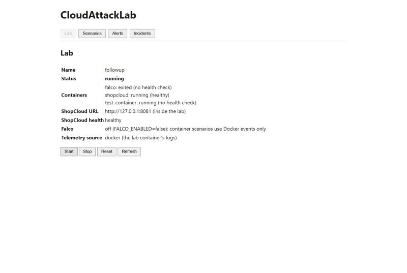
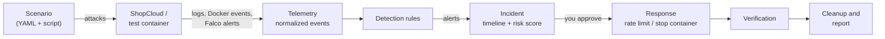
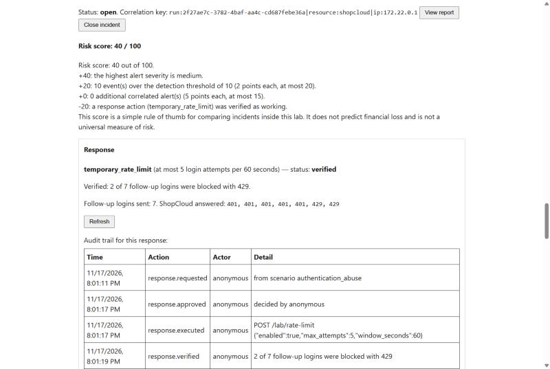

<!-- Logo: add docs/images/logo.png and uncomment.
<p align="center"></p>
-->

# CloudAttackLab

**A local-first lab for running controlled attacks against a containerized application and following them end to end: telemetry, detection, incident, approved response, verification.**

CloudAttackLab runs on one computer with Docker. It starts an isolated copy of a small web shop, **ShopCloud**, runs a controlled attack scenario against it, collects the real logs and container events the attack produces, detects it with rules, groups the alerts into an incident with an evidence timeline and an explained risk score, and lets you approve a response and check that it worked. Every step is shown on a web dashboard and recorded in an audit log, and the lab can be reset to where it started.

It is a student project built to show one complete, evidence-based workflow, not a production security tool.



## Contents

- [Features](#features)
- [How it works](#how-it-works)
- [Supported environment](#supported-environment)
- [Installation](#installation)
- [Everyday use](#everyday-use)
- [Basic and full monitoring mode](#basic-and-full-monitoring-mode)
- [Screenshots](#screenshots)
- [Documentation](#documentation)
- [Repository layout](#repository-layout)
- [Development and tests](#development-and-tests)
- [Project status](#project-status)
- [Safety](#safety)

## Features

| Area | What you get |
|---|---|
| **Attack scenarios** | Three controlled scenarios, each with a detection rule and cleanup: `authentication_abuse` (repeated failed logins), `unauthorized_resource_access` (reading data a user may not see), `suspicious_container_activity` (a shell started in a container). A fourth, `benign_baseline`, attacks nothing and measures false positives |
| **Target application** | ShopCloud, a real FastAPI shop in its own container, plus an isolated test container with no network |
| **Telemetry** | ShopCloud's own logs (from Docker, or from Loki), Docker events and, optionally, Falco, all normalized into one event schema |
| **Detection** | YAML rules with thresholds and time windows, run over the events of each scenario run |
| **Correlation and investigation** | Alerts grouped into incidents, each with an evidence timeline from the first event to the response |
| **Risk assessment** | A fixed, explained risk score per incident: every factor is shown |
| **Response** | `temporary_rate_limit` and `stop_container`, each needing your approval, then verified, then reverted by cleanup |
| **Monitoring and reporting** | A dashboard with overview, events, alerts, incidents, responses and reports; JSON run reports; an optional Loki, Alloy and Grafana stack with a provisioned dashboard |
| **Safety** | Fixed commands, bounded parameters, lab-only targets, approval before any change, an audit log of every action. All ports bound to `127.0.0.1` |

## How it works



Two Docker Compose projects run on the machine:

- **The platform** (`docker-compose.yml`): PostgreSQL, the FastAPI backend and the React dashboard, plus, with the `monitoring` profile, Loki, Alloy and Grafana.
- **The lab** (`lab/docker-compose.lab.yml`): ShopCloud, the test container and optional Falco. You never start it by hand: the backend's Lab Manager starts, stops and resets it through the Docker socket.

The [architecture guide](docs/architecture.md) covers the modules, the networks and the event schema.

## Supported environment

| | Version 1.0 |
|---|---|
| Tested on | Windows 11, WSL 2, Ubuntu, Docker Engine and the Docker Compose v2 plugin installed **inside** Ubuntu |
| Should work, not tested | Windows 10 with WSL 2; native Linux with Docker Engine |
| Not supported yet | Docker Desktop (the backend uses host networking), macOS, native Windows |
| Hardware | 16 GB RAM recommended (the platform and lab use about 190 MiB, about 810 MiB with monitoring and Falco); 30–50 GB free disk |
| Ports (all on `127.0.0.1`) | 5173 dashboard, 8000 API, 5432 PostgreSQL, 8081 ShopCloud; with monitoring 3000 Grafana, 3100 Loki, 12345 Alloy |

**The supported setup is Linux Docker Engine running inside Ubuntu on WSL 2.** The reason is host networking: the backend and the dashboard run with `network_mode: host`, so the backend reaches ShopCloud (`127.0.0.1:8081`) and Loki (`127.0.0.1:3100`) through ports published on the Docker host. This only works as intended where the containers share the network of a Linux Docker host. Docker Desktop (Windows or macOS) runs containers in its own VM and supports host networking only as an opt-in feature, which has not been tested. Moving to a bridge network is planned for after version 1.0; the [architecture guide](docs/architecture.md#why-the-backend-still-uses-host-networking) lists what that change involves.

## Installation

Run every command **inside Ubuntu (WSL)**, not in PowerShell.

**1. Install the prerequisites** (once). In an administrator PowerShell: `wsl --install -d Ubuntu`, restart, open Ubuntu, then install Docker Engine with [Docker's guide for Ubuntu](https://docs.docker.com/engine/install/ubuntu/) and let your user run it:

```bash
sudo usermod -aG docker $USER      # then close and reopen Ubuntu
docker compose version             # must work without sudo
```

**2. Clone the repository and enter it.**

```bash
git clone https://github.com/SaiyamKamate/CloudAttackLabs.git
cd CloudAttackLabs
```

**3. Run setup.**

```bash
scripts/setup.sh
```

It checks Docker and the ports, creates `.env` with random passwords (**only if you have none**; an existing `.env` is never touched), builds and starts the platform, waits until it is healthy, and creates and starts a lab. It is safe to run again, and it never deletes data. Add `--monitoring` for Loki, Alloy and Grafana, or `--no-lab` to skip the lab.

**4. Open the dashboard** at <http://127.0.0.1:5173> and run your first scenario from the **Scenarios** page. The [user guide](docs/user-guide.md) walks through it.

<details>
<summary>The same steps without the script</summary>

```bash
[ -f .env ] || cp .env.example .env    # then set POSTGRES_PASSWORD, LAB_CONTROL_TOKEN, GF_SECURITY_ADMIN_PASSWORD
docker compose up -d --build
curl -s http://127.0.0.1:8000/api/v1/health    # {"status":"ok","database":"ok"}
```

Then open <http://127.0.0.1:5173> and click **Create lab** and **Start** on the Lab page. Set `POSTGRES_PASSWORD` before the first start: the database keeps the password it was created with.
</details>

The [installation guide](docs/install.md) explains every step, Falco, uninstalling, upgrading from the old `cloudattacklab/` layout, and has a checklist for a new machine.

## Everyday use

| Command | What it does | Deletes data? |
|---|---|---|
| `scripts/setup.sh` | First-time setup, or repair: `.env`, build, start, health, lab | No |
| `scripts/start.sh` | Start after a reboot, without rebuilding. `--monitoring`, `--lab`, `--build` | No |
| `scripts/status.sh` | Containers, health endpoints and the lab's status | No (read-only) |
| `scripts/stop.sh` | Stop the lab, the monitoring stack and the platform | No |
| `scripts/reset.sh` | Factory reset: removes containers and **the database**, after you type `delete` | **Yes**, `.env` kept |

For logs, use Docker Compose directly: `docker compose logs -f backend` (the platform), `docker compose -f lab/docker-compose.lab.yml logs shopcloud` (the lab). If something does not start, the scripts say which step failed and what to try; [troubleshooting](docs/troubleshooting.md) lists the known problems.

## Basic and full monitoring mode

| | Basic mode (default) | Full monitoring mode |
|---|---|---|
| Start | `scripts/start.sh` or `docker compose up -d` | `scripts/start.sh --monitoring` or `docker compose --profile monitoring up -d` |
| Services | PostgreSQL, backend, dashboard; the lab (ShopCloud, test container) | The same, plus Loki, Alloy and Grafana |
| Scenarios, telemetry, detection, incidents, responses | Yes: telemetry comes from Docker (`TELEMETRY_SOURCE=docker`) | Yes: from Docker, or from Loki with `TELEMETRY_SOURCE=loki` |
| Needs | Nothing beyond `.env` | `GF_SECURITY_ADMIN_PASSWORD` in `.env` |

Set `COMPOSE_PROFILES=monitoring` in `.env` to make full mode the default. **Falco** is independent of both modes: set `FALCO_ENABLED=true` in `.env` and reset the lab (it needs a privileged container and a kernel with BTF; see [install §10](docs/install.md#10-turn-falco-on-optional)).

## Screenshots

| | |
|---|---|
|  |  |
| Alert with the events that raised it | An incident's explained risk score |
|  |  |
| The incident's evidence timeline | An approved response, executed and verified |

More in the [user guide](docs/user-guide.md).

## Documentation

| Document | What it covers |
|---|---|
| [Installation guide](docs/install.md) | Requirements, Docker in WSL, `.env`, starting and checking every part, Falco, stopping, uninstalling, upgrading, a fresh-machine checklist |
| [User guide](docs/user-guide.md) | The dashboard step by step: the scenarios, alerts and evidence, incidents, responses, reports, cleanup and reset |
| [Architecture](docs/architecture.md) | Modules, containers and networks, the data flow from scenario to response, the event schema, the networking decision |
| [Adding a scenario](docs/adding-a-scenario.md) | Scenario YAML, script, detection rule, tests and cleanup, with a template |
| [Troubleshooting](docs/troubleshooting.md) | Start-up failures and the real problems met in this project, with fixes |
| [Known limitations](docs/known-limitations.md) | What the lab does not do, or does only simply, and why |
| [Safety controls](docs/safety.md) | Each safety control and where the code enforces it |
| [API contract](docs/api-contract.md) | Every backend endpoint, its body, results and errors |
| [ShopCloud interface](docs/shopcloud-interface.md) | What a lab target must provide: endpoints, test accounts, log format |
| [Evaluation results](docs/evaluation-results.md) | Measurements of 17 November 2026, with threats to validity and how to repeat them |
| [Audit, November 2026](docs/audit-2026-11.md) | The independent audit of 16 November 2026 (a record of that day) |
| [Frontend](frontend/README.md) | The dashboard's pages, structure and data sources |

## Repository layout

| Path | What it is |
|---|---|
| `docker-compose.yml` | The platform (PostgreSQL, backend, dashboard) and the `monitoring` profile (Loki, Alloy, Grafana) |
| `.env.example` | Every setting, with comments. `scripts/setup.sh` turns it into `.env` |
| `scripts/` | `setup.sh`, `start.sh`, `stop.sh`, `status.sh`, `reset.sh` |
| `backend/` | FastAPI backend (`backend/app`, one package per module), Alembic migrations, tests |
| `frontend/` | React + Vite dashboard, served by nginx in its container |
| `shopcloud/` | ShopCloud, the lab target (FastAPI, SQLite), with its own tests |
| `lab/` | The lab's compose file (ShopCloud, test container, optional Falco) and Falco's image and rule |
| `scenarios/` | Scenario definitions (YAML) and their scripts |
| `rules/` | Detection rules (YAML) |
| `monitoring/` | Alloy's configuration and Grafana's provisioning and dashboard |
| `contracts/` | JSON Schema copies of the event and scenario formats (`backend/scripts/export_schemas.py`) |
| `tools/` | `check_shopcloud.py`, `evaluate.py`, `benign_traffic.py`, `evaluation_charts.py` |
| `mock_shopcloud/` | A small in-memory stand-in with ShopCloud's interface; not used by the lab |
| `evaluation/results/` | Raw results of the evaluation |
| `docs/` | The documentation above, and its screenshots |

## Development and tests

From the repository root, in WSL, with Python 3:

```bash
python3 -m venv .venv && source .venv/bin/activate
pip install -r backend/requirements.txt
pytest backend/tests        # 260 passed, 8 deselected (the integration tests)
pytest shopcloud/tests      # 22 passed
pytest -m integration       # starts the real lab with Docker; several minutes
```

The `backend/tests` and `shopcloud/tests` counts are from 18 November 2026; `pytest -m integration` was last run by the November 2026 audit (8 passed). For the dashboard's development server, see the [frontend README](frontend/README.md).

## Project status

Version 1.0 of the planned workflow is built and was evaluated on 17 November 2026 on one laptop: 54 scenario runs, all `completed`; in the 45 runs measured for detection the expected alert was raised every time; all 30 approved responses were executed, verified and reverted by cleanup. Ten minutes of benign traffic raised one false positive. The [evaluation](docs/evaluation-results.md) explains why these numbers prove less than they seem.

### Not in version 1.0

- **Planned for version 2:** AI-assisted incident analysis, and an attack-chain visualization (version 1.0 has a chronological evidence timeline per incident, not a graph of the attack's steps). Neither exists in the code today.
- **Deferred or out of scope:** Kubernetes and cloud (AWS, Azure, GCP) adapters, machine learning, a dashboard login, Prometheus, the `isolate_container` response, and PDF export of reports.

See [known limitations](docs/known-limitations.md) for each item and why.

## Safety

Scenarios run only against the lab's own targets, whose URL is checked to be inside the lab; their parameters are bounded; the only command run in a container is fixed in the code; every response needs approval and is verified and reversible; only the lab's test container can be stopped; every scenario has cleanup; and every action is audited. [safety.md](docs/safety.md) shows where each rule is enforced. Every port is bound to `127.0.0.1`, and the default credentials in this repository are for a local lab only: `scripts/setup.sh` replaces them with random ones in a new `.env`.

Run CloudAttackLab only on a machine you control. It mounts the Docker socket into the backend, which gives the backend full control of Docker on that machine.
