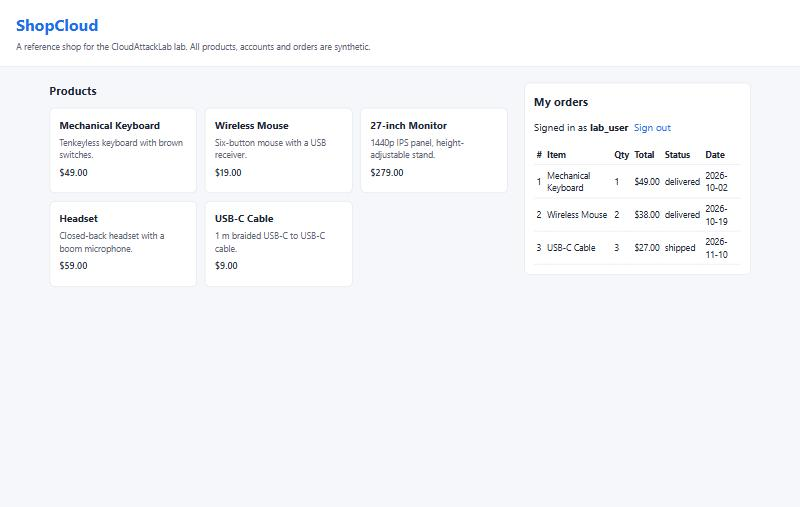

# CloudAttackLab

A local-first security experimentation platform: start an isolated Docker lab, run a controlled attack scenario against ShopCloud, collect real logs, detect, investigate and verify a response.

**Status:** Backend, lab control, the Scenario Engine, telemetry ingestion with the first detection, a basic dashboard, and one response action with approval and verification are implemented (steps 3–7 in `docs/api-contract.md`), plus, in step 8, the second application scenario, `unauthorized_resource_access`, in step 9 incident correlation, the incident timeline, a risk score and a run report, in step 10 reading ShopCloud's logs from Loki (`TELEMETRY_SOURCE=loki`), and in step 11 the container scenario `suspicious_container_activity` with Docker events, optional Falco (`FALCO_ENABLED=true`) and the `stop_container` response, and in step 12 the real ShopCloud (`shopcloud/`) as the lab target in place of the fake one. Not started: login/auth, the `isolate_container` action, Kubernetes and cloud adapters, Prometheus, PDF export and sharing of reports. The fixes for the November 2026 audit (`docs/audit-2026-11.md`) are in.

**Known limitations** (events matched to a run by time, every source IP is the Docker gateway, no login, local-only default credentials, Falco's requirements, Docker Compose only): see [`docs/known-limitations.md`](docs/known-limitations.md).

What works now:

- FastAPI backend in `backend/app` with PostgreSQL; tables are created by Alembic (`backend/alembic`).
- `GET /api/v1/health` and every "Labs" endpoint: create, list, details (with container status and ShopCloud health), start, stop, reset.
- Lab Manager (`backend/app/lab_manager`). Its Docker adapter is the only code that talks to Docker, and it only runs `docker compose -f lab/docker-compose.lab.yml`. Reset recreates the container and then calls ShopCloud's `POST /lab/reset`.
- Scenario Engine (`backend/app/scenario_engine`) and every "Scenarios and runs" endpoint: list/get scenarios, start a run, get a run, run cleanup.
  - Scenarios are loaded from `/scenarios` with the validating loader; an invalid file is skipped and logged, never run. The allowed targets come from the lab configuration, never the request.
  - Before a run, pre-flight checks the scenario's prerequisites (ShopCloud health, and that the named test account can log in). A run is refused with 409 if the lab is not running, the target is not the lab's target, or a check fails.
  - The run executes the scenario's script from `scenarios/scripts/` as a separate process, bounded by `timeout_seconds`, with the target URL taken from the lab configuration. That URL (`SHOPCLOUD_URL`) is checked at startup and before every run, lab start and reset: only a loopback address on the port `lab/docker-compose.lab.yml` publishes (`http://127.0.0.1:8081`), or a container of the `cloudattacklab-lab` Compose project, is accepted. Anything else is refused with 409 `target_url_refused`, the backend logs an error at startup, the Lab page shows the problem, and no request (and no lab token) is sent to it. Runs happen in the background; the API returns the run id at once. One active run per lab.
  - Cleanup runs the scenario's named steps through ShopCloud's `/lab` endpoints, and also runs automatically if a run fails or times out.
  - A script that exits with a non-zero code fails the run; if it printed a JSON summary, the summary is kept on the failed run.
  - A scenario with no response action can name a post-run check in `execution.parameters` (`verification_check`). After the run the engine repeats that check once against the lab's ShopCloud and stores the result under `verification` in the run's `summary`.
  - Run statuses. `pending` and `running` while it is active. When it ends:
    - `completed`: the script finished, every `expected_telemetry` item of the scenario was collected for the run (for example at least 10 `application` `authentication_failure` events for `authentication_abuse`), and the script reported no request errors.
    - `incomplete`: the script finished, but the evidence is not whole: an `expected_telemetry` item was not met, or the script's summary has `errors` > 0 (requests the target never answered). The run's `error` says why, for example "Run incomplete: expected at least 10 application authentication_failure event(s), collected 0", and the dashboard and the run report show it. Alerts that the collected events did raise are kept. Cleanup is not run automatically (run it from the dashboard).
    - `failed`: the script failed, timed out or reported a failure (for example access that should have been refused was granted), or a telemetry source failed. Cleanup runs automatically.
    - `cleaned_up`: cleanup was run for the run afterwards; its earlier `error` is kept.
- The first scenario, `authentication_abuse`: sends 20 wrong-password logins for `lab_user` and reports how many got 401/429. Its script uses a deliberately wrong password and never a real one.
- The second scenario, `unauthorized_resource_access` (guide section 5.3): logs in as `lab_restricted`, then requests `GET /api/orders` 8 times with that token. Every request must be refused with 403. The summary reports attempts sent, how many got 403 and how many got anything else. If any request returns 200 the summary says `"access_control_failed": true` and the run ends as `failed`. Its verification, `access_remains_denied`, makes one more request as `lab_restricted` after the run and records whether it was still denied. It has no response action; cleanup is `reset_target_state`.
- The container scenario, `suspicious_container_activity` (guide section 5.2): runs one harmless, fixed command (`sh -c "id; : cloudattacklab-scenario-marker"`) inside the lab's test container, the way an intruder would start a shell in a running container. See "Container scenario and Falco" below.
- Telemetry ingestion and detection (`backend/app/telemetry`, `backend/app/detection`) and every "Events and alerts" read endpoint: `GET /events`, `GET /events/{id}`, `GET /alerts`, `GET /alerts/{id}`.
  - While a run is active (and once more when it finishes), ShopCloud's logs are collected from the telemetry source chosen by `TELEMETRY_SOURCE` (see "Telemetry source: Docker or Loki" below). Lines that are not valid JSON are skipped and counted; nothing is invented.
  - Each log record is normalized into a `NormalizedEvent` using the mapping in `docs/shopcloud-interface.md` section 5. The original record is kept in `events.raw`; `raw_event_reference` is `docker:shopcloud:<request_id>` or `loki:shopcloud:<request_id>`, depending on the source; the same request_id is never stored twice, whichever source read it.
  - Detection rules are small validated YAML files in `/rules`. `repeated_failed_logins` fires when one source IP produces `threshold` failed logins within `window_seconds` (taken from the scenario's `detection`: 10 in 60s). One alert per run and source IP, with every contributing event linked through `alert_events`.
  - A rule's `group_by` is one field or a list of fields, and an optional `match` keeps only events with the listed values. Fields are `source_ip`, `username`, `resource`, or `raw.<name>` for a field of the original log record.
  - `repeated_access_denied` fires when one username gets `threshold` `authorization_denied` events on the same path within `window_seconds` (5 in 60s for the scenario). It counts only 403 denials for a logged-in user (`match: raw.status: 403`); a 401 with no token does not count. One alert per run, username and path.
- Incidents (`backend/app/incidents`): `GET /incidents` lists them with status and risk score; `GET /incidents/{id}` returns one with its alerts, responses, risk score and timeline. `POST /incidents/{id}/close` closes an incident (the Incidents page has a "Close incident" button); it is refused with 409 if the incident is already closed or one of its responses is still pending approval, and a closed incident takes no new response. Closing is audited (`incident.closed`) and shown at the end of the timeline.
  - Correlation. Only alerts of the same run can share an incident, so two scenarios run one after the other always give two incidents. Inside a run, two alerts are related when the events behind them share a resource and share either a source IP or a username. A new alert joins the oldest incident of its run that holds a related alert; otherwise it opens a new incident. Incidents are never merged or split afterwards. The rules are written at the top of `backend/app/incidents/service.py`. The incident's `correlation_key` records what opened it, for example `run:<run_id>|resource:shopcloud|ip:172.21.0.1`.
  - Evidence chain: incident -> alerts -> `alert_events` -> events -> each event's `raw_event_reference`.
  - Timeline. One time-ordered list mixing: scenario started, the events behind the alerts, each alert firing, scenario finished, every response step (requested, approved or rejected, executed, verified or failed, reverted) and cleanup. Each entry has `time`, `type`, `description` and `evidence` (an API path to the run, event, alert, response or audit rows, and for an event its `raw_event_reference`). It is built on request from the run, the events, the alerts and the audit log; nothing extra is stored.
  - Risk score (`backend/app/incidents/risk.py`). A 0-100 heuristic stored on the incident with a plain-language explanation. It is the sum of: base points for the highest alert severity (info 10, low 25, medium 40, high 60, critical 80); 2 points per event over the detection threshold, at most 20; 5 points per additional correlated alert, at most 15; minus 20 while a response action that was verified as working is still applied. Once cleanup or a lab reset reverts that response, the 20 points no longer apply and the explanation says so ("... was verified as working, but it was reverted by cleanup:manual, so it no longer lowers the score"). The result is limited to 0-100. It is recomputed when an alert joins the incident, when a response is verified and when a response is reverted. No machine learning. It does not predict financial loss and is not a universal measure of risk; the explanation shown to the user says so.
- Run report (`backend/app/reports`): `GET /runs/{run_id}/report` returns JSON with the lab, the scenario and the version that was run, parameters, start and finish times, the script's summary, expected telemetry next to what was collected, the alerts with their detection latency, the incidents with risk score, the responses with their verification result, the post-run verification and the cleanup status. Detection latency is the time from the event that crossed the threshold (the `threshold`-th event linked to the alert) to the alert being created; detection runs when the script ends, so it includes the rest of the run. JSON only: no PDF export and no sharing.
- Response Manager (`backend/app/response_manager`) and every "Response actions" endpoint, plus `GET /audit`.
  - `POST /incidents/{id}/responses` creates a `response_actions` row with status `pending_approval`. The action and its parameters are read from the scenario's `response` section; the endpoints take no request body, so a caller cannot choose the action, its values or the target. One open response per incident.
  - Nothing is executed until it is approved. Reject marks the row `rejected` and leaves ShopCloud untouched.
  - Approve executes `temporary_rate_limit`: `POST /lab/rate-limit` with `enabled=true` and the scenario's `max_attempts` and `window_seconds`, sent to the lab's configured ShopCloud. It is refused with 409 if the lab is not running.
  - Then it verifies with the scenario's check `login_returns_429`: `max_attempts + 2` logins with a deliberately wrong password, and the ones beyond the limit must all get 429. What was sent and the status of every answer is saved in `verification_result`. The status becomes `verified`, or `failed` if ShopCloud did not apply the limit or could not be reached.
  - It is reversible: the cleanup step `disable_rate_limit` turns the limit off and the response becomes `reverted`. Lab reset clears it too.
- A basic React dashboard (`frontend/`) with four pages and a report view: Lab (status, ShopCloud health, Start/Stop/Reset), Scenarios (list, Run, live status, the post-run verification in plain words, Cleanup) and Alerts (table, and each alert's linked events with their `raw_event_reference`). The alert detail has a "Request response" button, Approve and Reject for a pending response, then its status, the verification result in plain words and its audit trail. Incidents lists incidents with status and risk score; an incident's detail shows the risk score with its explanation, the same response controls, the linked alerts and the timeline. A finished run (and an incident) has a "View report" button that shows the run report on a readable page with "Download as JSON". All API calls go through one module, `frontend/src/api.js`.
- Every lab start/stop/reset, every run start/finish/failure/cleanup, and every response step (requested, approved or rejected with who decided, executed, verified or failed, reverted) writes an `audit_log` row, readable through `GET /audit`. There is no login yet, so the actor is `anonymous`.
- One lab can be running at a time, because the lab compose file uses fixed ports.

Run the whole platform (PostgreSQL, backend, dashboard):

```bash
[ -f .env ] || cp .env.example .env  # creates .env only if you have none; then change the values
docker compose up -d --build         # then open the dashboard at http://127.0.0.1:5173
```

If you already have a `.env`, keep it and copy over only the settings you need from `.env.example` (for the monitoring stack: `GF_SECURITY_ADMIN_PASSWORD`).

The backend API is on `127.0.0.1:8000`; the dashboard proxies `/api` to it. From the dashboard: create and Start the lab, Run `authentication_abuse`, watch it reach `completed`, then open Alerts to see the `repeated_failed_logins` alert and its 20 linked events. On that alert, click "Request response", then Approve: the status becomes `verified` with "2 of 7 follow-up logins were blocked with 429". Back on Scenarios, Cleanup turns the rate limit off and the response shows `reverted`. Then Run `unauthorized_resource_access`: it reaches `completed` with 8 of 8 requests refused and "Verification passed: access is still denied", and Alerts shows a second alert, `repeated_access_denied`, with its 8 linked events. Incidents now shows two incidents, one per run: the first with risk score 60 (it was 40 while its verified response was applied; the explanation says the response was reverted by cleanup) and the second with 46. Open one for its timeline, and use "View report" for the run report.

**Default credentials are for a local lab only.** The defaults in `.env.example`, `docker-compose.yml` and the backend (`LAB_CONTROL_TOKEN=lab-dev-token` or `change-me-lab-token`, `POSTGRES_PASSWORD=change-me-locally`, ShopCloud's test accounts `lab_user` / `lab_restricted`) are published in this repository. They are acceptable only because every port is bound to `127.0.0.1`. While the default lab token or database password is in use, the backend logs a warning at startup (`docker compose logs backend`, "Default credential in use: ..."). Grafana has no default: it needs `GF_SECURITY_ADMIN_PASSWORD` in `.env`. Set your own values in `.env`; change `POSTGRES_PASSWORD` before the database volume is first created (or remove the volume with `docker compose down -v`).

Both the backend and the dashboard containers use host networking and the backend mounts the Docker socket, so this needs a Linux Docker Engine (native, or inside WSL 2). On Docker Desktop, enable host networking.

### Telemetry source: Docker or Loki

The backend reads ShopCloud's logs from one of two sources, chosen with one setting in `.env`:

- `TELEMETRY_SOURCE=docker` (the default): the lab container's logs through the Docker adapter. Works without the monitoring stack.
- `TELEMETRY_SOURCE=loki`: Loki's HTTP API (`/loki/api/v1/query_range`) for `{service="shopcloud"}`, from the run's start, at `LOKI_URL` (default `http://127.0.0.1:3100`). Start the monitoring stack first, from the project root: `docker compose --env-file .env -f monitoring/docker-compose.monitoring.yml up -d` (Grafana needs `GF_SECURITY_ADMIN_PASSWORD` from `.env`).

```bash
TELEMETRY_SOURCE=loki docker compose up -d backend    # or set it in .env
```

Both sources return the same ShopCloud log lines, so normalization and detection are the same; only `raw_event_reference` changes (`loki:shopcloud:<request_id>`). The Lab page shows the active source and, for Loki, whether it can be reached.

- Late logs. Logs reach Loki a second or two after ShopCloud writes them. After a run, the backend polls Loki every `LOKI_SETTLE_INTERVAL_SECONDS` (2) until the number of records stops growing, for at most `LOKI_SETTLE_TIMEOUT_SECONDS` (20). An empty answer does not count as settled. Alloy (`monitoring/config.alloy`) looks for new containers every 5 seconds instead of its default minute, because a lab start or reset creates a new ShopCloud container whose logs only reach Loki once Alloy has found it.
- No fallback. If `TELEMETRY_SOURCE=loki` and Loki cannot be reached, the run fails before its script starts (nothing is sent to ShopCloud) with an error such as "Telemetry source 'loki' is not available: Loki at http://127.0.0.1:3100 could not be reached ...", shown on the run in the dashboard. A Loki failure during a run, or no ShopCloud logs at all after the timeout, also fails the run, and no alert is raised from partial telemetry. The backend never falls back to Docker and never invents events.

Networking. The backend and Loki are in different Compose projects. The backend already uses host networking (that is how it reaches ShopCloud on `127.0.0.1:8081`), and the monitoring stack publishes Loki on the host's `127.0.0.1:3100`, so the backend reaches Loki at `http://127.0.0.1:3100` with no extra wiring. I chose this over joining the two projects with a shared external Docker network because it is the pattern the backend already uses for the lab, it needs no change to either compose project's networks, neither project has to start first to create a network, and Loki stays reachable from this machine only. If the backend ever leaves host networking, the alternative is an external network that both projects join, with `LOKI_URL=http://loki:3100`.

### Container scenario and Falco

The lab compose file has a second target, `test_container`: an `alpine:3.20` container that only runs `sleep`, labelled `cloudattacklab.role=test-target`, with no network, a read-only root, 32 MB of memory and 0.1 CPU. The container scenario only ever touches this container; ShopCloud and the platform containers are never targeted.

- Execution. A container scenario's script runs inside the backend and gets a handle with one action, `run_marker()`. It runs the command fixed in `backend/app/lab_manager/container.py` through the Docker adapter (`docker compose exec -T test_container ...`). The command is not taken from scenario parameters or the API request (the run request accepts only `scenario_id`), and the adapter has no method that takes a command.
- Base telemetry: Docker events. The test container's events (`docker events`, filtered on the lab project and the test-target label) are normalized with source `docker`, `container_id` and resource `test_container`. `exec_start` becomes `suspicious_process` (nothing should ever start a process in this container), `start` becomes `container_started`, `die`/`stop` become `container_stopped`. Reference: `docker:test_container:exec_start-<timeNano>`.
- Extra evidence: Falco. With `FALCO_ENABLED=true`, Falco's JSON alerts about the run's test container are read like ShopCloud's logs (Docker logs, or Loki `{service="falco"}` with `TELEMETRY_SOURCE=loki`) and normalized with source `falco`, event type `suspicious_process` and `rule_id` set to the Falco rule name. Reference: `<docker|loki>:falco:<event time in ns>-<rule hash>`. Alerts about other containers are ignored. Falco having nothing to report is not an error; it is extra evidence.
- Detection. `rules/suspicious_container_process.yaml` fires on one `suspicious_process` event for `test_container`. It groups by resource, so the Docker event and the Falco event of a run fall into one alert, and so one incident.
- Response `stop_container`, with approval like `temporary_rate_limit`. The container comes from the incident's own events, never from a request. It is stopped only if it has the label `cloudattacklab.role=test-target` and belongs to the lab's Compose project (`cloudattacklab-lab`); this is checked when the response is requested and again right before `docker stop`. Anything else (ShopCloud, Falco, backend, dashboard, PostgreSQL, a container in another project) is refused. Verification inspects the container and confirms it is no longer running.
- Cleanup `recreate_test_container` recreates the test container, so the lab is back at baseline (and the `stop_container` response becomes `reverted`). Lab reset recreates every container, the test container included.
- The Lab page lists every lab container and shows whether Falco is on and healthy. The alert detail shows each event's source and Falco rule, and the incident timeline names each event's source.

**Falco requirements.** Falco is optional and off by default (`FALCO_ENABLED=false`), so the platform runs on machines without it; container scenarios then use Docker events only. To turn it on, set `FALCO_ENABLED=true` in `.env`, recreate the backend (`docker compose up -d backend`) and Start or Reset the lab. Falco (`falcosecurity/falco:0.45.2`, pinned, with the lab's rule baked in by `lab/falco/Dockerfile`) needs:

- A Linux kernel with BTF (`/sys/kernel/btf/vmlinux`) for the modern eBPF engine. Checked on WSL 2 with kernel 6.18.
- A privileged container. The modern eBPF engine loads BPF programs into the host kernel and attaches them to system-call tracepoints, which needs kernel capabilities (`CAP_BPF`, `CAP_PERFMON`, `CAP_SYS_RESOURCE`, `CAP_SYS_PTRACE`); it also reads the host's `/proc` and `/etc` (mounted read-only) to see every process, and the Docker socket to name containers. An unprivileged container cannot do any of this. Falco can in some setups run with just those capabilities; the lab uses `privileged: true`, as in the command verified on this machine, because it is the setting that works across kernels. Falco only observes; it changes nothing on the host. Because privileged containers are powerful, Falco stays off unless you turn it on.
- About 512 MB of memory (its limit in the lab compose file).

If `FALCO_ENABLED=true` but the Falco container is not running, a container run is refused with a clear pre-flight message.

### ShopCloud: the real one and the fake one

The lab target is now the real ShopCloud in `shopcloud/`, a small reference shop. It is separate from the platform: FastAPI with its own SQLite database inside its container (`/app/data/shop.db`), no platform code and not the platform's PostgreSQL. It follows `docs/shopcloud-interface.md` exactly (`tools/check_shopcloud.py` prints 14/14 against it) and adds a little more so it looks like a shop:

- Data, all synthetic: five products, the two test accounts from the interface (`lab_user`, `lab_restricted`) and three orders belonging to `lab_user`. Passwords are stored as scrypt hashes, and login tokens only as a SHA-256 of the token; sessions expire after 8 hours.
- `GET /api/products` and `GET /api/products/{id}` (public), and one page at `/` that lists the products, has a sign-in form and shows "My orders" after sign-in (plain HTML and a small script; the token is kept in memory only, and a strict Content-Security-Policy is sent).
- JSON logs on stdout for every request to `/api/*`, `/lab/*` and the page `/`, with the fields from the interface. Besides the interface's event names it uses: `products_listed`, `product_viewed`, `product_not_found` (404 for an unknown product), `page_viewed`, `rate_limit_read` (`GET /lab/rate-limit`), `rate_limit_rejected` (422 on `POST /lab/rate-limit`), `not_found` and `method_not_allowed` (an unknown path or method under `/api` or `/lab`). These are not in the interface yet; the platform stores them as event type `other` and no rule uses them. `/health` and the static files are not logged. Passwords and tokens are never logged.
- The database is created and seeded at start-up, so a new container is always at the baseline. `POST /lab/reset` restores the seeded data in one transaction, removes every session and turns the rate limit off.
- No intentional security holes: the scenarios test detection and response against normal behaviour (failed logins, denied access). The container runs as a non-root user (`shop`, uid 10001) and uvicorn ignores `X-Forwarded-For`, so `source_ip` is always the real peer.

Which one is used where:

| | Used for |
|---|---|
| `shopcloud/` | The lab target: `lab/docker-compose.lab.yml` builds it, so the dashboard, the scenarios and the integration tests (`pytest -m integration`) run against it. Its own tests: `pytest shopcloud/tests` |
| `mock_shopcloud/` | A fast, in-memory stand-in that follows the same interface. Not used by the lab any more; kept for quick local runs (`uvicorn app:app` from its folder) and to check `tools/check_shopcloud.py` itself. To use it as the lab target, set `build: ../mock_shopcloud` in the lab compose file. The platform's unit tests use neither (they use fakes) |

The backend builds the lab from inside its container, so `docker-compose.yml` mounts `./shopcloud` (read-only) next to `./mock_shopcloud`. After pulling this change, recreate the backend once: `docker compose up -d backend`.



### Frontend development

```bash
cd frontend
npm install
npm run dev                          # http://localhost:5173, proxies /api to the backend on :8000
```

Two notes for this repo's setup, both already configured in `frontend/vite.config.js`:

- **Hot reload on the Windows `D:` drive (via WSL).** Native file-change events from `/mnt/d` do not reach WSL's inotify, so Vite never notices saved files. `server.watch.usePolling` makes Vite poll instead, and saving a file now updates the browser.
- **Dev API calls use a Vite proxy, not CORS.** The dashboard calls relative paths (`/api/v1/...`) and Vite forwards them to `http://127.0.0.1:8000`. I chose the proxy over enabling CORS in FastAPI because it keeps the browser talking to a single origin in both development and the container (where nginx does the same forwarding), so `api.js` needs no environment-specific base URL and the backend needs no cross-origin configuration or relaxed headers.

## What is here

| Path | What it is |
|---|---|
| `docs/shopcloud-interface.md` | What ShopCloud must expose. Shared with whoever builds ShopCloud |
| `docs/api-contract.md` | The backend API the dashboard uses, with each endpoint's status |
| `docs/known-limitations.md` | What the lab does not do, or does only simply, and why |
| `docs/audit-2026-11.md` | The independent audit of November 2026 (its findings are fixed) |
| `backend/app/schemas/event.py` | Common event schema |
| `backend/app/schemas/scenario.py` | Scenario format and the validating loader |
| `backend/app/models.py` | Database tables (SQLAlchemy) |
| `contracts/*.schema.json` | JSON Schema copies of the two schemas, generated by `backend/scripts/export_schemas.py` |
| `scenarios/authentication_abuse.yaml` | First scenario definition |
| `scenarios/scripts/authentication_abuse.py` | The script that scenario runs |
| `rules/repeated_failed_logins.yaml` | First detection rule |
| `scenarios/unauthorized_resource_access.yaml` | Second scenario definition |
| `scenarios/scripts/unauthorized_resource_access.py` | The script that scenario runs |
| `rules/repeated_access_denied.yaml` | Second detection rule |
| `backend/app/incidents/service.py` | Correlation rules: which alerts share an incident |
| `backend/app/incidents/risk.py` | The risk score heuristic and its explanation |
| `backend/app/incidents/timeline.py` | Builds the incident timeline |
| `backend/app/reports/service.py` | Builds the run report |
| `backend/app/telemetry/source.py` | The telemetry source interface and the Docker source |
| `backend/app/telemetry/loki.py` | The Loki telemetry source |
| `scenarios/suspicious_container_activity.yaml` | The container scenario |
| `scenarios/scripts/suspicious_container_activity.py` | Its script (runs in the backend with a test-container handle) |
| `backend/app/lab_manager/container.py` | The fixed marker command and the test-container guard |
| `backend/app/telemetry/container.py` | Docker events and Falco alerts, normalized |
| `rules/suspicious_container_process.yaml` | The container detection rule |
| `lab/falco/` | Falco's Dockerfile (pinned version) and the lab's Falco rule |
| `monitoring/` | Loki, Alloy and Grafana with the provisioned "CloudAttackLab - Lab activity" dashboard (failed logins, 403 denials, 429 rate-limit hits, container exec events, latest ShopCloud events). Start: `docker compose --env-file .env -f monitoring/docker-compose.monitoring.yml up -d`, then http://127.0.0.1:3000 (user `admin`, password `GF_SECURITY_ADMIN_PASSWORD`) |
| `shopcloud/` | The real ShopCloud, the lab target (FastAPI, SQLite), with its tests in `shopcloud/tests` |
| `mock_shopcloud/` | Fake ShopCloud that follows the interface (fast, in memory; not the lab target) |
| `lab/docker-compose.lab.yml` | The isolated lab (ShopCloud, the test container, optional Falco) |
| `docker-compose.yml` | Platform services: PostgreSQL, the backend and the dashboard |
| `backend/app/lab_manager/target_guard.py` | The check that a lab target URL points into the lab |
| `backend/app/startup.py` | Startup checks: lab target URLs, default credentials |
| `frontend/` | The React dashboard (served by nginx in its container) |
| `tools/check_shopcloud.py` | Checks any running ShopCloud against the interface |

## Try it

```bash
python -m venv .venv && source .venv/bin/activate
pip install -r backend/requirements.txt

pytest backend/tests                                   # platform tests
pytest shopcloud/tests                                 # ShopCloud's own tests

pytest -m integration                                  # starts the real lab (Docker); see the test files

# The lab by hand, with the same .env as the platform (so ShopCloud gets your LAB_CONTROL_TOKEN):
docker compose --env-file .env -f lab/docker-compose.lab.yml up --build -d
python tools/check_shopcloud.py http://127.0.0.1:8081  # should print 14/14; reads LAB_CONTROL_TOKEN from .env
docker compose --env-file .env -f lab/docker-compose.lab.yml logs shopcloud   # the JSON logs
```

## Build order

What exists now, in the order it was built (each step is a merged pull request):

1. Contracts (`docs/`, `contracts/`, the event and scenario schemas) and the fake ShopCloud (`mock_shopcloud/`).
2. Platform skeleton: FastAPI, PostgreSQL, Alembic migrations.
3. Lab control: the Lab Manager and its Docker Compose adapter (create, start, stop, reset, details).
4. Scenario Engine and `authentication_abuse`, with pre-flight checks, background runs and cleanup.
5. Telemetry ingestion and normalization, and the first detection rule (`repeated_failed_logins`).
6. The React dashboard.
7. The response `temporary_rate_limit`, with approval, verification, revert and the audit log.
8. The second scenario, `unauthorized_resource_access`, and `repeated_access_denied`.
9. Incidents (correlation, timeline, risk score) and the run report.
10. Loki as a telemetry source, and the monitoring stack (Loki, Alloy, Grafana).
11. The container scenario `suspicious_container_activity`: Docker events, optional Falco, and `stop_container`.
12. The real ShopCloud (`shopcloud/`) as the lab target.
13. Fixes for the November 2026 audit: the lab target URL check, a working Grafana dashboard, one thing at a time during a run, `incomplete` runs, lab status checked against Docker, loading states, a tighter run time window, default-credential warnings, closing incidents and an honest risk score after a revert, and these docs.

Not built: login/auth, `isolate_container`, Kubernetes and cloud adapters, Prometheus, PDF export and sharing of reports.

## Safety

Scenarios run only against configured lab targets whose URL is checked to be inside the lab, with bounded parameters, mandatory approval for responses and mandatory cleanup. The scenario loader and the backend enforce these rules. See [`docs/known-limitations.md`](docs/known-limitations.md) for what they do not cover.
