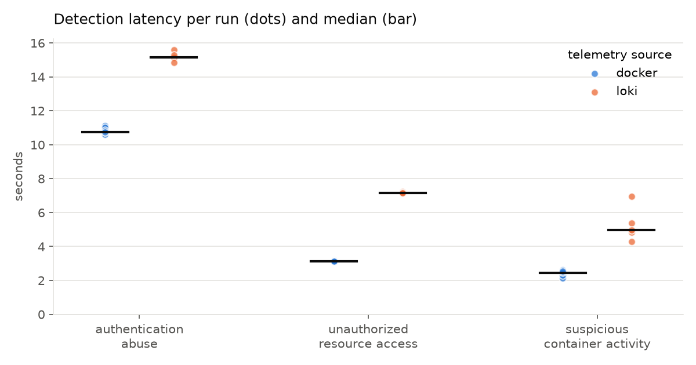
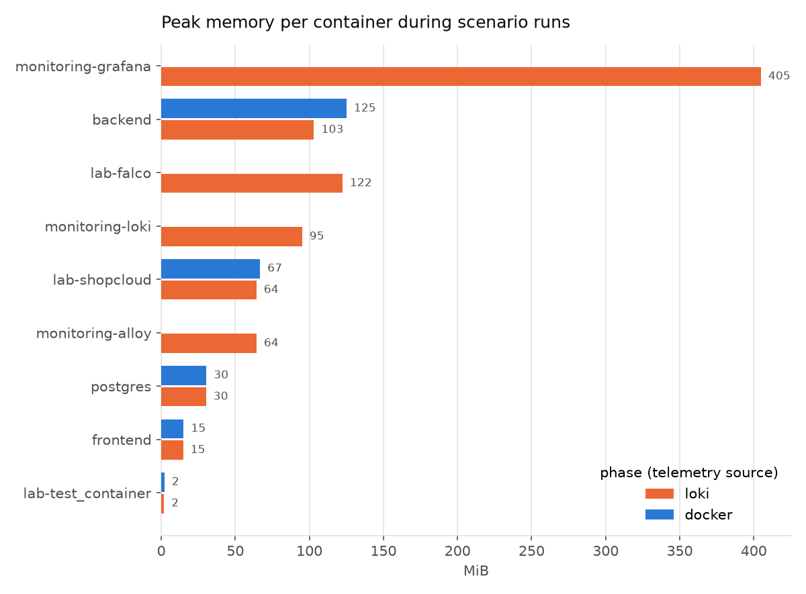

# Evaluation results (17 November 2026)

This is a repeatable measurement of CloudAttackLab against the metrics in project guide section 14. It describes what this platform did on one laptop, on one day, with synthetic traffic. It does not compare CloudAttackLab with any other platform, because no comparison was made.

- Script: `tools/evaluate.py` (with `tools/benign_traffic.py`; charts from `tools/evaluation_charts.py`)
- Raw results: [`evaluation/results/2026-11-17/`](../evaluation/results/2026-11-17/)
- How to repeat it: the README, "How to repeat this evaluation"

## How it was measured

`tools/evaluate.py` drives the platform through its HTTP API (`/api/v1`) only, using the same calls the dashboard makes: create/start/stop/reset the lab, start a run, read the run, its report, alerts and incidents, request and approve a response, run cleanup and close the incident. It reads results only from API answers. It never reads the database and never changes platform code or `.env`.

It also does a few things outside the API, the things an operator does around the platform:

- It switches the telemetry source by recreating the backend with `TELEMETRY_SOURCE` and `FALCO_ENABLED` set in the process environment (`docker compose up -d backend`). Shell variables override `.env`, so the file itself is not touched. Before measuring, it checks that `GET /labs/{id}` reports the wanted source and Falco setting.
- It starts the monitoring stack (Loki, Alloy, Grafana) for the Loki phase.
- It samples `docker stats --no-stream` in a loop while each run is active.
- It generates benign traffic (described below).

**Run plan, as executed.** Each run was preceded by a lab reset.

| Phase | Telemetry source | Falco | What |
|---|---|---|---|
| 1 | docker | off | 3 lab starts from stopped, then 10 runs of each of the three scenarios |
| 2 | docker | off | Correlation: the three scenarios back to back, 3 rounds (9 runs), with benign traffic running throughout |
| 3 | docker | off | Benign traffic only, 10 minutes, no scenario |
| 4 | loki | on | 3 lab starts from stopped, then 5 runs of each scenario |

Command: `python3 tools/evaluate.py --docker-runs 10 --loki-runs 5 --benign-minutes 10 --correlation-rounds 3 --setup-trials 3`. These values are now the script's defaults. Wall time was 33 minutes (13:24 to 13:57 UTC).

**Per run** (phases 1 and 4): reset the lab and wait until the target is healthy; start the run and poll it until it ends; read the report, alerts (with their events) and incidents. For `authentication_abuse` and `suspicious_container_activity`, request the scenario's response on the incident, approve it, and read the result. Then run cleanup, read the response again (it should be `reverted`) and close the incident.

**Definitions.**

| Metric | Definition used |
|---|---|
| Scenario execution success | The run ended `completed`: the script finished, every `expected_telemetry` item was collected and the script reported no request errors |
| Detection rate | The run has an alert from the scenario's own detection rule |
| False positives | Alerts or incidents raised by benign traffic: (a) with no scenario running; (b) benign events that ended up inside a scenario run's alert |
| Detection latency | The report's `detection_latency_seconds`: from the timestamp of the event that crossed the threshold (the `threshold`-th event linked to the alert) to the alert's creation |
| Correlation accuracy | Each run has exactly one incident; it belongs to that run; all its alerts and their events belong to that run; no benign event is among them |
| Response success | The approved response reached `executed` |
| Verification success | The approved response reached `verified` (its check passed). Also recorded: whether cleanup turned it into `reverted` |
| Lab setup time | From `POST /labs/{id}/start` on a stopped lab (and `POST .../reset` before each run) until `GET /labs/{id}` shows `running` with a healthy target, and a healthy Falco when Falco is on |
| Resource consumption | `docker stats` CPU % and memory of every `cloudattacklab*` container, sampled about every 2 seconds while a run was active |

**Benign traffic** (`tools/benign_traffic.py`, fixed seed 1). One action every 2 to 4 seconds, chosen at random:

- browsing: the shop page, the product list and single products;
- `lab_user` signing in with the right password and reading its orders;
- `lab_restricted` signing in with the right password and browsing products;
- at most one typo every 40 s (20 s in the correlation session): one wrong password followed 1 to 3 s later by the right one;
- at most one ordinary command every 45 s (20 s in the correlation session) in the test container with `docker exec` (`date`, `ls /`, `uptime`, ...), never the scenario marker.

In the correlation session the typos use only `lab_restricted`, because `authentication_abuse` uses `lab_user`. That is how a benign failed login can be told apart from a scenario one afterwards. ShopCloud returns no request id to the client, so there is no exact way to match a request to an event. Benign container commands are recognised by the missing scenario marker in the event message.

## Environment

From `environment.json`, recorded at the start of the run.

| Item | Value |
|---|---|
| Code | Branch `evaluation-job-c` at `e380837`: `main` at `18facb2` plus the evaluation scripts only. The platform code was unchanged |
| Host | Windows 11 (10.0.26200), one laptop |
| Docker host | WSL 2, Ubuntu 26.04 LTS, kernel 6.18.33.2-microsoft-standard-WSL2 |
| Docker | Engine 29.7.1, Compose 5.3.1 |
| CPU | 12th Gen Intel Core i7-12650H, 16 logical CPUs visible to WSL |
| RAM | 7,792 MiB visible to the WSL VM (not the Windows host total) |
| Scenarios | `authentication_abuse` 1.0.0, `unauthorized_resource_access` 1.0.0, `suspicious_container_activity` 1.0.0 |
| Thresholds (from each scenario's `detection`) | `repeated_failed_logins`: 10 in 60 s; `repeated_access_denied`: 5 in 60 s; `suspicious_container_process`: 1 in 60 s |
| Telemetry source | `docker` (phases 1 to 3), `loki` (phase 4; settle interval 2 s, timeout 20 s, the defaults) |
| Falco | off (phases 1 to 3), on (phase 4; `falcosecurity/falco:0.45.2`, modern eBPF) |
| Lab limits | ShopCloud 0.5 CPU / 256 MB, test container 0.1 CPU / 32 MB, Falco 512 MB |

`environment.json` records `"uncommitted_changes": true`. That flag is wrong. Git inside WSL reported every file on the Windows drive as modified because of file-mode and line-ending settings, while Windows git showed a clean tree apart from `evaluation/`. The script now runs git with `core.filemode=false` and `core.autocrlf=true` and ignores `evaluation/`. The raw file was kept as recorded.

## Results

### Scenario execution success

| Telemetry | Scenario | Completed | Run duration, median (s) |
|---|---|---|---|
| docker | authentication_abuse | 10/10 (100%) | 20.5 |
| docker | unauthorized_resource_access | 10/10 (100%) | 7.5 |
| docker | suspicious_container_activity | 10/10 (100%) | 2.8 |
| loki | authentication_abuse | 5/5 (100%) | 25.4 |
| loki | unauthorized_resource_access | 5/5 (100%) | 11.6 |
| loki | suspicious_container_activity | 5/5 (100%) | 5.3 |

No run ended `incomplete` or `failed`, and no run was refused. The 9 correlation runs also all ended `completed`. With Loki, runs take 4 to 5 s longer: after the script ends, the backend waits until Loki's record count stops growing.

### Detection rate

| Telemetry | Scenario | Expected alert raised | Events in the alert | Alerts / incidents per run |
|---|---|---|---|---|
| docker | authentication_abuse | 10/10 (100%) | 20 application | 1 / 1 |
| docker | unauthorized_resource_access | 10/10 (100%) | 8 application | 1 / 1 |
| docker | suspicious_container_activity | 10/10 (100%) | 1 docker | 1 / 1 |
| loki | authentication_abuse | 5/5 (100%) | 20 application | 1 / 1 |
| loki | unauthorized_resource_access | 5/5 (100%) | 8 application | 1 / 1 |
| loki | suspicious_container_activity | 5/5 (100%) | 1 docker + 1 falco | 1 / 1 |

With Falco on, every container run's alert held both the Docker exec event and Falco's event, grouped into one alert as designed.

### False positives

**(a) Benign traffic only, no scenario running (10 minutes).**

| Benign actions sent | HTTP errors | New alerts | New incidents | Events stored |
|---|---|---|---|---|
| 278: 113 browse, 94 correct logins, 52 order reads, 11 typos, 8 container commands | 0 | 0 | 0 | 0 |

The result is 0 false positives, but it says little about the detection rules. The platform collects telemetry only inside a run's time window (see `docs/known-limitations.md`, "Events are matched to a run by time"), so benign traffic between runs is never stored and never evaluated. The 0 shows that the platform raises nothing on its own outside runs. It does not show that the rules would ignore this traffic if they saw it.

**(b) Benign traffic while scenarios run (correlation session, 9 runs).**

| Scenario | Runs | Runs with a benign event inside the alert | Extra alerts raised |
|---|---|---|---|
| authentication_abuse | 3 | 3 (one benign `lab_restricted` failed login each; alert held 21 events instead of 20) | 0 |
| unauthorized_resource_access | 3 | 0 | 0 |
| suspicious_container_activity | 3 | 0 | 0 |

Benign traffic never raised an alert of its own. In each `authentication_abuse` run, though, one benign typo fell inside the run's window and was linked to the `repeated_failed_logins` alert as evidence. This is the "every source IP is the Docker gateway" limitation: the rule groups by source IP, and the benign client and the scenario script have the same address. The benign container commands (5 in this session) did not fall inside any container run's window, which lasts about 3 s, so this session did not test that case. By design, any exec in the test container during that window would be linked to the alert.

### Detection latency

| Telemetry | Scenario | n | min (s) | median (s) | max (s) |
|---|---|---|---|---|---|
| docker | authentication_abuse | 10 | 10.59 | 10.76 | 11.12 |
| docker | unauthorized_resource_access | 10 | 3.11 | 3.14 | 3.20 |
| docker | suspicious_container_activity | 10 | 2.13 | 2.44 | 2.60 |
| loki | authentication_abuse | 5 | 14.83 | 15.15 | 15.59 |
| loki | unauthorized_resource_access | 5 | 7.15 | 7.16 | 7.22 |
| loki | suspicious_container_activity | 5 | 4.29 | 4.98 | 6.97 |

Detection runs once, when the script has finished, so latency mostly measures how much of the run is left after the threshold is crossed. `authentication_abuse` crosses its threshold at the 10th of 20 logins, one second apart, so about 10 s of its latency is the rest of the script. Loki adds about 4 s, the time the backend waits for late log records to settle. These are not the latencies of a streaming detector.

### Correlation accuracy

Three rounds of the three scenarios back to back (reset between runs), with benign traffic running throughout.

| Runs | Exactly one incident, owned by the run | Alerts and events all from the run | Events from another run | Runs with no benign event merged |
|---|---|---|---|---|
| 9 | 9/9 (100%) | 9/9 (100%) | 0 | 6/9 (67%) |

Separation between runs was complete. The three runs where benign data was merged are the three `authentication_abuse` runs described under false positives (b). In phases 1 and 4, every one of the 45 runs also had exactly one alert in exactly one incident of its own.

### Response actions

| Telemetry | Action | Executed | Verified | Reverted by cleanup | Request + approve to result, median (s) |
|---|---|---|---|---|---|
| docker | temporary_rate_limit | 10/10 (100%) | 10/10 (100%) | 10/10 (100%) | 0.55 |
| docker | stop_container | 10/10 (100%) | 10/10 (100%) | 10/10 (100%) | 0.24 |
| loki | temporary_rate_limit | 5/5 (100%) | 5/5 (100%) | 5/5 (100%) | 0.77 |
| loki | stop_container | 5/5 (100%) | 5/5 (100%) | 5/5 (100%) | 0.32 |

`unauthorized_resource_access` has no response action. Its post-run check, `access_remains_denied`, passed in 10/10 (docker) and 5/5 (loki) runs. The risk scores were the same in every run of a kind: `authentication_abuse` 60 (after cleanup reverted the verified response), `unauthorized_resource_access` 46, and `suspicious_container_activity` 60 with Docker events or 62 with Falco (one event over the threshold).

### Lab setup time

| Operation | Telemetry | Falco | OK | n | min (s) | median (s) | max (s) |
|---|---|---|---|---|---|---|---|
| start (from stopped) | docker | off | 3/3 | 3 | 8.38 | 9.02 | 9.44 |
| start (from stopped) | loki | on | 3/3 | 3 | 8.56 | 8.58 | 9.16 |
| reset (before each run) | docker | off | 30/30 | 30 | 7.97 | 8.56 | 11.35 |
| reset (before each run) | loki | on | 15/15 | 15 | 8.71 | 9.39 | 10.54 |

All images were already built and cached. A first start on a new machine also includes image downloads and builds, which this does not measure. Start includes `docker compose up --build`, so it includes Compose checking the build cache.

### Resource consumption

All samples taken while scenario runs were active (phase 1: 167 samples per container; phase 4: 93).

| Container | Telemetry | CPU % mean | CPU % max | Memory mean (MiB) | Memory max (MiB) |
|---|---|---|---|---|---|
| backend | docker | 7.9 | 27.2 | 95 | 125 |
| lab-shopcloud | docker | 7.2 | 44.9 | 53 | 67 |
| postgres | docker | 1.1 | 6.7 | 28 | 30 |
| frontend | docker | 0.5 | 7.5 | 14 | 15 |
| lab-test_container | docker | 0.0 | 0.0 | 1 | 2 |
| backend | loki | 9.5 | 25.2 | 94 | 103 |
| lab-shopcloud | loki | 8.6 | 41.3 | 52 | 64 |
| lab-falco | loki | 2.6 | 10.0 | 112 | 122 |
| monitoring-grafana | loki | 4.0 | 7.8 | 362 | 405 |
| monitoring-loki | loki | 4.1 | 12.6 | 90 | 95 |
| monitoring-alloy | loki | 2.1 | 7.8 | 60 | 64 |
| postgres | loki | 1.6 | 10.1 | 29 | 30 |
| frontend | loki | 0.7 | 6.8 | 13 | 15 |
| lab-test_container | loki | 0.0 | 0.4 | 1 | 2 |

CPU % is Docker's figure, where 100% is one full CPU. Per sample, the containers together used a median of 192 MiB (max 220) in the Docker phase and 809 MiB (max 863) with the monitoring stack and Falco, about half of it Grafana. Per-scenario figures are in `summary.json` and `docker_stats.csv`.

## Threats to validity

- **One laptop, one day.** Every number comes from one machine (WSL 2 on Windows 11) in one 33-minute session. Other hardware, other Docker setups, or the same laptop under other load would give other times. Timings with a spread under a second should not be read as precise.
- **Few runs.** 10 runs per scenario with Docker and 5 with Loki, 9 correlation runs, 3 lab starts per phase. 10/10 does not mean the failure rate is zero; it means none of these 10 runs failed. With 10 runs and no failures, the true failure rate could still be as high as about 30% at 95% confidence (rule of three: about 3/n), and about 60% for 5 runs.
- **Synthetic traffic.** The scenarios and the benign traffic are scripts. The benign mix (a typo every 40 s or so, one user, regular pauses) is our guess at normal use, not recorded user behaviour. Real users would produce other patterns, for example several typos in a row, which this traffic never does.
- **Every source IP is the Docker gateway.** All clients, attack and benign, look like one address. `repeated_failed_logins` therefore cannot tell them apart, and that is why benign failed logins were merged into the attack alert. With real client addresses the result would differ.
- **Thresholds were chosen by us.** 10 failed logins in 60 s, 5 denials in 60 s and 1 container process are the project's own values, set for these scenarios. The scenarios were written to cross them (20 logins, 8 denials, 1 exec), so the 100% detection rate measures whether the pipeline works end to end, not how good the rules are at separating attacks from normal use.
- **The false-positive figure is limited by design.** Telemetry is collected only during runs, so the benign-only session could not produce events, and so could not produce alerts. The only real exposure of the rules to benign data was the 9-run overlap session.
- **Latency is batch latency.** Detection runs when a script ends, so latency depends on how long each script continues after the threshold is crossed, and for Loki on the settle wait.
- **The evaluator is also the author.** The script, the traffic and the definitions in this document were written by the same project, without independent review.
- **Resource sampling is coarse.** `docker stats --no-stream` takes about 2 s per sample, so short peaks can be missed. A container run lasts about 3 s and has only one or two samples.
- **No comparison.** Nothing here compares CloudAttackLab with another tool or platform, and none of it supports a claim that CloudAttackLab is better or worse than one.
