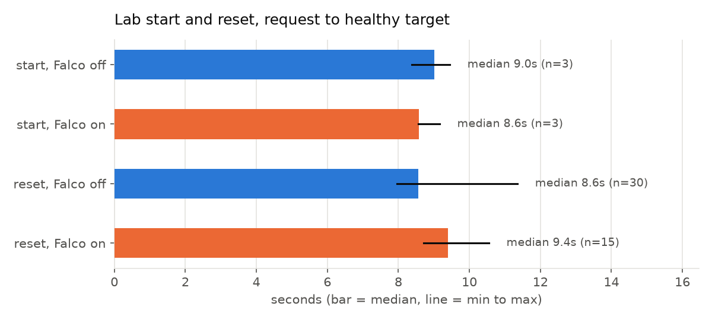

# Evaluation results (17 November 2026)

This is a repeatable measurement of CloudAttackLab against the metrics in project guide section 14. It describes what this platform did on one laptop, on one day, with synthetic traffic. It does not compare CloudAttackLab with any other platform, because no comparison was made.

- Script: `tools/evaluate.py` (with `tools/benign_traffic.py`; charts from `tools/evaluation_charts.py`)
- Raw results: [`evaluation/results/2026-11-17/`](../evaluation/results/2026-11-17/); the benign baseline (phase 3) in its subfolder [`benign_baseline/`](../evaluation/results/2026-11-17/benign_baseline/)
- Revised the same day: the benign-only session was replaced by a benign baseline measured through the platform's own pipeline, latency is reported two ways, and the cause of benign events in attack alerts is explained. See [What changed in this revision](#what-changed-in-this-revision)
- How to repeat it: [How to repeat this evaluation](#how-to-repeat-this-evaluation), at the end of this page

## How it was measured

`tools/evaluate.py` drives the platform through its HTTP API (`/api/v1`) only, using the same calls the dashboard makes: create/start/stop/reset the lab, start a run, read the run, its report, alerts and incidents, request and approve a response, run cleanup and close the incident. It reads results only from API answers. It never reads the database and never changes platform code or `.env`.

It also does a few things outside the API, the things an operator does around the platform:

- It switches the telemetry source by recreating the backend with `TELEMETRY_SOURCE` and `FALCO_ENABLED` set in the process environment (`docker compose up -d backend`). Shell variables override `.env`, so the file itself is not touched. Before measuring, it checks that `GET /labs/{id}` reports the wanted source and Falco setting.
- It starts the monitoring stack (Loki, Alloy, Grafana) for the Loki phase.
- It samples `docker stats --no-stream` in a loop while each run is active.
- It generates benign traffic (described below).

**Run plan, as executed.** Each run was preceded by a lab reset.

| Phase | Telemetry source | Falco | What |
|---|---|---|---|
| 1 | docker | off | 3 lab starts from stopped, then 10 runs of each of the three scenarios |
| 2 | docker | off | Correlation: the three scenarios back to back, 3 rounds (9 runs), with benign traffic running throughout |
| 3 | docker | off | Benign baseline: a 600 s `benign_baseline` observation run (every rule checked) with benign traffic and near-misses, no attack. Run separately at 17:01 to 17:11 UTC; see below |
| 4 | loki | on | 3 lab starts from stopped, then 5 runs of each scenario |

Phases 1, 2 and 4 ran with `python3 tools/evaluate.py --docker-runs 10 --loki-runs 5 --correlation-rounds 3 --setup-trials 3` (wall time 33 minutes, 13:24 to 13:57 UTC). That session's phase 3 (10 minutes of benign traffic with no run) stored no events, so it measured nothing about the rules; it was replaced by `python3 tools/evaluate.py --mode benign_baseline` (12 minutes, 17:00 to 17:12 UTC, branch `evaluation-fixes` at `82292d2`). The old session's record is kept as `benign_session.json`.

**Per run** (phases 1 and 4): reset the lab and wait until the target is healthy; start the run and poll it until it ends; read the report, alerts (with their events) and incidents. For `authentication_abuse` and `suspicious_container_activity`, request the scenario's response on the incident, approve it, and read the result. Then run cleanup, read the response again (it should be `reverted`) and close the incident.

**Definitions.**

| Metric | Definition used |
|---|---|
| Scenario execution success | The run ended `completed`: the script finished, every `expected_telemetry` item was collected and the script reported no request errors |
| Detection rate | The run has an alert from the scenario's own detection rule |
| False positives | (a) Benign baseline: alerts raised by the platform's own pipeline over benign traffic only. False-positive rate = of the rules the benign traffic gave events to count, the share that raised an alert (every alert of this run is a false positive). (b) Benign events that ended up inside a scenario run's alert |
| Time from threshold-crossing event to alert | The report's `detection_latency_seconds`: from the timestamp of the event that crossed the threshold (the `threshold`-th event linked to the alert) to the alert's creation |
| Time from run finish to alert | From the timestamp of the last event linked to the run's alert (the script's last action) to the alert's creation. The run's own `finished_at` cannot be used: it is set after detection, so it is always a few milliseconds after the alert |
| Correlation accuracy | Each run has exactly one incident; it belongs to that run; all its alerts and their events belong to that run; no benign event is among them |
| Response success | The approved response reached `executed` |
| Verification success | The approved response reached `verified` (its check passed). Also recorded: whether cleanup turned it into `reverted` |
| Lab setup time | From `POST /labs/{id}/start` on a stopped lab (and `POST .../reset` before each run) until `GET /labs/{id}` shows `running` with a healthy target, and a healthy Falco when Falco is on |
| Resource consumption | `docker stats` CPU % and memory of every `cloudattacklab*` container, sampled about every 2 seconds while a run was active |

**Benign traffic** (`tools/benign_traffic.py`, fixed seed 1). One action every 2 to 4 seconds, chosen at random:

- browsing: the shop page, the product list and single products;
- `lab_user` signing in with the right password and reading its orders;
- `lab_restricted` signing in with the right password and browsing products;
- at most one typo every 40 s (20 s in the correlation session): one wrong password followed 1 to 3 s later by the right one;
- at most one ordinary command every 45 s (20 s in the correlation session) in the test container with `docker exec` (`date`, `ls /`, `uptime`, ...), never the scenario marker.

**Benign baseline traffic.** The same background traffic (browsing, correct logins, order reads, `lab_restricted` browsing; no random typos or commands), plus a fixed schedule of near-misses, each just under a rule's threshold (`NearMissPlan` in `tools/benign_traffic.py`; offsets from the start of the traffic):

- at 30 s, 9 wrong passwords for `lab_user`, 3 s apart, never followed by the right one (`repeated_failed_logins` fires at 10 in 60 s);
- at 180 s, 4 requests by `lab_restricted` for `/api/orders`, which it may not read (`repeated_access_denied` fires at 5 in 60 s);
- from 130 s to 550 s, 6 single typos (a wrong password, then the right one), 84 s apart, alternating the two accounts. Every failed login counts against one source IP (see threats to validity), so they are kept more than 60 s from the burst and from each other, or they would add up to 10;
- at 90, 270 and 450 s, one ordinary command in the test container (`date`, `ls /`, ...), without the scenario marker.

In the correlation session the typos use only `lab_restricted`, because `authentication_abuse` uses `lab_user`. That is how a benign failed login can be told apart from a scenario one afterwards. ShopCloud returns no request id to the client, so there is no exact way to match a request to an event. Benign container commands are recognised by the missing scenario marker in the event message.

## Environment

From `environment.json`, recorded at the start of the run.

| Item | Value |
|---|---|
| Code | Phases 1, 2 and 4: branch `evaluation-job-c` at `e380837`, `main` at `18facb2` plus the evaluation scripts only, with the platform code unchanged. Phase 3: branch `evaluation-fixes` at `82292d2`, which adds the `observation` scenario type (rules, thresholds and attack-run detection unchanged) |
| Host | Windows 11 (10.0.26200), one laptop |
| Docker host | WSL 2, Ubuntu 26.04 LTS, kernel 6.18.33.2-microsoft-standard-WSL2 |
| Docker | Engine 29.7.1, Compose 5.3.1 |
| CPU | 12th Gen Intel Core i7-12650H, 16 logical CPUs visible to WSL |
| RAM | 7,792 MiB visible to the WSL VM (not the Windows host total) |
| Scenarios | `authentication_abuse` 1.0.0, `unauthorized_resource_access` 1.0.0, `suspicious_container_activity` 1.0.0 |
| Thresholds (from each scenario's `detection`) | `repeated_failed_logins`: 10 in 60 s; `repeated_access_denied`: 5 in 60 s; `suspicious_container_process`: 1 in 60 s |
| Telemetry source | `docker` (phases 1 to 3), `loki` (phase 4; settle interval 2 s, timeout 20 s, the defaults) |
| Falco | off (phases 1 to 3), on (phase 4; `falcosecurity/falco:0.45.2`, modern eBPF) |
| Lab limits | ShopCloud 0.5 CPU / 256 MB, test container 0.1 CPU / 32 MB, Falco 512 MB |

`environment.json` records `"uncommitted_changes": true`. That flag is wrong. Git inside WSL reported every file on the Windows drive as modified because of file-mode and line-ending settings, while Windows git showed a clean tree apart from `evaluation/`. The script now runs git with `core.filemode=false` and `core.autocrlf=true` and ignores `evaluation/`. The raw file was kept as recorded.

## Results

### Scenario execution success

| Telemetry | Scenario | Completed | Run duration, median (s) |
|---|---|---|---|
| docker | authentication_abuse | 10/10 (100%) | 20.5 |
| docker | unauthorized_resource_access | 10/10 (100%) | 7.5 |
| docker | suspicious_container_activity | 10/10 (100%) | 2.8 |
| loki | authentication_abuse | 5/5 (100%) | 25.4 |
| loki | unauthorized_resource_access | 5/5 (100%) | 11.6 |
| loki | suspicious_container_activity | 5/5 (100%) | 5.3 |

No run ended `incomplete` or `failed`, and no run was refused. The 9 correlation runs also all ended `completed`. With Loki, runs take 4 to 5 s longer: after the script ends, the backend waits until Loki's record count stops growing.

### Detection rate

| Telemetry | Scenario | Expected alert raised | Events in the alert | Alerts / incidents per run |
|---|---|---|---|---|
| docker | authentication_abuse | 10/10 (100%) | 20 application | 1 / 1 |
| docker | unauthorized_resource_access | 10/10 (100%) | 8 application | 1 / 1 |
| docker | suspicious_container_activity | 10/10 (100%) | 1 docker | 1 / 1 |
| loki | authentication_abuse | 5/5 (100%) | 20 application | 1 / 1 |
| loki | unauthorized_resource_access | 5/5 (100%) | 8 application | 1 / 1 |
| loki | suspicious_container_activity | 5/5 (100%) | 1 docker + 1 falco | 1 / 1 |

With Falco on, every container run's alert held both the Docker exec event and Falco's event, grouped into one alert as designed.

### False positives

**(a) Benign baseline: benign traffic only, through the real pipeline (600 s).**

The platform ran a `benign_baseline` observation run: for 600 s it collected ShopCloud's logs and the test container's Docker events, normalized and stored them exactly as for a scenario run, and then checked every rule with the threshold of the scenario that uses it. It sent nothing itself. The benign traffic above ran during the first 585 s: 329 requests and commands, all answered (0 HTTP errors). The run ended `completed`.

| Events stored | Events by type | Alerts raised | Incidents | False-positive rate |
|---|---|---|---|---|
| 329 | application: 133 `other` (browsing), 114 `authentication_success`, 60 `resource_access`, 15 `authentication_failure`, 4 `authorization_denied`; docker: 3 `suspicious_process` | 1 | 1 | 1 of 3 rules (33%) |

| Rule | Threshold | Benign events it counted | Most in any one window | Alerts |
|---|---|---|---|---|
| `repeated_failed_logins` | 10 in 60 s | 15 (9 in the burst, 6 single typos) | 9 | 0 |
| `repeated_access_denied` | 5 in 60 s | 4 | 4 | 0 |
| `suspicious_container_process` | 1 in 60 s | 3 | 1 | 1 |

The two count-based rules held at their near-misses: 9 failed logins and 4 denials in a window raised nothing. The container rule raised one false positive, for the benign `date` in the test container at 17:02:37 UTC. That is by design: the rule counts any process started in the test container, with a threshold of 1, because in this lab nothing should ever start one, and it cannot tell an operator's `date` from an intruder's shell. The two later commands (`ls /`, `uptime`) would each have raised an alert on their own, but a run gets one alert per rule and group, and all three have the group `test_container`. Counted per command, all 3 of 3 benign commands would be flagged.

The alert became one incident (risk score 60). It was raised when the observation ended, 511.7 s after its event, because detection runs only when a run ends.

What this does not show: the near-misses are exactly one below each threshold, so they show that each threshold is applied as written, not how often real users come that close. 15 failed logins in 10 minutes is more than ordinary typing mistakes would produce; the burst was put in on purpose.

**(b) Benign traffic while scenarios run (correlation session, 9 runs).**

| Scenario | Runs | Runs with a benign event inside the alert | Extra alerts raised |
|---|---|---|---|
| authentication_abuse | 3 | 3 (one benign `lab_restricted` failed login each; alert held 21 events instead of 20) | 0 |
| unauthorized_resource_access | 3 | 0 | 0 |
| suspicious_container_activity | 3 | 0 | 0 |

Benign traffic never raised an alert of its own. In each `authentication_abuse` run, though, one benign typo fell inside the run's window and was linked to the `repeated_failed_logins` alert as evidence. The cause is explained under [threats to validity](#threats-to-validity): events are matched to a run by time, and every request appears to come from the Docker gateway address. The benign container commands (5 in this session) did not fall inside any container run's window, which lasts about 3 s, so this session did not test that case. By design, any exec in the test container during that window would be linked to the alert.

### Detection latency


Detection runs once, when a scenario's script has finished (and, with Loki, once the late records have settled), not while the run is going on. So there are two different questions, with two different answers.

**Time from threshold-crossing event to alert.** These are the numbers this page has always reported (the report's `detection_latency_seconds`), unchanged and only renamed.

| Telemetry | Scenario | n | min (s) | median (s) | max (s) |
|---|---|---|---|---|---|
| docker | authentication_abuse | 10 | 10.59 | 10.76 | 11.12 |
| docker | unauthorized_resource_access | 10 | 3.11 | 3.14 | 3.20 |
| docker | suspicious_container_activity | 10 | 2.13 | 2.44 | 2.60 |
| loki | authentication_abuse | 5 | 14.83 | 15.15 | 15.59 |
| loki | unauthorized_resource_access | 5 | 7.15 | 7.16 | 7.22 |
| loki | suspicious_container_activity | 5 | 4.29 | 4.98 | 6.97 |

Because detection waits for the script to end, this number mostly reflects how much of the run was left after the threshold was crossed. `authentication_abuse` crosses its threshold at the 10th of 20 logins, one second apart, so about 10 s of it is the rest of the script; `unauthorized_resource_access` crosses at the 5th of 8 denials, about 3 s before the end. A scenario that sent more requests after the threshold would show a larger number with the same detector.

**Time from run finish to alert.** From the run's last event (the script's last action) to the alert. Computed from the same 45 runs (`runs.json`), with no new runs.

| Telemetry | Scenario | n | min (s) | median (s) | max (s) |
|---|---|---|---|---|---|
| docker | authentication_abuse | 10 | 0.10 | 0.12 | 0.14 |
| docker | unauthorized_resource_access | 10 | 0.10 | 0.12 | 0.17 |
| docker | suspicious_container_activity | 10 | 2.13 | 2.44 | 2.60 |
| loki | authentication_abuse | 5 | 4.13 | 4.18 | 4.20 |
| loki | unauthorized_resource_access | 5 | 4.12 | 4.14 | 4.18 |
| loki | suspicious_container_activity | 5 | 4.15 | 4.44 | 6.25 |

This is the platform's own processing time once the activity has stopped. With Docker logs it is about 0.1 s: a last read of the logs, storing the events and running the rule. With Loki it is about 4 s, the settle wait: the backend polls Loki every 2 s until the record count stops growing, so it needs at least two reads after the last record arrives. The container scenario takes about 2.4 s even with Docker, because Docker events also go through a settle wait (an exec event can reach the daemon's log a moment after `docker exec` returns). For the container scenario both measures are the same, because its single event is both the threshold-crossing event and the last one.

Neither number is the latency of a streaming detector, which CloudAttackLab does not have (see `docs/known-limitations.md`, "Detection runs once, at the end of a run").

### Correlation accuracy

Three rounds of the three scenarios back to back (reset between runs), with benign traffic running throughout.

| Runs | Exactly one incident, owned by the run | Alerts and events all from the run | Events from another run | Runs with no benign event merged |
|---|---|---|---|---|
| 9 | 9/9 (100%) | 9/9 (100%) | 0 | 6/9 (67%) |

Separation between runs was complete. The three runs where benign data was merged are the three `authentication_abuse` runs described under false positives (b). In phases 1 and 4, every one of the 45 runs also had exactly one alert in exactly one incident of its own.

### Response actions

| Telemetry | Action | Executed | Verified | Reverted by cleanup | Request + approve to result, median (s) |
|---|---|---|---|---|---|
| docker | temporary_rate_limit | 10/10 (100%) | 10/10 (100%) | 10/10 (100%) | 0.55 |
| docker | stop_container | 10/10 (100%) | 10/10 (100%) | 10/10 (100%) | 0.24 |
| loki | temporary_rate_limit | 5/5 (100%) | 5/5 (100%) | 5/5 (100%) | 0.77 |
| loki | stop_container | 5/5 (100%) | 5/5 (100%) | 5/5 (100%) | 0.32 |

`unauthorized_resource_access` has no response action. Its post-run check, `access_remains_denied`, passed in 10/10 (docker) and 5/5 (loki) runs. The risk scores were the same in every run of a kind: `authentication_abuse` 60 (after cleanup reverted the verified response), `unauthorized_resource_access` 46, and `suspicious_container_activity` 60 with Docker events or 62 with Falco (one event over the threshold).

### Lab setup time



| Operation | Telemetry | Falco | OK | n | min (s) | median (s) | max (s) |
|---|---|---|---|---|---|---|---|
| start (from stopped) | docker | off | 3/3 | 3 | 8.38 | 9.02 | 9.44 |
| start (from stopped) | loki | on | 3/3 | 3 | 8.56 | 8.58 | 9.16 |
| reset (before each run) | docker | off | 30/30 | 30 | 7.97 | 8.56 | 11.35 |
| reset (before each run) | loki | on | 15/15 | 15 | 8.71 | 9.39 | 10.54 |

All images were already built and cached. A first start on a new machine also includes image downloads and builds, which this does not measure. Start includes `docker compose up --build`, so it includes Compose checking the build cache.

### Resource consumption


All samples taken while scenario runs were active (phase 1: 167 samples per container; phase 4: 93).

| Container | Telemetry | CPU % mean | CPU % max | Memory mean (MiB) | Memory max (MiB) |
|---|---|---|---|---|---|
| backend | docker | 7.9 | 27.2 | 95 | 125 |
| lab-shopcloud | docker | 7.2 | 44.9 | 53 | 67 |
| postgres | docker | 1.1 | 6.7 | 28 | 30 |
| frontend | docker | 0.5 | 7.5 | 14 | 15 |
| lab-test_container | docker | 0.0 | 0.0 | 1 | 2 |
| backend | loki | 9.5 | 25.2 | 94 | 103 |
| lab-shopcloud | loki | 8.6 | 41.3 | 52 | 64 |
| lab-falco | loki | 2.6 | 10.0 | 112 | 122 |
| monitoring-grafana | loki | 4.0 | 7.8 | 362 | 405 |
| monitoring-loki | loki | 4.1 | 12.6 | 90 | 95 |
| monitoring-alloy | loki | 2.1 | 7.8 | 60 | 64 |
| postgres | loki | 1.6 | 10.1 | 29 | 30 |
| frontend | loki | 0.7 | 6.8 | 13 | 15 |
| lab-test_container | loki | 0.0 | 0.4 | 1 | 2 |

CPU % is Docker's figure, where 100% is one full CPU. Per sample, the containers together used a median of 192 MiB (max 220) in the Docker phase and 809 MiB (max 863) with the monitoring stack and Falco, about half of it Grafana. Per-scenario figures are in `summary.json` and `docker_stats.csv`.

## Threats to validity

- **One laptop, one day.** Every number comes from one machine (WSL 2 on Windows 11) in one 33-minute session. Other hardware, other Docker setups, or the same laptop under other load would give other times. Timings with a spread under a second should not be read as precise.
- **Few runs.** 10 runs per scenario with Docker and 5 with Loki, 9 correlation runs, 3 lab starts per phase. 10/10 does not mean the failure rate is zero; it means none of these 10 runs failed. With 10 runs and no failures, the true failure rate could still be as high as about 30% at 95% confidence (rule of three: about 3/n), and about 60% for 5 runs.
- **Synthetic traffic.** The scenarios and the benign traffic are scripts. The benign mix (regular pauses, two accounts) and the near-miss schedule are our guess at normal use and its edge cases, not recorded user behaviour. Real users would produce other patterns. The false-positive rate covers three rules in one 10-minute session, so 1 of 3 describes this session; it is not an estimate for other traffic.
- **Benign events in attack evidence come from how runs and clients are told apart.** In 3 of the 9 correlation runs (every `authentication_abuse` run) one benign failed login ended up in the attack alert. Two things together cause it. First, events are matched to a run by time: every ShopCloud record between the run's start and the end of its script (plus 3 s of grace) is stored as that run's event, because nothing in a request says which run sent it. Second, every request appears to come from the Docker gateway address (`172.22.0.1` here), whoever sent it, and `repeated_failed_logins` groups by source IP. So a benign failed login during an attack has the same run, the same source and the same event type as the attack's own, and the platform cannot tell it apart from them. The evaluation could only separate it afterwards because the benign traffic used `lab_restricted` and the attack `lab_user`; the rule does not look at usernames. With real client addresses, or a request id that ShopCloud returned to the client, the result would differ.
- **Thresholds were chosen by us.** 10 failed logins in 60 s, 5 denials in 60 s and 1 container process are the project's own values, set for these scenarios. The scenarios were written to cross them (20 logins, 8 denials, 1 exec), so the 100% detection rate measures whether the pipeline works end to end, not how good the rules are at separating attacks from normal use.
- **The benign baseline is a run.** The platform collects telemetry only during a run, so benign traffic is measured inside an observation run, which uses the same collection, storage and detection code as a scenario run. Outside any run, nothing is collected. The first version of this evaluation measured benign traffic with no run active; it stored 0 events, so its 0 alerts proved nothing, and it was replaced.
- **Latency is batch latency.** Detection runs when a script ends, so the time from the threshold-crossing event to the alert depends on how long each script continues after the threshold is crossed. The time from run finish to alert removes that, but uses the last event linked to the alert as the run's finish, which is a moment before the script itself returned.
- **The evaluator is also the author.** The script, the traffic and the definitions in this document were written by the same project, without independent review.
- **Resource sampling is coarse.** `docker stats --no-stream` takes about 2 s per sample, so short peaks can be missed. A container run lasts about 3 s and has only one or two samples.
- **No comparison.** Nothing here compares CloudAttackLab with another tool or platform, and none of it supports a claim that CloudAttackLab is better or worse than one.

## How to repeat this evaluation

`tools/evaluate.py` measures the platform through its API only (project guide section 14: run success, detection rate, false positives, detection latency, correlation, response and verification, lab setup time, resource use).

From the `cloudattacklab/` folder, where the `docker` CLI works (here: inside WSL), with the platform images built and nothing else using the lab:

```bash
python3 tools/evaluate.py                    # full plan, about 35 minutes
python3 tools/evaluate.py --mode benign_baseline   # only the benign baseline, about 12 minutes
```

The defaults are 10 runs of each scenario with `TELEMETRY_SOURCE=docker`, 3 back-to-back correlation rounds with benign traffic (`tools/benign_traffic.py`), the benign baseline (a `benign_baseline` run, whose length, 600 s, is set in `scenarios/benign_baseline.yaml`), and 5 runs of each scenario with `TELEMETRY_SOURCE=loki` and Falco on. Every count is an option (`--docker-runs`, `--loki-runs`, `--correlation-rounds`, `--setup-trials`, and `--no-benign-baseline`; `--help` lists them). The script switches the telemetry source by recreating the backend with environment variables, never by editing `.env`. It starts the monitoring stack for the Loki phase, and at the end stops the lab, puts the backend back on the `.env` settings and stops everything (`--keep-running` to skip that). The lab is reset before every run. Runs, alerts and incidents are added to your local database.

Raw CSV and JSON go to `evaluation/results/<UTC date>/`, including `environment.json` (commit, OS, Docker, CPU, RAM, scenario versions, thresholds, telemetry source, Falco). Then:

```bash
python3 tools/evaluate.py --summarize evaluation/results/<date>          # the summary tables
python3 tools/evaluation_charts.py evaluation/results/<date> docs/evaluation   # PNG charts (needs matplotlib)
```

(This section moved here from the README on 17 November 2026. The full-plan command produced phases 1, 2 and 4 above, with the old benign-only session in place of the baseline; `--mode benign_baseline` produced phase 3.)

## What changed in this revision

Revised on 17 November 2026, after review. The platform's detection rules and thresholds did not change.

1. **False positives.** The benign-only session stored 0 events, because telemetry is only collected during a run, so its 0 alerts proved nothing. A new scenario type, `observation`, and the scenario `benign_baseline` now measure benign traffic through the real pipeline; see [false positives](#false-positives). Result: 1 false-positive alert, from the container rule.
2. **Latency.** The old numbers are unchanged and renamed "time from threshold-crossing event to alert". A second measure, "time from run finish to alert", was added from the same recorded runs; see [detection latency](#detection-latency).
3. **Benign events in attack evidence** (3 of 9 correlation runs). The result is unchanged; its cause is now explained under [threats to validity](#threats-to-validity).

Only the benign baseline was run again; everything else comes from the runs recorded earlier that day.
