# User guide: the dashboard

This guide walks through one full session on the CloudAttackLab dashboard: start the lab, run each of the three scenarios, read an alert and its evidence, open an incident's timeline and risk score, request, approve and verify a response, view and download a report, clean up and reset.

Before you start, install and start the platform with the [installation guide](install.md). The dashboard is at <http://127.0.0.1:5173>.

**About the screenshots.** They were taken on 17 November 2026 on the test machine. That machine already had runs from earlier testing, so the Alerts and Incidents lists are long, and the lab is called `followup` rather than `default`. On a new installation the lists start empty. The numbers you see (event counts, risk scores, source IP) should match, except the source IP, whose last numbers depend on your Docker network (here `172.22.0.1`).

## The four pages

The buttons at the top switch between four pages:

| Page | What it is for |
|---|---|
| **Lab** | The lab's status, its containers, ShopCloud's health, Falco and the telemetry source. Start, Stop, Reset |
| **Scenarios** | The three scenarios. Run one, watch its status, run its cleanup, open its report |
| **Alerts** | Every alert, oldest first. Open one to see its evidence and to request a response |
| **Incidents** | Every incident, newest first, with status and risk score. Open one for its risk explanation, timeline, response and report |

The dashboard always works on **the first lab ever created** (the oldest one). The API can create more labs, but the dashboard shows only that one.

## 1. Start the lab

Open **Lab**. On a new installation the page says "No lab yet."; click **Create lab** (it creates a lab called `default`). Then click **Start**.

Start runs `docker compose up` for the lab and waits until ShopCloud is healthy, which takes about 9 seconds once the images are built (longer the first time). The page then shows:

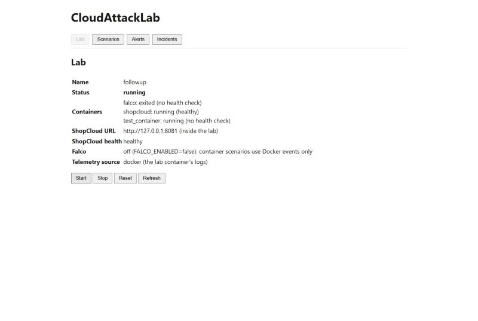

- **Status** `running`. Other values: `stopped`, `degraded` (a lab container is down; the page says which), `starting`, `error`.
- **Containers**: `shopcloud` (the shop under test) and `test_container` (the target of the container scenario). `falco` appears even when Falco is off, as "exited"; that is normal.
- **ShopCloud URL**: where the backend sends scenario traffic, and "(inside the lab)" when the safety check accepts it. If it says it is refused, see [safety](safety.md#1-lab-only-targets).
- **Falco** and **Telemetry source**: the settings from `.env`.

**Refresh** reads the status again; the page does not update by itself.

## 2. Run `authentication_abuse` (failed logins)

Open **Scenarios**. It lists the three scenarios found in `scenarios/`:

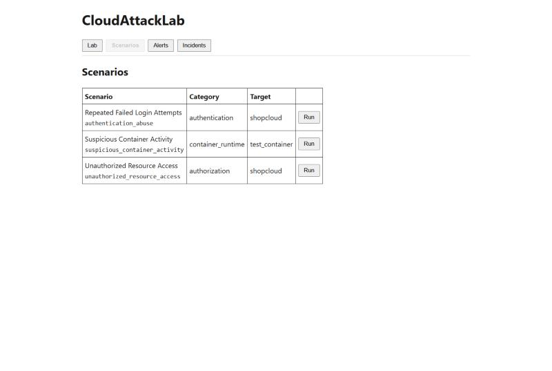

Click **Run** next to *Repeated Failed Login Attempts*. The script sends 20 logins for the test account `lab_user` with a deliberately wrong password, one per second. While it runs, the status says `running (updating...)` and every Run button is disabled, because a lab runs one scenario at a time:

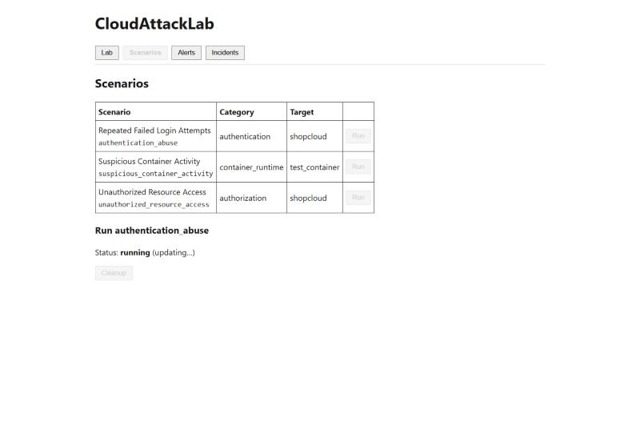

After about 21 seconds the status becomes `completed`, with the script's summary: 20 attempts, 20 answered `401`.

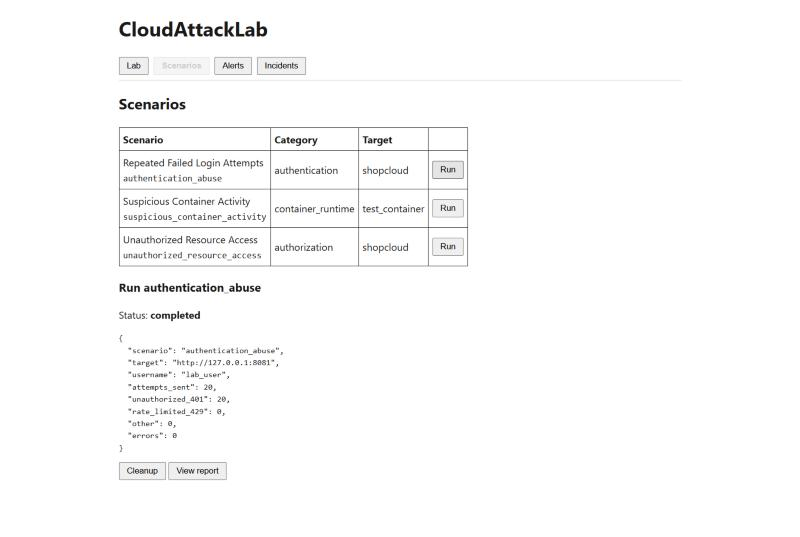

A run can end in four ways:

| Status | Meaning |
|---|---|
| `completed` | The script finished, the expected evidence was collected (here: at least 10 failed-login events) and no request went unanswered |
| `incomplete` | The script finished, but some expected evidence is missing or some requests got no answer. The reason is shown. Alerts that were raised are kept |
| `failed` | The script failed, timed out, or a telemetry source failed. Cleanup runs automatically |
| `cleaned_up` | Cleanup was run afterwards |

## 3. Read the alert and its evidence

Open **Alerts**. The newest alert is at the **bottom** of the list:

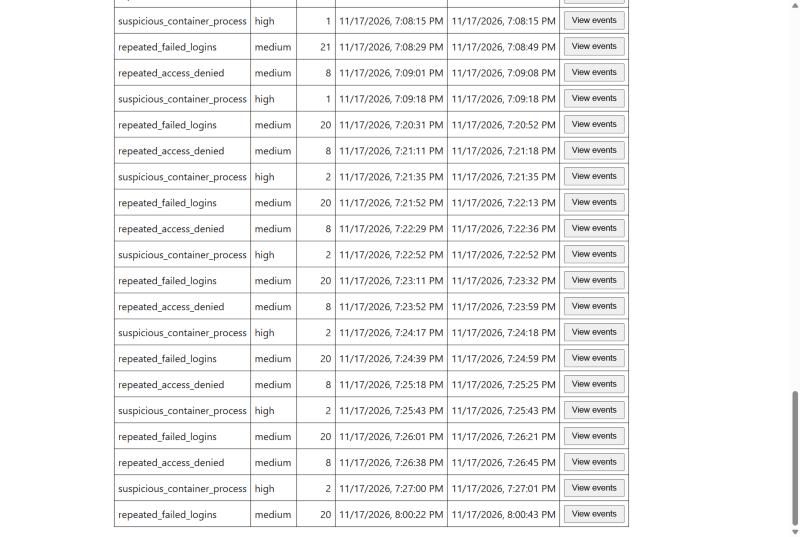

Click **View events** on the newest `repeated_failed_logins` row. Below the list you see:

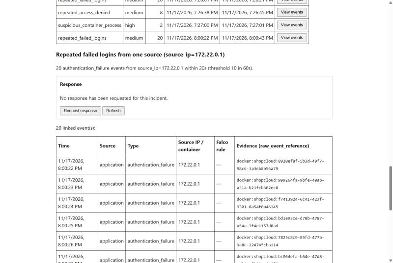

- The title and the reason it fired: "20 authentication_failure events from source_ip=172.22.0.1 within 20s (threshold 10 in 60s)".
- A **Response** panel (next section).
- The **linked events**: every event that counts towards the alert. Each row has its time, source (`application` = ShopCloud's log), type, source IP, and its **evidence**, `raw_event_reference`. For ShopCloud events it is `docker:shopcloud:<request_id>` (or `loki:shopcloud:<request_id>` with Loki): the `request_id` is in ShopCloud's own log line, so you can find the original record with `docker compose -f lab/docker-compose.lab.yml logs shopcloud`.

Every source IP is the same Docker gateway address. That is a known limitation, explained in [known limitations](known-limitations.md#every-source-ip-is-the-docker-gateway-address).

## 4. Request, approve and verify a response

In the alert's **Response** panel, click **Request response**. The response comes from the scenario file: for `authentication_abuse` it is `temporary_rate_limit`, at most 5 logins per 60 seconds. Its status is `pending_approval` and nothing has changed in ShopCloud yet:

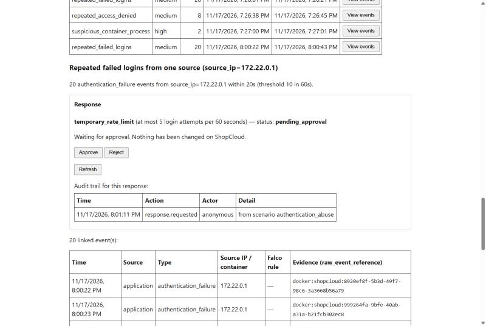

Click **Approve** (or **Reject**, which leaves ShopCloud untouched). Approving does three things in a row:

1. **Executes** the action: the backend tells ShopCloud to turn the rate limit on.
2. **Verifies** it: the backend sends 7 logins with a wrong password and expects the ones over the limit to be refused with `429`.
3. Records the result. Here: "Verified: 2 of 7 follow-up logins were blocked with 429", with every status code ShopCloud answered.

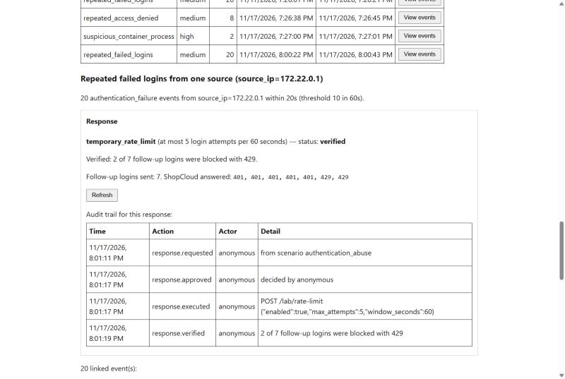

The audit trail under it shows each step, who did it (`anonymous`, because there is no login) and what was sent.

While the rate limit is on, **any** login to ShopCloud from this machine may get `429`, including yours with the right password. Cleanup (step 7) or Reset turns it off. See [troubleshooting](troubleshooting.md#a-manual-login-gets-429-after-a-test).

The same panel appears on the incident page, so you can do this from either place.

## 5. Open the incident: risk score and timeline

Open **Incidents**. The newest incident is at the top:

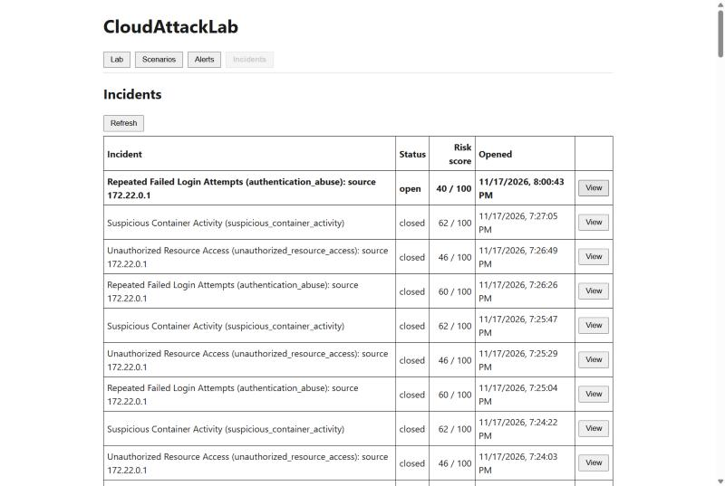

Click **View**. The detail opens below the list (scroll down). It starts with the status, the correlation key (what grouped the alerts: the run, the resource and the source IP) and the **risk score** with its explanation:

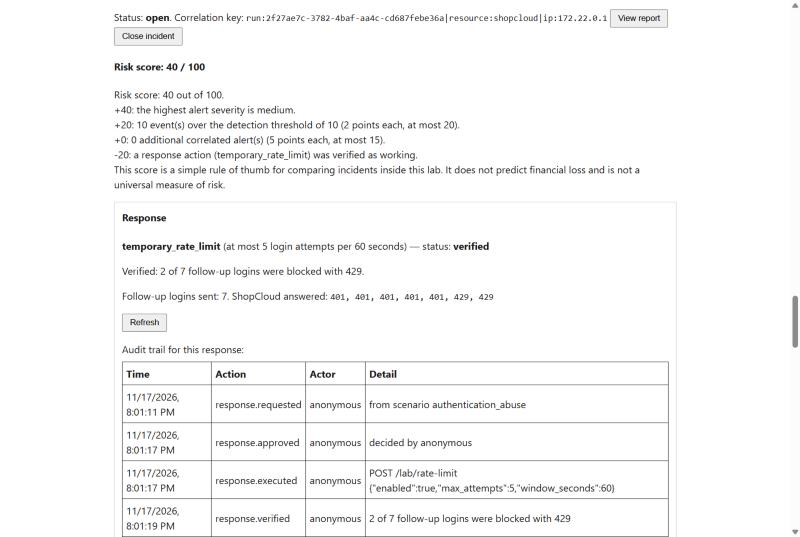

The score is a simple sum, written out line by line: 40 points for a medium-severity alert, 2 points for each event over the threshold (here 10, so 20 points, the maximum), 5 points for each extra correlated alert, minus 20 while a verified response is still applied. Here: 40 + 20 + 0 − 20 = 40. It is a rule of thumb for comparing incidents in this lab, not a prediction of loss.

Further down are the **linked alerts** and the **timeline**: one list, in time order, of the scenario starting, every event behind the alert, the alert firing, the scenario finishing, every response step and the cleanup. Each line links to its evidence (the run, the event with its `raw_event_reference`, the alert, the response or the audit rows):

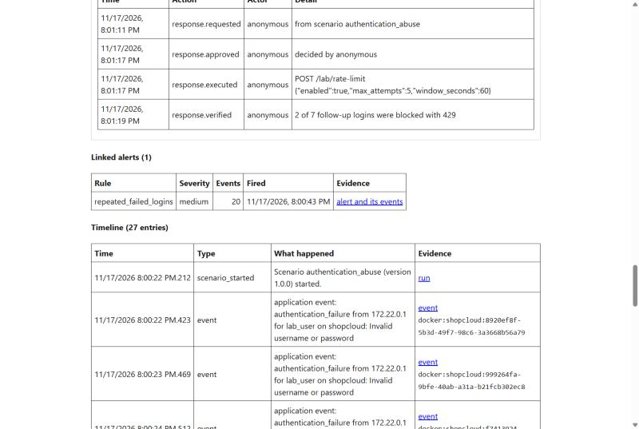

## 6. View and download the report

Click **View report** on the incident (or on the run, on the Scenarios page). The report shows, for one run: the lab and scenario, the run's times and parameters, what the script reported, the telemetry expected next to what was collected, the alerts with their detection latency, the incident and risk score, the response and its verification, and the cleanup status.

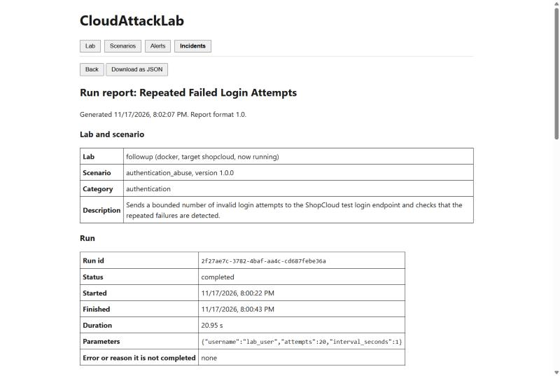

**Download as JSON** saves the same report as `report-<scenario>-<run id>.json`. The same JSON is available from the API:

```bash
curl -s http://127.0.0.1:8000/api/v1/runs/<run id>/report
```

(Run on the test machine with the run id from the screenshot; it returned the 3.7 KB report. The **Download as JSON** button itself was not clicked during this check.)

**Back** returns to the page you came from.

## 7. Clean up

Go back to **Scenarios**. The last run is still shown. Click **Cleanup**. For `authentication_abuse` it runs the scenario's two cleanup steps, `disable_rate_limit` and `reset_target_state`: the rate limit goes off and ShopCloud's data and sessions go back to their starting state. The run becomes `cleaned_up`:

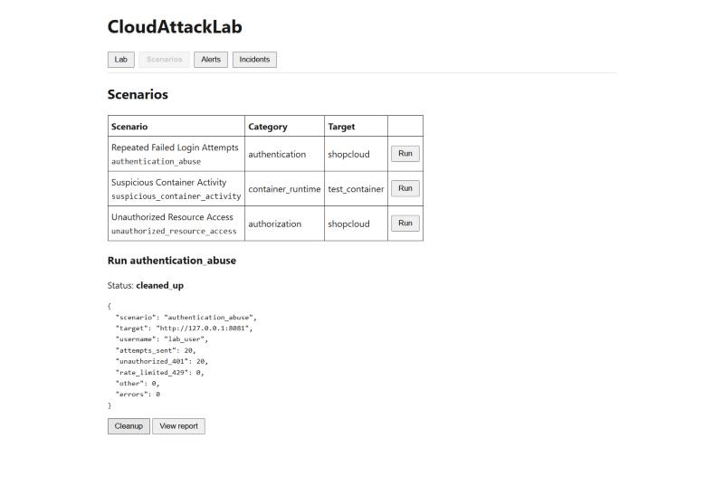

The response becomes `reverted`, and the incident's risk score goes back up to 60, because the response no longer protects anything. The explanation says so.

Cleanup is refused while any run in the lab is still active.

## 8. Run `unauthorized_resource_access` (denied access)

Click **Run** next to *Unauthorized Resource Access*. The script signs in as `lab_restricted`, a user who may not read orders, and asks for `GET /api/orders` 8 times. All 8 must be refused with `403`. After about 8 seconds the run is `completed`, and because this scenario has no response action, the engine checks once more after the run and reports it in plain words: "Verification passed: access is still denied".

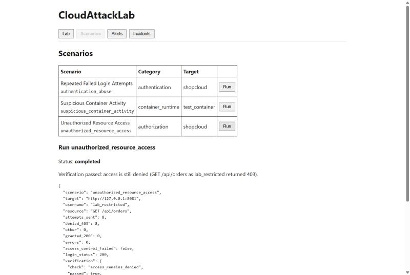

On **Alerts**, the new alert is `repeated_access_denied` with 8 events. The incident's risk score is 46: 40 for a medium alert plus 2 × 3 events over the threshold of 5. If any request had been allowed, the run would end `failed` with `"access_control_failed": true`.

Click **Cleanup** when you are done (`reset_target_state`).

## 9. Run `suspicious_container_activity` (a shell in a container)

This scenario runs one fixed, harmless command, `sh -c "id; : cloudattacklab-scenario-marker"`, inside the lab's test container, the way an intruder would start a shell. Docker reports it as an `exec_start` event, and Falco, when it is on, reports it too.

The screenshots below were taken with Falco on (see [install, step 10](install.md#10-turn-falco-on-optional)). Click **Run** next to *Suspicious Container Activity*. It completes in about 3 seconds and shows the command and its output:

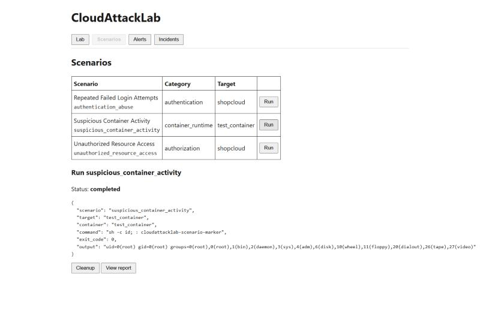

On **Alerts**, the new `suspicious_container_process` alert (severity `high`) holds **two** events: one from Docker and one from Falco, whose rule is "CloudAttackLab marker process in test container". With Falco off it holds only the Docker event.

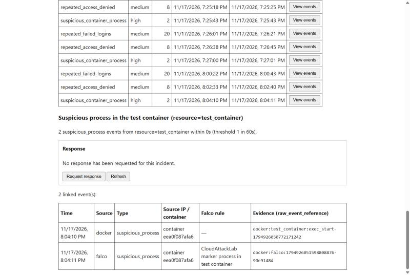

Click **Request response**, then **Approve**. The response here is `stop_container`: the backend stops the test container (and refuses any other container), then inspects it to confirm it is no longer running:

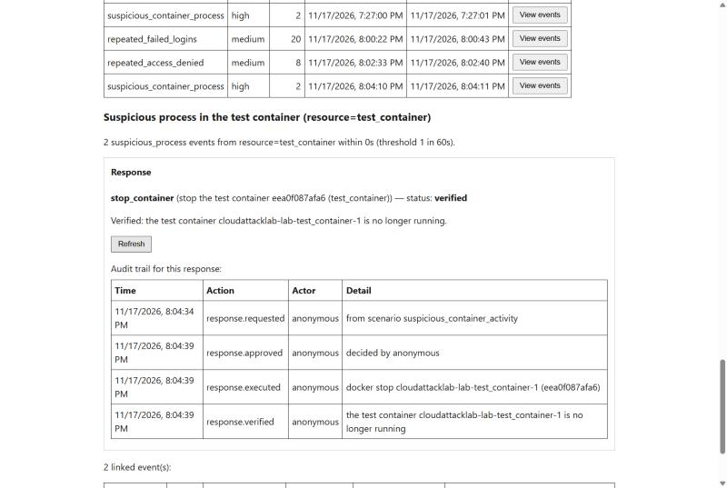

Then click **Cleanup** on the Scenarios page. Its step `recreate_test_container` creates a fresh test container, and the response becomes `reverted`.

## 10. Close incidents

On an incident's detail, **Close incident** marks it `closed`. A closed incident takes no new response, and closing is refused while one of its responses is still waiting for approval. Closing is recorded in the audit log and at the end of the timeline.

After the three scenarios and their cleanups, the Incidents page shows one incident per run: 60 for the login one (its response was reverted), 46 for the access one, and 62 for the container one (60 with Docker events only; Falco's extra event adds 2). Here the newest one has just been closed:

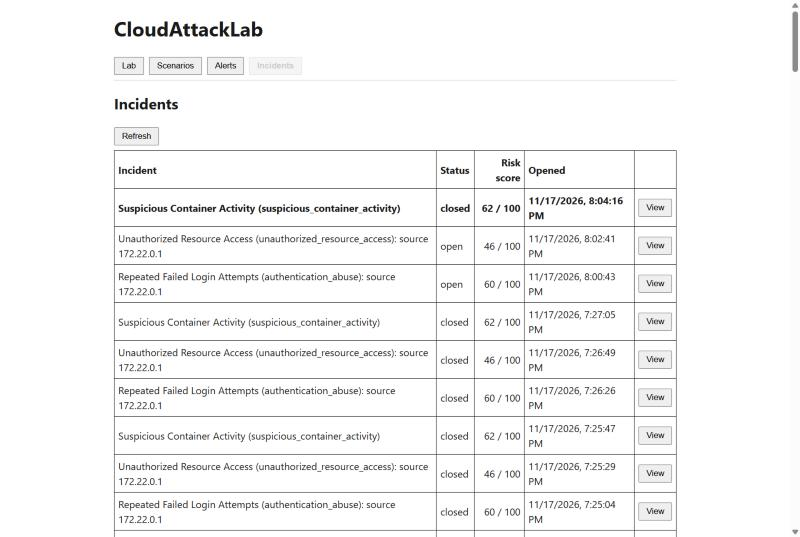

## 11. Reset the lab

**Reset** on the Lab page recreates every lab container and calls ShopCloud's own reset, so the lab is back at its starting point: original data, no sessions, rate limit off, a fresh test container (and Falco, if it is on). It also reverts any response that is still applied. Use it whenever you are not sure what state the lab is in, after changing `FALCO_ENABLED`, or when the page says `degraded`.

Reset is refused while a run is active (the button is disabled), and takes about 9 seconds.

**Stop** stops the lab's containers but keeps them and their logs. Nothing in the database is deleted by Stop, Reset or Cleanup: runs, alerts, incidents and the audit log stay.

## What the dashboard does not do

- There is no login. Anyone who can open `127.0.0.1:5173` on this machine can run scenarios and approve responses. See [known limitations](known-limitations.md#no-dashboard-login).
- Pages do not refresh by themselves, except the status of a run in progress. Use **Refresh**.
- Reports are JSON only: no PDF and no sharing.
