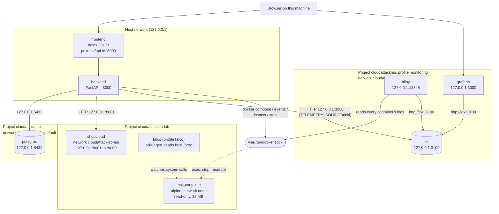
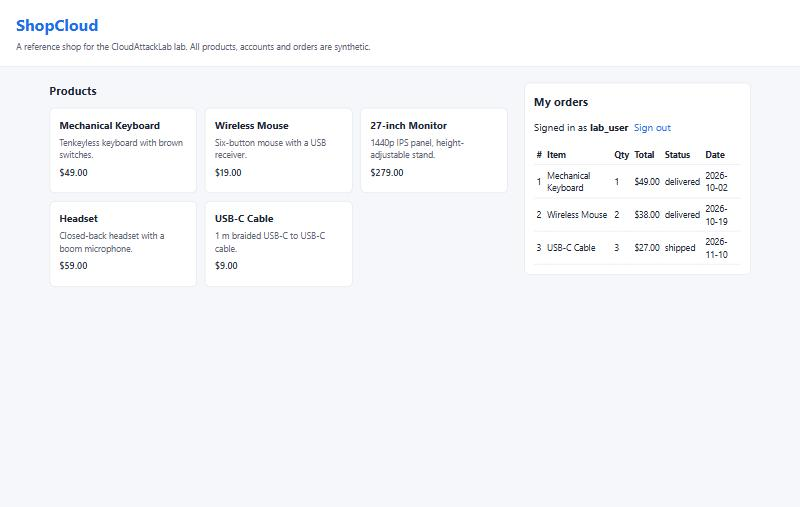
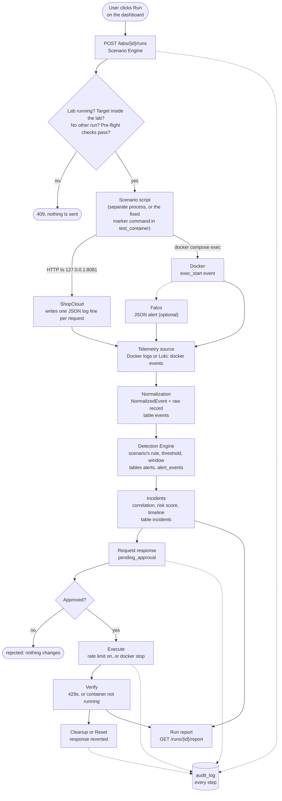

# Architecture

This page explains how CloudAttackLab is built: its modules, what each one does, how data travels from a scenario to an alert to a response, and the one event format every telemetry source is converted into.

## The big picture

CloudAttackLab is two Docker Compose projects on one machine:

| Compose project | File | Containers | Job |
|---|---|---|---|
| `cloudattacklab` (the platform) | `docker-compose.yml` | Basic mode: `postgres`, `backend`, `frontend`. With the `monitoring` profile also `loki`, `alloy`, `grafana` | Stores results, runs scenarios, detects, responds, serves the dashboard; optionally stores and shows logs |
| `cloudattacklab-lab` (the lab) | `lab/docker-compose.lab.yml` | `shopcloud`, `test_container`, `falco` (profile `falco`, optional) | The isolated environment that scenarios act on |

The user only starts the platform (`scripts/setup.sh`, `scripts/start.sh`, or `docker compose up -d`, with `--profile monitoring` for the monitoring stack) by hand. The backend starts, stops and resets the lab itself through the Docker socket. Until 18 November 2026 the monitoring stack was a third project, `cloudattacklab-monitoring`, with its own compose file; it became a profile so that it needs no separate command set and no `--env-file`.

The backend is one FastAPI application (`backend/app/main.py`) with one Python package per module. Every route is under `/api/v1` (see [the API contract](api-contract.md)). PostgreSQL holds eight tables, created by Alembic migrations in `backend/alembic/`: `labs`, `scenario_runs`, `events`, `alerts` (and the link table `alert_events`), `incidents`, `response_actions`, `audit_log`, and `users`, which exists but is unused because there is no login yet.

## Containers and networks

Things to notice:

- **The backend and the dashboard use the host's network** (`network_mode: host`). That is how the backend reaches ShopCloud at `127.0.0.1:8081` (published by the lab project) and Loki at `127.0.0.1:3100` without joining their networks. It is also why the platform needs a Linux Docker Engine (native or in WSL 2).
- **Inside one Compose project, containers reach each other by service name**: Alloy and Grafana use `http://loki:3100`. From the host network the same Loki is `127.0.0.1:3100`. `127.0.0.1` inside a container on a Compose network means that container itself (see [troubleshooting](troubleshooting.md#containers-cannot-reach-each-other-on-127001)).
- **Every published port is bound to `127.0.0.1`**, so nothing is reachable from other machines.
- **The test container has no network at all** (`network_mode: none`), a read-only root, 32 MB of memory and 0.1 CPU. It only runs `sleep`.
- **Falco** runs only when `FALCO_ENABLED=true` (the backend then adds the Compose profile `falco`). It is privileged; see [safety](safety.md#falco-is-privileged).

### Why the backend still uses host networking

Moving the backend and the dashboard to a bridge network, with service-name URLs, was evaluated for version 1.0 and **not done**. It would make the platform less tied to a Linux Docker Engine, but it touches every path the platform depends on:

| What depends on host networking | What a bridge network would need |
|---|---|
| The backend reaches ShopCloud at `127.0.0.1:8081`, and the target check (`SHOPCLOUD_URL` must point into the lab) accepts that | The backend joins the lab's network `cloudattacklab-lab`, which the Lab Manager creates and recreates on start and reset; `SHOPCLOUD_URL` naming a lab container (the target check already accepts that) |
| The backend reaches Loki at `127.0.0.1:3100` | `LOKI_URL=http://loki:3100` (same project now, so this part is easy) |
| The backend reaches PostgreSQL at `127.0.0.1:5432` | `POSTGRES_HOST=postgres` |
| nginx in the dashboard container proxies `/api` to `127.0.0.1:8000` | `frontend/nginx.conf` proxies to `backend:8000`; ports `5173` and `8000` published on `127.0.0.1` |
| `tools/evaluate.py`, `tools/check_shopcloud.py` and the integration tests call `127.0.0.1` | Unchanged (published ports), but every scenario and response would have to be re-run to validate |

The lab network being created by a different project, after the platform has started, is the hard part: the backend would have to attach itself to it on every lab start and reset. The current setup works and was evaluated on Windows 11 with WSL 2, so it stays the baseline, and Docker Desktop and macOS remain untested (see [known limitations](known-limitations.md)).

## The modules

| Module | Code | What it does |
|---|---|---|
| Lab Manager | `backend/app/lab_manager/` | Creates, starts, stops and resets the lab; reports container status and ShopCloud's health; corrects the stored lab status against Docker when a lab is read |
| Scenario Engine | `backend/app/scenario_engine/`, `backend/app/schemas/scenario.py`, `scenarios/` | Loads and validates scenario files, runs pre-flight checks, runs the scenario's script in the background with a timeout (an observation run has none and only watches), collects telemetry during the run, decides the run's outcome, runs cleanup |
| Telemetry sources | `backend/app/telemetry/source.py`, `loki.py`, `container.py`, `factory.py` | Read raw records: ShopCloud's logs (from Docker or Loki), the test container's Docker events, Falco's alerts |
| Normalization | `backend/app/telemetry/normalize.py`, `container.py`, `ingest.py` | Turn each raw record into a `NormalizedEvent` and store it, never twice, with the raw record kept beside it |
| Detection Engine | `backend/app/detection/`, `rules/` | Loads and validates rule files and runs the scenario's rule (every rule, for an observation run) over the run's events; raises one alert per group that reaches the threshold |
| Incidents | `backend/app/incidents/` | Groups a run's alerts into incidents, computes the risk score, builds the timeline, closes incidents |
| Response Manager | `backend/app/response_manager/` | Creates a response from the scenario's definition, waits for approval, executes it, verifies it, marks it reverted after cleanup or reset |
| Reports | `backend/app/reports/` | Builds the JSON report of one run |
| Audit | `backend/app/audit.py` | Writes one `audit_log` row for every lab, run, cleanup, response and incident action |
| Startup checks | `backend/app/startup.py` | At start, checks that the lab target URL points into the lab and warns about default credentials |
| Dashboard | `frontend/` | React (Vite) pages Lab, Scenarios, Alerts, Incidents and a report view. All API calls go through `frontend/src/api.js`. Served by nginx in its container |
| Monitoring stack | `monitoring/` | Loki stores logs; Alloy ships every container's logs to Loki with a `service` label; Grafana shows the provisioned "CloudAttackLab - Lab activity" dashboard |
| ShopCloud | `shopcloud/` | The lab target: a small shop (FastAPI, SQLite) with two test accounts, JSON logs on stdout, and `/lab/*` control endpoints. Its contract is [shopcloud-interface.md](shopcloud-interface.md) |

### ShopCloud

ShopCloud (`shopcloud/`) is separate from the platform: its own FastAPI app with its own SQLite database inside its container, no platform code. It has five synthetic products, the two test accounts `lab_user` and `lab_restricted`, three orders belonging to `lab_user`, and one page at `/` with a sign-in form. Passwords are stored as scrypt hashes and login tokens only as SHA-256 hashes. It has no intentional security holes: the scenarios test detection and response against normal behaviour (failed logins, denied access). Its container runs as a non-root user, and it ignores `X-Forwarded-For`, so `source_ip` is always the real peer. `tools/check_shopcloud.py` checks it against [the interface](shopcloud-interface.md) (14 checks).

`mock_shopcloud/` is a small in-memory stand-in with the same interface. The lab does not use it; to swap it in, set `build: ../mock_shopcloud` in `lab/docker-compose.lab.yml`.

### Lab Manager

The Lab Manager talks to Docker only through the `LabAdapter` interface (`lab_manager/adapter.py`). Its one implementation, `DockerComposeAdapter` (`lab_manager/docker_adapter.py`), is the only code that runs Docker commands:

- `docker compose -f lab/docker-compose.lab.yml up --build --wait` to start, `stop` to stop, `up --force-recreate --wait` to reset, `ps` and `logs` to read;
- `docker compose ... exec -T test_container <the fixed marker command>` for the container scenario;
- `docker events` (filtered on the lab project and the test-target label), `docker inspect` and `docker stop` for the container scenario and its response;
- `docker compose ... up --force-recreate --no-deps test_container` for the cleanup step `recreate_test_container`.

A Kubernetes or cloud adapter would implement the same interface; none exists.

Reset also calls ShopCloud's `POST /lab/reset`, which restores its data, removes every session and turns the rate limit off. Only one lab can run at a time, because the lab's ports are fixed, and only one lab operation runs at a time.

### Scenario Engine

A scenario is a YAML file in `scenarios/` plus a script in `scenarios/scripts/`. The loader (`schemas/scenario.py`) validates every file when it is read and skips invalid ones. [Adding a scenario](adding-a-scenario.md) describes the format.

A run goes through these steps (`scenario_engine/service.py`):

1. **Checks** (all refuse with 409): the lab is running; the scenario's target is the lab's target; for application scenarios the target URL is inside the lab; no other run is active in the lab; the pre-flight checks in the scenario's `prerequisites` pass; with Falco on, the Falco container runs.
2. A `scenario_runs` row is created (`pending`) and the API returns at once. The rest happens on a background thread.
3. Each telemetry source is checked. If one cannot be read, the run fails before the script starts and nothing is sent to ShopCloud.
4. The script runs. An **application** script runs as a separate Python process (`python -I <script> <target URL> <parameters as JSON>`), killed after `timeout_seconds`, and prints a one-line JSON summary. A **container** script is loaded into the backend and called with a handle whose only action is `run_marker()`.
5. Meanwhile, a collector thread reads the telemetry every 2 seconds, and once more after the script ends (with Loki, it polls until the record count stops growing, for at most 20 seconds).
6. The Detection Engine runs once over the run's events.
7. If the scenario names a post-run check (`verification_check`), it is repeated once.
8. The outcome is decided: `completed`, `incomplete` or `failed` (see the [user guide](user-guide.md#2-run-authentication_abuse-failed-logins)). On `failed`, cleanup runs automatically.

**Observation runs.** A scenario of type `observation` (the shipped one is `benign_baseline`) has no script, no `detection` and no response. Its run goes through the same steps, except that step 4 is a wait of `execution.parameters.duration_seconds` (600 s for `benign_baseline`) during which the platform sends nothing. It collects everything an attack run of either type would: ShopCloud's logs from `TELEMETRY_SOURCE`, the test container's Docker events and, with Falco on, Falco's alerts, through the same ingest and normalization code. In step 6 every rule is checked, each with the threshold and window of the scenario that uses it (`detection/checks.py`); the list is fixed when the run starts and kept in the run's `parameters.detection_rules`. Traffic sent from outside during the run, for example by `tools/benign_traffic.py`, is therefore stored and checked exactly as it would be during an attack run, and every alert the run raises is a false positive. The evaluation uses it to measure the [false-positive rate](evaluation-results.md#false-positives).

### Telemetry sources and normalization

| Source | What is read | Normalized as | `raw_event_reference` |
|---|---|---|---|
| ShopCloud's logs, through Docker (`TELEMETRY_SOURCE=docker`, the default) | `docker compose logs shopcloud --since <run start>` | `source: application`, type from ShopCloud's `event` field | `docker:shopcloud:<request_id>` |
| ShopCloud's logs, through Loki (`TELEMETRY_SOURCE=loki`) | Loki `query_range` for `{service="shopcloud"}` | the same | `loki:shopcloud:<request_id>` |
| Docker events of the test container | `docker events` filtered on the lab project and the label `cloudattacklab.role=test-target` | `source: docker`; `exec_start` → `suspicious_process`, `start` → `container_started`, `die`/`stop` → `container_stopped` | `docker:test_container:exec_start-<timeNano>` |
| Falco alerts (`FALCO_ENABLED=true`) | Falco's JSON lines, through Docker or Loki like ShopCloud's | `source: falco`, `suspicious_process`, `rule_id` = Falco rule | `<docker\|loki>:falco:<time in ns>-<rule hash>` |

ShopCloud's event names map to event types like this (`telemetry/normalize.py`): `login_success` → `authentication_success`, `login_failed` → `authentication_failure`, `login_rate_limited` → `rate_limit_triggered`, `access_granted` → `resource_access`, `access_denied` → `authorization_denied`, `rate_limit_changed` and `lab_reset` → `config_changed`, anything else → `other`.

Rules for every source:

- A record is taken only if its time is inside the run's window: from the run's start to the end of the script, plus 3 seconds of grace.
- A record that is not valid JSON, or lacks a request id, an event name or a timestamp, is skipped and counted. Nothing is made up.
- The original record is stored in `events.raw`. The same request id is never stored twice, whichever source read it.
- ShopCloud's records of the platform's own calls (`lab_reset`, `rate_limit_changed`) are never stored as a run's events.

### The common event schema

Every event, whatever its source, is a `NormalizedEvent` (`backend/app/schemas/event.py`, schema version `1.0`; JSON Schema copy in [`contracts/event.schema.json`](../contracts/event.schema.json)):

| Field | Type | Required | Meaning |
|---|---|---|---|
| `event_id` | UUID | generated | Unique id of the event |
| `timestamp` | date-time, UTC | yes | When it happened. A time without a time zone is refused |
| `scenario_id` | string | no | The scenario that was running |
| `source` | `application`, `docker`, `falco`, `platform` | yes | Where it came from |
| `event_type` | see below | yes | Normalized category |
| `severity` | `info`, `low`, `medium`, `high`, `critical` | default `info` | Failures and denials are `low` |
| `source_ip` | IP address | no | Checked to be a valid address |
| `resource` | string | yes | What was affected: `shopcloud`, `test_container` |
| `message` | string | yes | Human-readable text |
| `raw_event_reference` | string | yes | Pointer to the original record |
| `schema_version` | string | default `1.0` | |
| `lab_id`, `run_id` | UUID | no | The lab and run it belongs to |
| `username` | string | no | The account involved |
| `container_id` | string | no | The container involved |
| `rule_id` | string | no | For Falco events: the Falco rule's name |
| `correlation_key` | string | no | For example `run:<run_id>\|ip:<source_ip>` |

Event types: `authentication_success`, `authentication_failure`, `rate_limit_triggered`, `authorization_denied`, `resource_access`, `container_started`, `container_stopped`, `suspicious_process`, `scenario_started`, `scenario_finished`, `response_executed`, `config_changed`, `other`.

The `platform` source and the types `scenario_started`, `scenario_finished` and `response_executed` are defined but no code stores such events: the timeline builds those entries from the run and the audit log instead. To change the schema: edit `event.py`, raise `SCHEMA_VERSION`, run `python backend/scripts/export_schemas.py`.

### Detection Engine

A rule is a YAML file in `rules/` (`detection/rules.py`), counting events of one type over a time window:

- `event_type`: which events to count;
- `group_by`: one field or a list, from `source_ip`, `username`, `resource` or `raw.<field of the original record>`;
- `match` (optional): keep only events with these values, for example `raw.status: 403`;
- `severity`, `title`, `description`, and fallback `default_threshold` and `default_window_seconds`.

The threshold and window actually used come from the scenario's `detection` section (for an observation run, from the scenario that uses each rule; see above). An attack run is checked against its own rule only. The rule fires when one group reaches the threshold within the window; there is one alert per run and group, and every event of the group is linked to the alert (`alert_events`). Detection runs once, when the script has finished (or the observation has ended), not as a stream. The report's `detection_latency_seconds` is therefore the time from the threshold-crossing event to the alert, and mostly reflects how much of the run was left; see the [evaluation](evaluation-results.md#detection-latency).

### Incidents

`incidents/service.py` attaches each new alert to an incident:

1. Only alerts of the same run can share an incident.
2. Inside a run, two alerts are related when their events share a resource **and** share a source IP or a username.
3. A new alert joins the oldest incident of its run that holds a related alert; otherwise it opens a new one.
4. Incidents are never merged or split later.

The **risk score** (`incidents/risk.py`) is 0–100: base points for the highest alert severity (info 10, low 25, medium 40, high 60, critical 80); plus 2 per event over the threshold (at most 20); plus 5 per extra correlated alert (at most 15); minus 20 while a verified response is still applied. It is recomputed when an alert joins, a response is verified, or a response is reverted, and it comes with a written explanation.

The **timeline** (`incidents/timeline.py`) is built when it is requested, from the run, the events, the alerts and the audit log. Nothing extra is stored.

### Response Manager

1. `POST /incidents/{id}/responses` creates a `response_actions` row, `pending_approval`. The action and its parameters come from the scenario's `response` section; the request has no body. For `stop_container`, the container comes from the incident's own events. One open response per incident.
2. **Approve** executes the action, then verifies it, and stores what was sent and received in `verification_result`. **Reject** changes nothing.
3. `temporary_rate_limit` → `POST /lab/rate-limit` on ShopCloud; verified by `login_returns_429` (`max_attempts + 2` wrong logins; those over the limit must get 429).
4. `stop_container` → `docker stop` of the test container, only after checking its labels; verified by `container_not_running` (`docker inspect`).
5. Cleanup (`disable_rate_limit`, `reset_target_state`, `recreate_test_container`) or a lab reset marks the response `reverted`.

Statuses: `pending_approval` → `approved` → `executed` → `verified` or `failed`; or `rejected`; later `reverted`.

## How data flows: from a scenario to an alert to a response

The **evidence chain** always leads back to the original record: incident → alerts → `alert_events` → events → each event's `raw_event_reference` and `raw`.

## Settings

All settings are environment variables, read in `backend/app/config.py` and set in `.env` (see `.env.example`). The ones you are most likely to change:

| Setting | Default | Meaning |
|---|---|---|
| `POSTGRES_PASSWORD` | `change-me-locally` | Database password |
| `LAB_CONTROL_TOKEN` | `lab-dev-token` (compose) | Secret for ShopCloud's `/lab/*` endpoints |
| `SHOPCLOUD_URL` | `http://127.0.0.1:8081` | Where the backend reaches ShopCloud. Must point into the lab |
| `TELEMETRY_SOURCE` | `docker` | `docker` or `loki` |
| `LOKI_URL` | `http://127.0.0.1:3100` | Where the backend reaches Loki |
| `LOKI_SETTLE_INTERVAL_SECONDS`, `LOKI_SETTLE_TIMEOUT_SECONDS` | 2, 20 | How long to wait for late Loki records after a run |
| `FALCO_ENABLED` | `false` | Run Falco in the lab |
| `GF_SECURITY_ADMIN_PASSWORD` | none (required) | Grafana's admin password |
| `LAB_START_TIMEOUT_SECONDS` | 180 | How long a lab start or reset may take |
| `TELEMETRY_SINCE_GRACE_SECONDS` | 3 | Grace added to the end of a run's time window |
