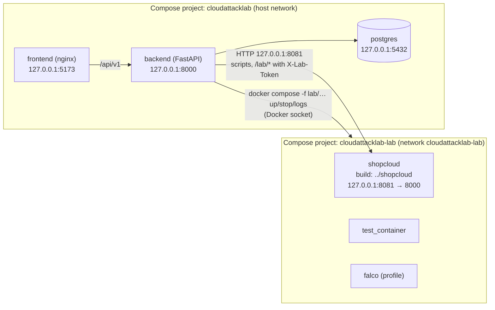
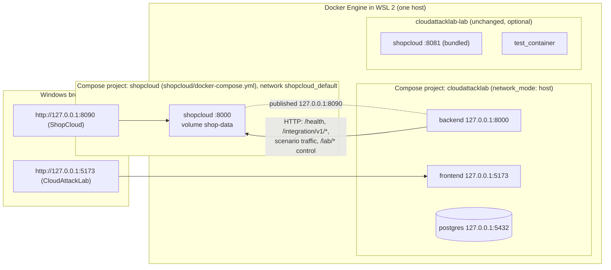

# Presentation integration plan: an independent ShopCloud connected to CloudAttackLab

| | |
|---|---|
| Investigated | `main` at `bb5dcb2`, 19 November 2026 |
| Method | Read-only code and configuration tracing. No application file, migration or Docker configuration was changed. Nothing was started, run, committed or pushed. This file is the only file written. |
| Scope | One presentation milestone: register an independently running ShopCloud, verify it, authorize it, run **Authentication Abuse** against it, collect its real telemetry, and show the alert and incident. Not the full roadmap. |
| Markers | ✅ **Exists today** (verified in code). 🆕 **Proposed** (does not exist). ⚠️ **Constraint or risk** found in the code. |

---

## Contents

1. [Summary and verdict](#1-summary-and-verdict)
2. [Existing architecture](#2-existing-architecture)
3. [Gap analysis against the demonstration](#3-gap-analysis-against-the-demonstration)
4. [Design decisions](#4-design-decisions)
5. [Required modifications and files](#5-required-modifications-and-files)
6. [New API endpoints](#6-new-api-endpoints)
7. [Database changes](#7-database-changes)
8. [Docker networking design](#8-docker-networking-design)
9. [Integration authentication](#9-integration-authentication)
10. [Telemetry event schema](#10-telemetry-event-schema)
11. [Target authorization](#11-target-authorization)
12. [Attack execution changes](#12-attack-execution-changes)
13. [Security considerations](#13-security-considerations)
14. [Test plan](#14-test-plan)
15. [Two-day implementation priorities](#15-two-day-implementation-priorities)
16. [Final verdict: feasibility and the smallest safe implementation](#16-final-verdict-feasibility-and-the-smallest-safe-implementation)
17. [Evidence index](#17-evidence-index)

---

## 1. Summary and verdict

**Feasible in two days, if the scope stays narrow.** The detection half of the pipeline (normalization, the `repeated_failed_logins` rule, alerts, incidents, risk, reports and every dashboard page after "run started") is target-agnostic enough to reuse **unchanged**. What has to change is the front half. Today a target is a value in an environment variable, its URL is validated against the lab's Compose file, it is started by the backend through the Docker socket, and its telemetry is read from that Compose project's container logs. None of that works for an application CloudAttackLab does not own.

The smallest safe implementation:

1. 🆕 **ShopCloud** (still the same code) gets its own Compose project, a fixed loopback port (`127.0.0.1:8090`), a persistent SQLite volume, and three small authenticated `/integration/v1/*` endpoints: a handshake, a telemetry test, and a bounded event feed that returns the JSON records it already writes to stdout.
2. 🆕 **CloudAttackLab** stores registered targets in a new `targets` table. It validates each URL with a strict IP-literal allowlist and checks the HMAC handshake. It stores time-boxed, scenario-scoped authorizations in a new `target_authorizations` table. It **auto-creates one ordinary `labs` row per target** (with `environment = "external"`), so runs, events, alerts, incidents, responses and reports keep working without schema changes to the existing tables.
3. 🆕 A new `IntegrationFeedSource` implements the existing `TelemetrySource` protocol (`telemetry/source.py`). The existing `TelemetryIngestor` and `normalize()` therefore store the records as normal `application` events, and the existing detection engine raises the alert and the incident.

One stated decision was changed for V1 (**accepted by the project team on 20 November 2026**). ⚠️ **"ShopCloud must send telemetry to CloudAttackLab" (push) cannot be done safely in two days.** The backend runs with `network_mode: host` and binds only to `127.0.0.1:8000` (`docker-compose.yml`, `backend`; `backend/Dockerfile` `CMD`). A ShopCloud container on its own bridge network cannot reach it. Making it reachable means binding the backend API (which has no authentication) to a wider interface. V1 therefore uses **authenticated pull**: ShopCloud produces the structured security events, and CloudAttackLab collects them through the authenticated feed. Push is the V1.1 follow-up (§4.2).

---

## 2. Existing architecture

### 2.1 Picture as built



### 2.2 The 14 investigation items

| # | Item | What exists ✅ | Evidence |
|---|---|---|---|
| 1 | **ShopCloud directory and deployment** | Source is **inside this repository** at `shopcloud/`. It isn't deployed on its own: `lab/docker-compose.lab.yml` service `shopcloud` has `build: ../shopcloud`. The backend's Lab Manager starts it with `docker compose up --build --wait` through the Docker socket. The backend also mounts `./shopcloud` read-only as the build context. A second, fake implementation sits in `mock_shopcloud/`. | `lab/docker-compose.lab.yml` lines 11–25; `docker-compose.yml` backend `volumes` (`./shopcloud:/workspace/shopcloud:ro`); `backend/app/lab_manager/docker_adapter.py` `DockerComposeAdapter.start()`, `reset()`; `docker-compose.yml` header comment ("You do not start it by hand"). |
| 2 | **ShopCloud frontend, backend, database** | **One container.** FastAPI app factory `create_app()` serves the API and a static page (`/` → `static/index.html`, `/static` mount; `shop.js` calls `/api/products`, `/api/login`, `/api/orders` with relative paths). The database is **SQLite** at `SHOP_DB_PATH=/app/data/shop.db`, created and **reset to seed on every start** (`Database.__init__` calls `self.reset()`). There's no volume, so data lasts only as long as the container. Accounts `lab_user` and `lab_restricted` are seeded with scrypt hashes. | `shopcloud/shop/main.py` `create_app()`, `page()`, `app.mount("/static")`; `shopcloud/shop/db.py` `Database.__init__`, `reset()`, `ACCOUNTS`; `shopcloud/shop/static/shop.js` (`fetch("/api/…")`); `shopcloud/Dockerfile` `ENV SHOP_DB_PATH` |
| 3 | **Compose files and networks** | Platform project `cloudattacklab`: `backend` and `frontend` use `network_mode: host`; `postgres` publishes `127.0.0.1:5432`. Lab project `cloudattacklab-lab`: `shopcloud` on network `cloudattacklab-lab`, published `127.0.0.1:8081:8000`; `test_container` has `network_mode: none`. Optional monitoring profile: `loki` (`127.0.0.1:3100`), `alloy`, `grafana` (`127.0.0.1:3000`). | `docker-compose.yml`; `lab/docker-compose.lab.yml` |
| 4 | **Hardcoded ShopCloud URLs** | Default `http://127.0.0.1:8081` in: `backend/app/config.py` `get_settings()` (`lab_targets={"shopcloud": SHOPCLOUD_URL}`), `docker-compose.yml` (`SHOPCLOUD_URL` default), `.env.example`, `lab/docker-compose.lab.yml` (port), `scripts/setup.sh` line 41 (port-free check `8081:shopcloud`), `tools/benign_traffic.py` line 53 (`SHOPCLOUD_URL` constant), `tools/check_shopcloud.py` (usage text), `frontend/src/pages/LabPage.jsx` line 127 and `SettingsPage.jsx` (help text), plus test fixtures. The target **name** `shopcloud` is fixed in `config.py`, `scenarios/*.yaml` (`target: shopcloud`), `telemetry/normalize.py` (`resource="shopcloud"`, `raw_event_reference=f"{origin}:shopcloud:…"`), `config.py` `telemetry_service` default and `frontend/src/api.js` `createLab(name, target = 'shopcloud')`. | grep for `8081`, `SHOPCLOUD_URL`, `'shopcloud'` |
| 5 | **Attack scenario scripts** | Three YAML scenarios plus `benign_baseline`. Application scripts run as a **separate process**: `runner.execute_script()` → `python -I <script> <base_url> '<json params>'`, bounded by `timeout_seconds`. `base_url` comes from configuration (`settings.lab_targets[lab.target]`), never from a request. Scenario parameters are bounded (`attempts` ≤ `MAX_ATTEMPTS = 200`). | `backend/app/scenario_engine/runner.py` `execute_script()`, `resolve_script()`; `backend/app/scenario_engine/service.py` `start_run()` lines 149–150; `backend/app/schemas/scenario.py` `MAX_ATTEMPTS`, `Execution` validator |
| 6 | **Authentication Abuse** | `scenarios/authentication_abuse.yaml`: `type: application`, `target: shopcloud`, prerequisites `http_health` and `test_account lab_user`, 20 attempts 1 s apart, `timeout_seconds: 60`, expected ≥ 10 `application/authentication_failure`, detection `repeated_failed_logins` threshold 10 / 60 s, response `temporary_rate_limit` (approval required), cleanup `disable_rate_limit` and `reset_target_state`. The script `send_login()` posts a deliberately wrong password with `urllib.request.urlopen`. ⚠️ **`urlopen` follows redirects by default**, so a target answering 301/302/303 would make the script send a follow-up request to any `Location`. | `scenarios/authentication_abuse.yaml`; `scenarios/scripts/authentication_abuse.py` `send_login()`, `main()` |
| 7 | **Telemetry through Docker and Loki** | `TelemetrySource` protocol (`collect(since)`, `check()`, `name`, `late_arriving`). `DockerLogSource` → `DockerAdapter.logs()` → `docker compose -f lab/docker-compose.lab.yml logs --since … shopcloud`, so **only the lab project's container**. `LokiSource` queries `{service="shopcloud"}`. ⚠️ Alloy labels every container on the host by its Compose service name only, so an independent project with a service called `shopcloud` would **already** mix into that Loki stream (this is unauthenticated and accidental; see `TELEMETRY_AND_LOGGING_INVESTIGATION.md` F1). | `backend/app/telemetry/source.py`; `telemetry/factory.py` `make_source()`; `telemetry/loki.py`; `lab_manager/docker_adapter.py` `logs()`; `monitoring/config.alloy` |
| 8 | **Event normalization** | `normalize(record, ctx, origin)` needs `request_id`, `event` and `timestamp`; maps `EVENT_TYPE_MAP` (`login_failed` → `authentication_failure`, etc.); sets `source=application`, `resource="shopcloud"`, `raw_event_reference=f"{origin}:shopcloud:{request_id}"`. `TelemetryIngestor.ingest()` filters invalid JSON, `PLATFORM_BOOKKEEPING`, the run window (+3 s grace) and duplicate `request_id`s, and keeps the original record in `events.raw`. **Both are source-agnostic**: any source that returns ShopCloud's JSON lines works. | `backend/app/telemetry/normalize.py` `normalize()`, `EVENT_TYPE_MAP`; `telemetry/ingest.py` `TelemetryIngestor.ingest()`, `request_id_of()` |
| 9 | **PostgreSQL schemas** | Tables `users`, `labs`, `scenario_runs`, `events`, `alerts`, `alert_events`, `incidents`, `response_actions`, `audit_log` (migrations `0001_initial_tables.py`, `0002_scenario_run_summary.py`). `labs.target` is a free `String(64)` name and **`labs.environment` already exists** (`String(32)`, default `"docker"`). No `targets` table and no authorization table. `scenario_runs.lab_id` is required, so every run belongs to a lab. | `backend/app/models.py` `Lab`, `ScenarioRun`, `Event`; `backend/alembic/versions/0001_initial_tables.py` line 36 |
| 10 | **Detection rules** | `rules/repeated_failed_logins.yaml`: `event_type: authentication_failure`, `group_by: source_ip`. `DetectionEngine.run_for_run()` runs **once after collection** over `Event.run_id == run.id`. `_first_window_reaching()` is the sliding window. It never looks at where an event came from. | `backend/app/detection/engine.py` `run_for_run()`, `_evaluate()`, `_first_window_reaching()` |
| 11 | **Alerts and incidents** | `_build_alert()` (one alert per run and group) → `attach_alerts()` groups alerts by the same resource and the same IP or username into an `Incident` with a run-scoped `correlation_key`, then `refresh_risk()`. Keyed by `run.lab_id` and `run.id` only. | `detection/engine.py` `_build_alert()`; `backend/app/incidents/service.py` `attach_alerts()`, `related()`, `_correlation_key()` |
| 12 | **Target-related APIs** | **None for targets.** Only `POST/GET /labs`, `GET /labs/{id}` (includes `target_health`, `target_url {url, allowed, error}`, `telemetry`), `POST /labs/{id}/start|stop|reset`. `LabCreate.target` must be a name in `settings.lab_targets` (`LabManager.create()` → 422 `unknown_target`). | `backend/app/lab_manager/router.py`; `lab_manager/api_schemas.py` `LabCreate`, `LabDetail`; `lab_manager/service.py` `LabManager.create()` |
| 13 | **Frontend routing and navigation** | Hash router `parseHash()`/`navigate()` in `frontend/src/lib/router.js`; page registry `PAGES` in `frontend/src/App.jsx`; sidebar `NAV` in `frontend/src/lib/nav.js` (sections Operations, Simulation, Detection, Response). All HTTP calls go through `frontend/src/api.js`. `ScenariosPage.jsx` starts runs against `activeLab` with `api.startRun(activeLab.id, selected.id)`. No target page. | `frontend/src/lib/router.js`, `nav.js`, `App.jsx`, `api.js`, `pages/ScenariosPage.jsx` line ~54 |
| 14 | **Response mechanisms** | `ResponseManager.request()` / `approve()` / `reject()`. For `temporary_rate_limit`, `approve()` calls `target.set_rate_limit()` (`POST /lab/rate-limit` with `X-Lab-Token`), then verifies with `login_returns_429`. Cleanup steps are `disable_rate_limit` and `reset_target_state` (`POST /lab/reset`). Every target call goes through `GuardedTargetClient`, which re-checks the URL first. | `backend/app/response_manager/service.py` `approve()`, `_target_for()`, `_planned_action()`; `response_manager/verification.py` `login_returns_429()`; `scenario_engine/service.py` `_cleanup_step()`; `lab_manager/target_guard.py` `GuardedTargetClient` |

### 2.3 Key constraints found ⚠️

| ID | Constraint | Why it matters for this milestone | Evidence |
|---|---|---|---|
| C1 | **The target is configuration, not data.** One target, `shopcloud`, read from `SHOPCLOUD_URL` once (`@lru_cache get_settings()`). Target clients are built once (`@lru_cache get_target_clients()`). | Registering a target at runtime from the UI needs persistence and a per-request lookup instead of a cached dict. | `config.py` `get_settings()`; `lab_manager/router.py` `get_target_clients()`; `scenario_engine/router.py` `get_scenario_engine()` |
| C2 | **The URL guard is tied to the lab Compose file.** `_check()` accepts only (a) loopback on a port that `lab/docker-compose.lab.yml` publishes for the service, or (b) a container name in the `cloudattacklab-lab` project. | An independent ShopCloud on its own port or project is **refused**. The guard's ideas are reusable (scheme, userinfo and IP checks); its allowlist source is not. | `lab_manager/target_guard.py` `_check()`, `published_ports()` |
| C3 | **Lab lifecycle means `docker compose up`.** `LabManager.start()` → `adapter.start()` then `wait_healthy()`; `reset()` recreates containers. `reconcile()` marks a lab degraded when lab containers are down. | An external target must never be started, stopped or recreated by CloudAttackLab. "Start" has to mean "verify". | `lab_manager/service.py` `start()`, `reset()`, `reconcile()` |
| C4 | **Telemetry is read from the lab project's containers.** | With ShopCloud in another project, `DockerLogSource` returns nothing for `shopcloud`. The run ends `incomplete` ("expected at least 10 application authentication_failure event(s), collected 0") through `run_shortfalls()`. | `telemetry/source.py` `DockerLogSource.collect()`; `scenario_engine/service.py` `run_shortfalls()` |
| C5 | **No integration authentication.** The only secret is `LAB_CONTROL_TOKEN`, shared through `.env` and sent as `X-Lab-Token` to `/lab/*`. Nothing proves that the application at a URL *is* ShopCloud. | Registration must prove identity before anything else is sent. | `shopcloud/shop/main.py` `lab_authorized()`; `lab_manager/target.py` `HttpTargetClient.reset()`, `set_rate_limit()` |
| C6 | **No authorization step and no operator identity.** A run needs only a running lab plus pre-flight. Every audit row has `actor="anonymous"`. | "Authorize before execution" is new. The authorizer can only be recorded as typed text until dashboard login exists. | `scenario_engine/service.py` `start_run()`; `backend/app/audit.py` `ANONYMOUS_ACTOR` |
| C7 | **The backend is host-networked and bound to loopback.** | It can reach a target's published loopback port (as it does today for 8081). A target container **cannot** reach the backend (push is blocked; §4.2). | `docker-compose.yml` backend `network_mode: host`, `BACKEND_HOST: 127.0.0.1`; `backend/Dockerfile` `CMD` |
| C8 | **The scenario script follows HTTP redirects.** | A redirect to `http://169.254.169.254/…` or a public host would leave the lab. It is harmless today only because the target is our own build. | `scenarios/scripts/authentication_abuse.py` `send_login()` (`urllib.request.urlopen`) |
| C9 | **`/integration/*` paths would not be logged by ShopCloud.** `LOGGED_PREFIXES = ("/api/", "/lab/")`. | Good: the platform's polling of the feed does not create telemetry about itself. Keep it that way. | `shopcloud/shop/main.py` `LOGGED_PREFIXES`, `log_requests()` |
| C10 | **ShopCloud resets its database at every start** and has no volume. | Fine for a lab, but an "independent application" should keep its data across restarts. Add a volume; keep `/lab/reset` as the explicit baseline. | `shopcloud/shop/db.py` `Database.__init__`; `lab/docker-compose.lab.yml` (no `volumes:`) |

---

## 3. Gap analysis against the demonstration

| Demo step | Today | Needed (🆕) |
|---|---|---|
| 1. Start ShopCloud independently | ❌ Only through the backend's Lab Manager (`docker_adapter.start()`) | ShopCloud's own `docker-compose.yml` (project `shopcloud`, port `127.0.0.1:8090`) |
| 2. Open ShopCloud in a browser | ✅ `http://127.0.0.1:8081`, but only while the lab runs | `http://127.0.0.1:8090`, works with CloudAttackLab stopped |
| 3. Start CloudAttackLab independently | ✅ `docker compose up -d` (basic mode) | No change |
| 4. Open Target Management | ❌ No page | `targets` page in `NAV`/`PAGES` |
| 5. Register ShopCloud | ❌ Target is env config | `POST /api/v1/targets` + `targets` table + URL policy |
| 6. Verify its connection | 🟡 `/health` only (`HttpTargetClient.health()`), with no identity proof | `POST /targets/{id}/verify`: HMAC handshake |
| 7. Verify telemetry integration | ❌ | `POST /targets/{id}/verify-telemetry`: test event with nonce, read back through the feed |
| 8. Authorize a controlled experiment | ❌ | `POST /targets/{id}/authorizations` (scoped, time-boxed, audited) |
| 9. Execute Authentication Abuse | ✅ against the lab target | Same scenario; `start_run()` resolves the registered target and checks the authorization |
| 10. Collect actual ShopCloud logs | ✅ from lab Docker logs | `IntegrationFeedSource` reading ShopCloud's own feed |
| 11. Actual alert and incident | ✅ `DetectionEngine.run_for_run()` → `attach_alerts()` | **No change** |
| 12. Display results | ✅ Runs, Events, Alerts, Incidents, Reports pages | **No change** (runs belong to the target's auto-created lab) |

---

## 4. Design decisions

### 4.1 Reuse the `labs` row as the run container (no change to existing tables)

`scenario_runs.lab_id`, `events.lab_id`, `alerts.lab_id` and `incidents.lab_id` all point to `labs`. Every page after "run started" is keyed by lab and run. **Proposal:** registering a target also creates one `labs` row with `environment = "external"` and `target = <target slug>`, and the `targets` row stores its `lab_id`. The run, detection, incident, response and report code then works as it is. The only code that must branch on `lab.environment == "external"` is code that touches Docker or resolves a target client (§12).

### 4.2 Telemetry delivery: authenticated pull for V1, push in V1.1

> **Decision (20 November 2026): accepted.** V1 uses authenticated pull (option A). Push (option B) is deferred to V1.1, after the dashboard has authentication.

| Option | Works with current networking? | Change to CloudAttackLab exposure | Effort | Verdict |
|---|---|---|---|---|
| **A. Pull** (🆕 recommended): ShopCloud keeps a bounded buffer of its JSON security records and serves `GET /integration/v1/events`; the backend polls it during a run | ✅ The backend already reaches `127.0.0.1:<port>` (as with 8081) | None | Small: one `TelemetrySource` class (`collect`/`check` already defined) | **V1** |
| B. Push to the backend API | ❌ The backend binds `127.0.0.1` on the host; a bridge container can't reach it (C7) | Needs `BACKEND_HOST` on a bridge-reachable interface. The API has **no authentication** (`audit.ANONYMOUS_ACTOR`) | Medium, plus a security review | V1.1, after dashboard auth |
| C. ShopCloud with `network_mode: host`, then push to `127.0.0.1:8000` | ✅ | None, but **the victim shares the host's network namespace** and every `source_ip` becomes 127.0.0.1 | Small | Rejected: weakens isolation |
| D. Keep reading Docker logs of the external container (`docker logs <name>`) | ✅ (socket mounted) | CloudAttackLab needs Docker-level control over the "independent" app | Small | **Plan B only** (§15) if the feed slips |

Pull preserves every security property the backend has today (loopback-only, no new inbound surface). It also reuses the `TelemetrySource` abstraction exactly as `LokiSource` did. ShopCloud still **produces** structured, schema-versioned security telemetry; only the transport direction differs. Present it this way: "ShopCloud publishes an authenticated security-event feed; CloudAttackLab subscribes to it during authorized experiments."

### 4.3 V1 supports ShopCloud only

A registered target has `kind = "shopcloud"` (the only allowed value). Scenarios keep `target: shopcloud` and match on **kind**, not on the target's name. The existing `ScenarioEngine` allowed-target set (`set(settings.lab_targets)`) keeps working because `shopcloud` stays in it.

### 4.4 Keep the bundled lab for now

The container scenario (`test_container`, Falco) and every existing integration test depend on `lab/docker-compose.lab.yml`. For the presentation the bundled lab stays. Independent ShopCloud uses port **8090**, so both can run at once without a port clash on 8081.

> **Decision (20 November 2026): ShopCloud stays in this repository until after the presentation.** The standalone deployment is `shopcloud/docker-compose.yml` (Compose project `shopcloud`, service `shopcloud-standalone`, `127.0.0.1:8090`). It builds from the **same** `shopcloud/` source as the bundled lab, so there's one copy of the code. The integration endpoints live in `shopcloud/shop/` and stay disabled unless `INTEGRATION_KEY` is set, so the bundled 8081 instance behaves exactly as before. Extracting `shopcloud/` into its own GitHub repository (and pointing the lab at a versioned image) is a follow-up after the presentation.

---

## 5. Required modifications and files

### 5.1 ShopCloud (🆕 changes in place, in `shopcloud/`; see the §4.4 decision)

| File | Change |
|---|---|
| `shop/main.py` | (1) In `log_requests()`, also append each record that `write_log()` writes to a bounded in-memory buffer (`collections.deque(maxlen=10_000)`, with a monotonically increasing `seq`). (2) Add an `integration` router under `/integration/v1/` (§6.2). (3) Keep `/integration/*` outside `LOGGED_PREFIXES` (C9). |
| `shop/integration.py` (new) | HMAC verify (`hmac.compare_digest`), the event buffer, and the three handlers. Standard library only. |
| `shop/security.py` | No change. Reuse the `secrets` and `hmac` patterns that are already there. |
| `shop/db.py` | No schema change. Optional: skip the reset-on-start when `SHOP_RESET_ON_START=false`, so the volume keeps data (C10). |
| `Dockerfile` | No change needed (already non-root, `--no-proxy-headers`). |
| `docker-compose.yml` (new) | `name: shopcloud`; service `shopcloud`; `ports: ["127.0.0.1:8090:8000"]`; volume `shop-data:/app/data`; env `LAB_CONTROL_TOKEN`, `INTEGRATION_KEY`, `INTEGRATION_INSTANCE_ID`; health check as in `lab/docker-compose.lab.yml`. |
| `.env.example`, `README.md` (new) | How to start it, generate keys and open the shop. |
| `docs/shopcloud-interface.md` | Add section 7 "Integration API v1" (§9, §10). The copy in CloudAttackLab stays the contract reference. |
| `tests/test_integration.py` (new) | Handshake accept and reject, feed bounds, test event, and that no `/integration/*` request is logged. |

### 5.2 CloudAttackLab backend

| File | Status | Change |
|---|---|---|
| `backend/app/models.py` | modify | Add `Target` and `TargetAuthorization` models (§7). Existing models unchanged. |
| `backend/alembic/versions/0003_targets.py` | 🆕 (not created now) | Creates the two tables. |
| `backend/app/targets/__init__.py`, `router.py`, `service.py`, `api_schemas.py` | 🆕 | Registration, verification, telemetry verification, authorizations (§6.1). |
| `backend/app/targets/url_policy.py` | 🆕 | `check_registered_url()`: the strict allowlist (§13.1). Uses the same parsing approach as `target_guard._check()` (`urlsplit`, scheme, userinfo and `ipaddress` checks). |
| `backend/app/targets/handshake.py` | 🆕 | Builds the challenge and verifies ShopCloud's HMAC (§9). |
| `backend/app/telemetry/integration.py` | 🆕 | `IntegrationFeedSource` (`name = "integration"`, `late_arriving = True`): `collect(since)` pages `GET /integration/v1/events`, and `check()` calls the feed with `limit=1`. |
| `backend/app/lab_manager/target_guard.py` | modify | `GuardedTargetClient` takes a callable guard, so an external target re-validates **its registered URL** through `url_policy` before every request. The existing `TargetGuard` stays for the bundled lab. |
| `backend/app/lab_manager/target.py` | modify | `HttpTargetClient`: pass `follow_redirects=False` explicitly (it's httpx's default, but this makes it explicit and testable) and treat any 3xx as `TargetError`. Add `integration_handshake()` and `integration_test_event()`. |
| `backend/app/lab_manager/resolve.py` | 🆕 | `resolve_target(session, lab) -> ResolvedTarget(base_url, client, kind, feed_source)`: one function replaces the six `target_clients[...]` lookups (§12.2). |
| `backend/app/lab_manager/service.py` | modify | `start()`, `stop()`, `reset()`, `details()`, `reconcile()`: branch on `lab.environment == "external"` (no adapter calls; "start" = handshake + `/health`; "reset" = `client.reset()` only). |
| `backend/app/lab_manager/router.py` | modify | `get_lab()`: for external labs, report target health and the policy result instead of containers and the Compose guard. |
| `backend/app/scenario_engine/service.py` | modify | `start_run()`: resolve the target, **require an active authorization**, use the registered base URL. `_telemetry_feeds()`: an external lab uses `IntegrationFeedSource`. `_run_in_background()`, `cleanup_run()`, `_run_cleanup()`: use the resolved client. `_container_id()` returns `None` for external labs. |
| `backend/app/scenario_engine/preflight.py` | modify (small) | For external targets, `http_health` passes only if the handshake from the authorization is still valid (re-run the handshake before the run). |
| `backend/app/response_manager/service.py` | modify | `_target_for()` uses `resolve_target()`. `approve()` is unchanged. |
| `backend/app/telemetry/normalize.py` | none | Works as is. The `origin` becomes `integration`, so references read `integration:shopcloud:<request_id>`. |
| `backend/app/main.py` | modify | `app.include_router(targets_router, prefix=API_PREFIX)`. |
| `backend/app/config.py` | modify | `TARGET_ALLOWED_CIDRS` (default `127.0.0.0/8`), `TARGET_ALLOWED_PORTS` (default `8090`), `TARGET_AUTHORIZATION_MAX_MINUTES` (default `60`), `INTEGRATION_FEED_PAGE_LIMIT` (`1000`). |
| `scenarios/scripts/authentication_abuse.py` | modify | Use an opener without `HTTPRedirectHandler`, so any 3xx counts as `other` and nothing is followed (C8). Apply the same to `unauthorized_resource_access.py`. |
| `backend/tests/test_targets_*.py` | 🆕 | §14 |

### 5.3 CloudAttackLab frontend

| File | Status | Change |
|---|---|---|
| `frontend/src/pages/TargetsPage.jsx` | 🆕 | List, register form (URL, display name, integration key, control token), and one card per target. The card shows a 4-step checklist: **Registered → Connection verified → Telemetry verified → Authorized** (with an expiry countdown and a Revoke button). A "Use this target" button selects its lab. |
| `frontend/src/lib/nav.js` | modify | `{ key: 'targets', label: 'Target Management', icon: Target }` in the Operations section. |
| `frontend/src/App.jsx` | modify | `targets: TargetsPage` in `PAGES`. |
| `frontend/src/api.js` | modify | `listTargets`, `registerTarget`, `getTarget`, `verifyTarget`, `verifyTargetTelemetry`, `authorizeTarget`, `revokeAuthorization`. |
| `frontend/src/pages/ScenariosPage.jsx` | modify (small) | Show "Target: ShopCloud (external) · authorized until 14:32". Pass through a 409 `not_authorized` with a link to Target Management. |
| `frontend/src/pages/LabPage.jsx` | modify (small) | For `environment === 'external'`, hide Start/Stop/Reset container controls and the container table. Show "Managed outside CloudAttackLab". |

---

## 6. New API endpoints

### 6.1 CloudAttackLab (prefix `/api/v1`) 🆕

| Method and path | Body | Does | Errors |
|---|---|---|---|
| `GET /targets` | – | Lists targets with `status`, `verified_at`, `telemetry_verified_at`, `active_authorization` | – |
| `POST /targets` | `{name, kind: "shopcloud", base_url, integration_key, control_token}` | Validates the URL **without sending anything** (`url_policy`). Stores the target with `status=registered` and creates its `labs` row (`environment="external"`). Audit `target.registered`. Secrets are write-only and never returned. | 422 `url_refused` (reason given), 422 `unsupported_kind`, 409 `target_name_taken` |
| `GET /targets/{id}` | – | Detail: the policy result now, `/health`, the last handshake, telemetry status, authorizations | 404 |
| `POST /targets/{id}/verify` | – | Re-checks the URL (including the resolved address), `GET /health`, then the HMAC handshake (§9). Stores `instance_id`, `app_version` and `capabilities`, and sets `status=verified`. Audit `target.verified` / `target.verify_failed`. | 409 `url_refused`, 502 `handshake_failed` |
| `POST /targets/{id}/verify-telemetry` | – | Requires `verified`. Asks ShopCloud to emit a test event carrying a nonce, then reads the feed until it appears (≤ 10 s) and checks the event against the schema. Sets `telemetry_verified_at`. Audit `target.telemetry_verified`. | 409 `not_verified`, 502 `telemetry_check_failed` |
| `POST /targets/{id}/authorizations` | `{scenario_ids: ["authentication_abuse"], duration_minutes: 30, authorized_by: "<name>", acknowledgement: true}` | Requires `verified` and telemetry verified. Creates an `active` authorization that expires at `now + min(duration, MAX)`. Audit `target.authorized`. | 409 `not_verified`, 422 `scenario_not_allowed`, 422 `acknowledgement_required` |
| `POST /targets/{id}/authorizations/{aid}/revoke` | – | `status=revoked`. Audit `target.authorization_revoked`. A run already started finishes; no new run starts. | 404, 409 |
| `DELETE /targets/{id}` *(optional)* | – | Soft-disables the target (`status=disabled`); keeps the lab, runs and evidence. Audit `target.disabled`. | 409 if a run is active |

**Unchanged:** `POST /labs/{lab_id}/runs` stays the run entry point (the frontend passes the target's `lab_id`). It returns a new **409 `not_authorized`** when no active authorization covers the scenario.

### 6.2 ShopCloud (prefix `/integration/v1`) 🆕

All of these require HMAC authentication (§9) and are **not** logged as security telemetry.

| Method and path | Purpose |
|---|---|
| `POST /integration/v1/handshake` | Proves possession of the integration key. Returns identity and capabilities. |
| `POST /integration/v1/telemetry/test` | Emits one `integration_test` security event carrying the caller's nonce. |
| `GET /integration/v1/events?since=<RFC3339>&after_seq=<n>&limit=<≤1000>` | Returns buffered security events, oldest first: `{"events":[…], "next_seq": n, "truncated": bool}` |

Existing endpoints used unchanged: `GET /health`, `POST /api/login`, `GET /api/orders`, `GET|POST /lab/rate-limit`, `POST /lab/reset` (`X-Lab-Token`).

---

## 7. Database changes

🆕 Proposed migration `0003_targets.py`. **Not created in this investigation.** No existing table changes.

```text
targets
  id                   uuid PK
  name                 varchar(100) unique          -- display/slug, e.g. "shopcloud-demo"
  kind                 varchar(32)  not null        -- V1: only "shopcloud"
  base_url             varchar(300) not null        -- normalized, e.g. http://127.0.0.1:8090
  resolved_ip          varchar(45)                  -- the address the policy approved (pinned)
  port                 integer      not null
  integration_key      text         not null        -- write-only via API; never serialized
  control_token        text         not null        -- ShopCloud's LAB_CONTROL_TOKEN; write-only
  status               varchar(20)  not null        -- registered | verified | disabled
  instance_id          varchar(64)                  -- from the handshake
  app_version          varchar(32)
  capabilities         json                         -- e.g. ["login_endpoint","rate_limit_control","telemetry_feed_v1"]
  verified_at          timestamptz
  telemetry_verified_at timestamptz
  lab_id               uuid FK labs.id unique not null  -- the auto-created external lab
  created_at, updated_at timestamptz

target_authorizations
  id              uuid PK
  target_id       uuid FK targets.id not null
  scenario_ids    json not null                     -- ["authentication_abuse"]
  status          varchar(20) not null              -- active | revoked | expired (expired computed on read)
  authorized_by   varchar(64) not null              -- typed name (no dashboard login yet; C6)
  acknowledgement text not null                     -- the exact statement the operator accepted
  max_runs        integer not null default 3
  runs_used       integer not null default 0
  created_at      timestamptz
  expires_at      timestamptz not null
  revoked_at      timestamptz
  index (target_id, status, expires_at)
```

- **Existing tables reused:** `labs` (an `environment="external"` row per target; `labs.environment` already exists from `0001_initial_tables.py`), `scenario_runs`, `events`, `alerts`, `incidents`, `response_actions` and `audit_log`. The authorization used by a run is recorded in the `run.start` audit `detail` (`authorization_id`). No column is added to `scenario_runs`.
- **Secrets:** stored in plain text, with the same trust level as `LAB_CONTROL_TOKEN` in `.env` today (a local lab). The API schema must never include them (a separate `TargetOut` model with no secret fields). At-rest encryption is listed as a limitation.
- **Rollback:** `downgrade()` drops both tables. External lab rows stay as ordinary labs; their status should be set to `stopped` in the downgrade.

---

## 8. Docker networking design



| Decision | Detail | Why |
|---|---|---|
| ShopCloud network | Its own default bridge network (`shopcloud_default`), **not** the `cloudattacklab-lab` network and not the host network | Independent; doesn't share a namespace with the platform |
| Published port | `127.0.0.1:8090:8000` | Loopback only, like `lab/docker-compose.lab.yml`. 8090 avoids the bundled lab's 8081 |
| Platform → ShopCloud | Backend (host network) → `http://127.0.0.1:8090` | The path already proven for 8081 (C7) |
| ShopCloud → platform | **None** in V1 | The backend is loopback-bound; see §4.2 |
| Docker socket | Not used for the external target. No `docker compose` call ever touches project `shopcloud` | Independence. CloudAttackLab can't stop, recreate or exec into it |
| `source_ip` seen by ShopCloud | The bridge gateway of `shopcloud_default` (e.g. `172.x.0.1`) for both scenario traffic and verification | Stable within a run, so `group_by: source_ip` still produces one alert (as with 8081 today) |
| Monitoring (optional) | Alloy will also ship the independent ShopCloud's stdout as `{service="shopcloud"}`, mixed with the bundled lab's | Known issue F1; doesn't affect V1, which reads the feed. Consider renaming the service (`shopcloud-app`) in the new repo to avoid the label collision |
| Browser access from Windows | WSL 2 forwards `127.0.0.1` ports to Windows (as it does for 5173 and 8081 today) | Verify once on the demo machine (§14.3) |

---

## 9. Integration authentication

### 9.1 Secrets

| Secret | Held by | Used for | Exists? |
|---|---|---|---|
| `INTEGRATION_KEY` (≥ 32 random bytes, base64url) | ShopCloud env; CloudAttackLab `targets.integration_key` | HMAC on every `/integration/v1/*` request and response | 🆕 |
| `LAB_CONTROL_TOKEN` | ShopCloud env; CloudAttackLab `targets.control_token` | `X-Lab-Token` on `/lab/*` (responses, cleanup, reset) | ✅ (today from the platform's `.env`; becomes per-target) |

They are kept separate, so a feed reader can't change the rate limit or reset data. Both are generated on the ShopCloud side (`python -c "import secrets; print(secrets.token_urlsafe(32))"`) and pasted once into the registration form.

### 9.2 Request signing (all `/integration/v1/*` calls)

```text
X-CAL-Timestamp: <unix seconds>
X-CAL-Nonce:     <128-bit random, hex>
X-CAL-Signature: hex(HMAC-SHA256(INTEGRATION_KEY,
                   METHOD \n PATH?QUERY \n timestamp \n nonce \n sha256(body)))
```

ShopCloud rejects the request (401, generic body) if the timestamp is more than 60 s off, the nonce was seen in the last 120 s (in-memory set), or the signature doesn't match (`hmac.compare_digest`). The key itself never crosses the wire.

### 9.3 Handshake

```mermaid
sequenceDiagram
    participant CAL as CloudAttackLab backend
    participant SC as ShopCloud
    CAL->>CAL: url_policy(base_url) → resolved_ip pinned (nothing sent yet)
    CAL->>SC: GET /health (no redirects, 3 s timeout)
    SC-->>CAL: 200 {"status":"ok"}
    CAL->>SC: POST /integration/v1/handshake (signed) {"challenge": c, "target_id": id}
    SC-->>CAL: 200 {"app":"shopcloud","kind":"shopcloud","instance_id":…,"app_version":"1.1.0",<br/>"interface_version":"1.0","telemetry_schema":"shopcloud.security_event/1",<br/>"capabilities":[…],"proof": HMAC(key, "handshake|"+c+"|"+id+"|"+instance_id)}
    CAL->>CAL: verify proof, kind == "shopcloud", required capabilities present
    CAL->>CAL: targets.status = verified; audit target.verified
```

The **response** is bound to the challenge (`proof`), so a different application at the same URL can't replay an older answer.

---

## 10. Telemetry event schema

### 10.1 Record (`shopcloud.security_event/1`)

The record is **exactly today's log line** (`docs/shopcloud-interface.md` §5, written by `shopcloud/shop/main.py` `write_log()`) plus three integration fields. `normalize()` therefore needs no change.

```json
{
  "schema": "shopcloud.security_event/1",
  "seq": 1842,
  "instance_id": "shopcloud-7c1e",
  "timestamp": "2026-11-21T10:15:02.481Z",
  "service": "shopcloud",
  "level": "warning",
  "event": "login_failed",
  "request_id": "0b5e8c2e-6a77-4f0e-9a9f-2f0c1b8e3d11",
  "source_ip": "172.23.0.1",
  "method": "POST",
  "path": "/api/login",
  "status": 401,
  "username": "lab_user",
  "message": "Invalid username or password"
}
```

| Field | Required | Used by CloudAttackLab | Status |
|---|---|---|---|
| `timestamp`, `event`, `request_id` | yes | `normalize()` skips the record without them; dedup key | ✅ existing |
| `source_ip`, `username`, `message` | no | Detection grouping (`source_ip`), incident correlation (`related()`) | ✅ existing |
| `service`, `level`, `method`, `path`, `status` | yes | Kept in `events.raw` as evidence; `rules/repeated_access_denied.yaml` matches `raw.status`, `raw.path` | ✅ existing |
| `schema` | yes | `IntegrationFeedSource` drops records with an unknown schema (counted as `skipped`) | 🆕 |
| `seq` | yes | Feed cursor (`after_seq`); detects a gap if the buffer wrapped (`truncated: true` fails the run as incomplete evidence) | 🆕 |
| `instance_id` | yes | Must equal the handshake's `instance_id`; otherwise the record is dropped and the run fails | 🆕 |

**Event names and mapping:** unchanged (`EVENT_TYPE_MAP`). The new `integration_test` event maps to `EventType.other`. It is emitted only by `/integration/v1/telemetry/test` and is excluded from run windows, because that call happens during verification, not during a run. **Never** include passwords or tokens (an existing rule).

### 10.2 Feed contract

- `GET /integration/v1/events?since=<RFC3339>&after_seq=<n>&limit=<1..1000>` returns events ordered by `seq`, with `since` applied as `timestamp >= since`.
- The buffer is a bounded `deque(maxlen=10000)` (≈ 3 MB). Authentication Abuse produces about 20–30 records per run, so wrapping inside one run isn't realistic. If `after_seq` is older than the oldest buffered `seq`, the feed answers `truncated: true`.
- `IntegrationFeedSource.collect(since)` pages until `next_seq` stops advancing (at most 20 pages, mirroring `LokiSource`'s page cap). It returns `json.dumps(record)` lines, so `TelemetryIngestor.ingest()` is reused **as is**.
- Timeouts: 3 s connect, 5 s read. Responses are capped at 2 MB. Redirects are refused.

---

## 11. Target authorization

| Rule | Implementation (🆕) |
|---|---|
| Registration ≠ authorization | `POST /targets` sends nothing to the target; `verify` sends only `/health` and the handshake; scenario traffic needs an `active` `target_authorizations` row |
| Preconditions | `targets.status == "verified"` **and** `telemetry_verified_at` set (so evidence collection is known to work before any attack traffic) |
| Explicit consent | `acknowledgement: true` plus the operator's typed name. The stored text: "I confirm `<base_url>` is a lab system I control and authorize CloudAttackLab to run `<scenarios>` against it until `<expires_at>`." |
| Scope | `scenario_ids` subset of the scenarios whose `target == kind`. V1 UI offers only `authentication_abuse` |
| Time box | `expires_at = now + min(duration_minutes, TARGET_AUTHORIZATION_MAX_MINUTES)` (default max 60) |
| Budget | `max_runs` (default 3). `runs_used` is incremented in the same transaction as the `run.start` audit row |
| Checked where | `ScenarioService.start_run()`, after the lab and scenario checks and before `run_preflight()`. The check is repeated in `ResponseManager.approve()`, because a response also sends traffic. Cleanup is always allowed, because it restores the baseline |
| Revocation and expiry | Checked at every start. A run in progress isn't killed (it's already bounded by `timeout_seconds: 60`) |
| Audit | `target.authorized`, `target.authorization_revoked`, and `run.start` detail gets `authorization_id`, `target_id`, `base_url` and `resolved_ip` |

---

## 12. Attack execution changes

### 12.1 Run flow for an external target (🆕 parts in bold)

1. `POST /labs/{lab_id}/runs` → `ScenarioService.start_run()`.
2. Lab exists; `scenario.target == target.kind` (instead of `== lab.target`, line 134).
3. **`resolve_target()` loads the `targets` row; `url_policy` re-validates it and re-resolves the address, which must equal the pinned `resolved_ip`.**
4. **Active authorization covering `scenario.id` → else 409 `not_authorized`.**
5. Lab status: for an external lab, "running" means the last handshake is under 5 minutes old; **otherwise the handshake is re-run now**.
6. `run_preflight()` unchanged: `http_health` and `test_account lab_user`. ⚠️ The `test_account` check logs in with the default password from `LAB_TEST_ACCOUNTS` (`config.py` `DEFAULT_TEST_ACCOUNTS`), so the independent ShopCloud must keep the documented test accounts (interface §2).
7. The run row and the audit row (**with `authorization_id`**) are committed, then the background thread starts.
8. `_telemetry_feeds()` → **`[Feed(IntegrationFeedSource(target), what="shopcloud security events", settle=True)]`**. `feed.source.check()` performs a signed feed call; if it fails, the run fails before the script runs (existing fail-closed behaviour, `_run_in_background()` lines 249–259).
9. `runner.execute_script(script, base_url=<registered base_url>, …)`. Bounds are unchanged: 20 attempts, 60 s timeout, `attempts ≤ 200`. **The script refuses redirects.**
10. `_collect_loop()` → `TelemetryIngestor.ingest()` → `normalize(origin="integration")`. The `events` rows are `source=application`, `resource=shopcloud`, `raw_event_reference=integration:shopcloud:<request_id>`.
11. `DetectionEngine.run_for_run()` → `repeated_failed_logins` → `Alert` → `attach_alerts()` → `Incident` + risk. **No change.**
12. `run_verification()`, cleanup and responses use **the resolved client** (`set_rate_limit`, `reset` with the target's `control_token`).

### 12.2 The six lookups to replace with `resolve_target()`

| Location | Today |
|---|---|
| `scenario_engine/service.py` `start_run()` lines 140–150 | `self.target_clients[lab.target]`, `self.settings.lab_targets[lab.target]` |
| `scenario_engine/service.py` `_run_in_background()` line 327 | `self.target_clients.get(target_name)` for verification |
| `scenario_engine/service.py` `_run_in_background()` line 372 | the same, for auto-cleanup |
| `scenario_engine/service.py` `cleanup_run()` line 220 | `self.target_clients.get(scenario.target)` |
| `response_manager/service.py` `_target_for()` | `self.target_clients[lab.target]` |
| `lab_manager/service.py` `_client()` | `self.target_clients[lab.target]` |

For a `docker` lab, `resolve_target()` returns exactly what these lines return today, so existing behaviour and tests are preserved.

---

## 13. Security considerations

### 13.1 URL policy (`targets/url_policy.py`), applied at registration, verification and before **every** request

1. Parse with `urlsplit`. The scheme must be `http` or `https`. Reject userinfo, fragments and any path other than empty or `/` (mirrors `target_guard._check()`).
2. **The host must be an IP literal or exactly `localhost`** (mapped to `127.0.0.1`). V1 rejects other host names. This removes DNS rebinding and DNS-based SSRF entirely, at no cost for a local lab.
3. The IP must be inside `TARGET_ALLOWED_CIDRS` (default `127.0.0.0/8`; an operator may add one RFC 1918 lab subnet). It must **not** be: unspecified (`0.0.0.0`, `::`), link-local (`169.254.0.0/16`, `fe80::/10`, which covers AWS, GCP and Azure metadata at `169.254.169.254`), `100.100.100.200` (Alibaba metadata), `fd00:ec2::254` (AWS IPv6 metadata), multicast, broadcast or reserved. IPv4-mapped IPv6 is unwrapped before checking.
4. The port must be explicit and in `TARGET_ALLOWED_PORTS` (default `{8090}`), and **never** a platform port: `8000` (backend), `5173` (dashboard), `5432` (PostgreSQL), `3000` (Grafana), `3100` (Loki), `12345` (Alloy). This stops CloudAttackLab from being pointed at itself.
5. The validated `(ip, port)` is pinned in `targets.resolved_ip` and `port`. Requests are built from the pinned values, never from re-parsing user input.
6. **No redirects anywhere:** `httpx` with `follow_redirects=False`, a 3xx is an error; scripts use an opener without a redirect handler.
7. **Identity:** after the policy passes, nothing beyond `/health` and the handshake is sent until the handshake proves the integration key (§9). Scenario traffic additionally needs authorization (§11).

### 13.2 Threats and controls

| Threat | Control | Existing or new |
|---|---|---|
| Attacking a public website | IP-literal + CIDR allowlist; host names refused | 🆕 (mirrors ✅ `target_guard` loopback idea) |
| SSRF to cloud metadata | Link-local and metadata IPs refused; no redirects | 🆕 |
| DNS rebinding | No DNS resolution in V1 (IP literals only) | 🆕 |
| Pointing at CloudAttackLab's own services | Platform port blocklist | 🆕 |
| Redirect escape | `follow_redirects=False`; the script's opener has no redirect handler | 🆕 (fixes ⚠️ C8) |
| Impostor app on the approved port | HMAC handshake bound to a challenge; `instance_id` checked on every record | 🆕 |
| Forged telemetry from a third party | Feed is pulled from the pinned address over signed requests; `instance_id` must match | 🆕 |
| Run without consent | `not_authorized` 409; scoped, time-boxed, budgeted authorization | 🆕 |
| Unbounded traffic | Existing: `attempts ≤ 200`, `timeout_seconds`, one run per lab (`_acquire()`); response bounds (`_planned_action()`). New: `max_runs` per authorization, feed `limit ≤ 1000`, ≤ 20 pages, 2 MB cap | ✅ + 🆕 |
| Secret disclosure | Write-only fields; `TargetOut` without secrets; ShopCloud never logs headers (`write_log()` logs no headers) | 🆕 |
| Replay of signed requests | ±60 s timestamp window + nonce cache | 🆕 |
| Audit gaps | Every target action recorded in `audit_log` through `audit.record()` | ✅ helper, 🆕 actions |
| Unauthenticated platform API | ⚠️ **Not fixed in V1.** Anyone on the machine can call `/api/v1`. Bound to loopback (`BACKEND_HOST=127.0.0.1`), the same as today | Known limitation |

### 13.3 Known limitations to state in the presentation

- Secrets are stored in plain text in PostgreSQL (local lab trust model).
- `authorized_by` is typed text until dashboard login exists (`audit.ANONYMOUS_ACTOR`).
- Telemetry is pulled, not pushed (§4.2).
- One registered target kind (`shopcloud`); one active run per lab.
- Detection is still post-run, not streaming (`docs/known-limitations.md`).

---

## 14. Test plan

### 14.1 Unit tests (no Docker)

| Test | Asserts |
|---|---|
| `test_url_policy.py` | Accepts `http://127.0.0.1:8090`, `http://localhost:8090`. Refuses `http://example.com`, `http://169.254.169.254`, `http://[::ffff:169.254.169.254]:8090`, `http://0.0.0.0:8090`, `http://127.0.0.1:8000`, `:5432`, `:5173`, `http://user:pw@127.0.0.1:8090`, `ftp://…`, a port missing from the allowlist, `http://10.0.0.5:8090` while not allowlisted |
| `test_handshake.py` | Valid proof accepted; wrong key, stale timestamp, reused nonce, wrong `kind`, missing capability and a proof for another challenge are all rejected |
| `test_integration_source.py` | `collect()` paging and the 20-page cap; `truncated: true` → `TelemetrySourceError`; unknown `schema` or wrong `instance_id` dropped; a 3xx is an error; output lines pass through `TelemetryIngestor` and produce `integration:shopcloud:<id>` references |
| `test_target_authorization.py` | No authorization → 409 `not_authorized`; expired, revoked or out-of-scope scenario → 409; `max_runs` enforced; `runs_used` and the audit row are committed together |
| `test_targets_api.py` | Secrets never appear in any response; registration creates exactly one external lab; verify / verify-telemetry state machine; audit actions written |
| `test_resolve_target.py` | A `docker` lab resolves exactly as today (regression for the six call sites) |
| Existing suite | `pytest` passes unchanged, especially `test_target_url_guard.py`, `test_runs_api.py`, `test_scenario_engine.py`, `test_detection.py`, `test_responses_api.py` |
| ShopCloud `tests/test_integration.py` | Signed requests accepted; unsigned → 401; `/integration/*` produces **no** log line; the buffer holds exactly what `write_log()` printed |
| Script redirect test | A local stub answering 302 to `http://169.254.169.254/` is not followed; the summary counts `other` |

### 14.2 Opt-in integration test (Docker; pattern of `test_lab_integration.py`)

`test_external_target_integration.py`: start `shopcloud/docker-compose.yml` on 8090, then register → verify → verify-telemetry → authorize → run `authentication_abuse`. Assert run `completed`, ≥ 10 `authentication_failure` events with `integration:` references, one `repeated_failed_logins` alert, one incident. Then request and approve the response → `verified`; cleanup → rate limit off.

### 14.3 Demo rehearsal checklist (manual, on the presentation machine)

1. Stop CloudAttackLab. `docker compose up -d --build` in `shopcloud/`. Open `http://127.0.0.1:8090` in the Windows browser; log in as `lab_user`.
2. Start CloudAttackLab. Open `http://127.0.0.1:5173` → Target Management.
3. **Negative demo (30 s):** try to register `http://169.254.169.254` and `https://example.com`; show the refusal reasons.
4. Register `http://127.0.0.1:8090` → Verify connection → Verify telemetry → Authorize (30 min, `authentication_abuse`).
5. Try running before authorizing (optional) → 409 `not_authorized`.
6. Run Authentication Abuse → Runs page shows `completed` → Events (20 × `authentication_failure`, origin `integration`) → Alert → Incident with risk score → approve `temporary_rate_limit` → `verified` → Report.
7. Show the audit trail (`/audit`): `target.registered` … `run.finish`.
8. Stop CloudAttackLab; ShopCloud still serves the shop.

---

## 15. Two-day implementation priorities

**Rule:** anything not on the critical path is cut before the demo. The critical path is **P0**.

### Day 1

| Slot | Priority | Work | Done when |
|---|---|---|---|
| AM | P0 | **ShopCloud (in place):** add `shopcloud/docker-compose.yml` (8090, volume), `integration.py` (HMAC, buffer, 3 endpoints), tests | `curl` with a signed request returns the handshake; browsing the shop fills the buffer |
| AM | P0 | **Backend data:** `Target` and `TargetAuthorization` models + migration `0003`; `url_policy.py` + tests | Unit tests green |
| PM | P0 | **Backend targets module:** register / verify / verify-telemetry / authorize / revoke endpoints with audit; `handshake.py`; auto-created external lab | Full target lifecycle works with `curl` |
| PM | P0 | `IntegrationFeedSource` + tests | A `TelemetryIngestor` test stores events from a stubbed feed |

### Day 2

| Slot | Priority | Work | Done when |
|---|---|---|---|
| AM | P0 | `resolve_target()` and the six call sites; `start_run()` authorization check; external branches in `LabManager`; `_telemetry_feeds()` external branch; redirect-free script | End-to-end run via `curl` against ShopCloud on 8090 produces alert and incident; existing `pytest` suite green |
| AM | P1 | Response and cleanup through the resolved client (`temporary_rate_limit` verified) | Response verified on the external target |
| PM | P0 | Frontend: `TargetsPage.jsx`, `nav.js`, `App.jsx`, `api.js`; external-lab state in `LabPage.jsx` and `ScenariosPage.jsx` | Demo steps 4–12 work by clicking |
| PM | P0 | Rehearse §14.3 twice; write the ShopCloud README and a short section in `docs/user-guide.md` | Clean run-through under 8 minutes |
| PM | P2 | Opt-in Docker integration test; `docs/shopcloud-interface.md` §7 | If time allows |

### Cut lines and Plan B

- **If Day 1 PM slips:** drop `verify-telemetry` as a separate step. Do the telemetry check implicitly inside `verify` by reading the feed once with `limit=1`. Demo step 7 becomes part of step 6.
- **If the feed source isn't stable by Day 2 noon (Plan B, option D in §4.2):** temporarily collect from the external container's stdout with `docker logs` through a **new** adapter method restricted to a container that carries a label `cloudattacklab.integration=shopcloud` *and* whose published port matches the registered port. Every other step (registration, URL policy, handshake, authorization) stays the same. Say so honestly in the presentation: "telemetry transport: container log stream; the authenticated feed is the next step".
- **Not before the presentation:** push telemetry, removing `shopcloud/` from this repository and using a versioned image in `lab/docker-compose.lab.yml`, at-rest secret encryption, dashboard login, a multi-container ShopCloud (separate nginx frontend and PostgreSQL), host-name targets with DNS pinning, and arbitrary application kinds.

---

## 16. Final verdict: feasibility and the smallest safe implementation

**Is the integration feasible on the existing V1.0 architecture? Yes.** Three properties of the current code make it a two-day change rather than a rewrite:

1. **The telemetry abstraction is already pluggable.** `TelemetrySource` (`telemetry/source.py`) was built so `LokiSource` could replace Docker logs without touching ingestion or detection. A third implementation, `IntegrationFeedSource`, uses the same seam.
2. **Detection and everything after it are target-agnostic.** `normalize()`, `TelemetryIngestor`, `DetectionEngine`, `attach_alerts()`, risk, reports and every dashboard page after "run started" work on `events` rows keyed by `run_id` and `lab_id`. Giving each registered target an ordinary `labs` row (`environment = "external"`, a column that already exists) reuses all of it without changing an existing table.
3. **The safety model already exists and only needs a new allowlist source.** Every target request goes through `GuardedTargetClient`. Scripts are fixed, bounded and receive their URL from the platform (`runner.execute_script()`). One run per lab is enforced (`_acquire()`). Every action is audited (`audit.record()`).

What the existing architecture **does not** support, and must be built: runtime target registration (C1), a URL policy not tied to the lab Compose file (C2), an external lab lifecycle with no Docker (C3), an authenticated telemetry transport (C4, C5), and an authorization step (C6). Push telemetry is **not** feasible safely in two days, because the backend is loopback-bound on the host network (C7).

**The smallest safe implementation** is:

> ShopCloud as its own Compose project on `127.0.0.1:8090` with three HMAC-signed `/integration/v1` endpoints (handshake, test event, bounded event feed that serves the JSON records it already writes).
> CloudAttackLab adds two tables (`targets`, `target_authorizations`), one module (`targets/`: IP-literal allowlist policy, handshake, registration, authorization), one telemetry source (`IntegrationFeedSource`), one resolver that replaces six hard-wired target lookups, a refuse-redirects fix in the scenario script, and one frontend page.
> Normalization, detection, incidents, responses and reports stay unchanged.

The demonstration's 12 steps are covered by P0 work alone. The bundled lab, the container scenario and the existing test suite keep working unchanged.

---

## 17. Evidence index

| Claim | File | Symbol / line |
|---|---|---|
| Single configured target from env | `backend/app/config.py` | `get_settings()` → `lab_targets`, line 105 |
| Target clients cached at import time | `backend/app/lab_manager/router.py` | `get_target_clients()` (`@lru_cache`) |
| URL guard tied to the lab Compose file | `backend/app/lab_manager/target_guard.py` | `_check()`, `published_ports()`, `GuardedTargetClient` |
| Lab lifecycle through Docker | `backend/app/lab_manager/service.py`; `docker_adapter.py` | `LabManager.start()/reset()/reconcile()`; `DockerComposeAdapter.start()/reset()/logs()` |
| `labs.environment` exists | `backend/app/models.py`; `alembic/versions/0001_initial_tables.py` | `Lab.environment`; line 36 |
| Run orchestration and target lookups | `backend/app/scenario_engine/service.py` | `start_run()` 120–206, `_run_in_background()` 229–380, `_telemetry_feeds()` 383–456, `cleanup_run()` 209–226, `_cleanup_step()` 622–636, `run_shortfalls()` 658–683 |
| Script execution and bounds | `backend/app/scenario_engine/runner.py`; `schemas/scenario.py` | `execute_script()`; `MAX_ATTEMPTS = 200` |
| Pre-flight | `backend/app/scenario_engine/preflight.py` | `run_preflight()`, `_run_one()` |
| Scenario | `scenarios/authentication_abuse.yaml`; `scenarios/scripts/authentication_abuse.py` | whole file; `send_login()` (urllib, follows redirects) |
| Telemetry seam | `backend/app/telemetry/source.py`; `factory.py`; `loki.py` | `TelemetrySource`, `DockerLogSource`; `make_source()`; `LokiSource` |
| Ingestion and normalization | `backend/app/telemetry/ingest.py`; `normalize.py` | `TelemetryIngestor.ingest()`, `PLATFORM_BOOKKEEPING`; `normalize()`, `EVENT_TYPE_MAP` |
| Detection | `backend/app/detection/engine.py`; `rules/repeated_failed_logins.yaml` | `run_for_run()`, `_first_window_reaching()`, `_build_alert()` |
| Incidents | `backend/app/incidents/service.py` | `attach_alerts()`, `related()`, `_correlation_key()` |
| Responses | `backend/app/response_manager/service.py`; `verification.py` | `approve()`, `_target_for()`, `_planned_action()`; `login_returns_429()` |
| Audit helper, anonymous actor | `backend/app/audit.py` | `record()`, `ANONYMOUS_ACTOR` |
| ShopCloud app, logs, lab control | `shopcloud/shop/main.py` | `create_app()`, `log_requests()`, `write_log()`, `LOGGED_PREFIXES`, `lab_authorized()` |
| ShopCloud database | `shopcloud/shop/db.py` | `Database.__init__` (reset at start), `reset()`, `ACCOUNTS` |
| ShopCloud deployment today | `lab/docker-compose.lab.yml`; `shopcloud/Dockerfile` | `shopcloud` service; `CMD` (`--no-proxy-headers`) |
| Backend networking | `docker-compose.yml`; `backend/Dockerfile` | `network_mode: host`, `BACKEND_HOST: 127.0.0.1`; `CMD uvicorn --host ${BACKEND_HOST}` |
| Log format contract | `docs/shopcloud-interface.md` | §2 test accounts, §4 lab control, §5 log format |
| Frontend routing | `frontend/src/lib/router.js`; `nav.js`; `App.jsx`; `api.js` | `parseHash()`, `NAV`, `PAGES`, `api` |
| Hardcoded port 8081 outside the backend | `scripts/setup.sh` line 41; `tools/benign_traffic.py` line 53; `tools/check_shopcloud.py`; `frontend/src/pages/LabPage.jsx` line 127 | — |
| Alloy label collision (F1) | `monitoring/config.alloy`; `docs/architecture/TELEMETRY_AND_LOGGING_INVESTIGATION.md` | `discovery.relabel`; §6F F1 |
