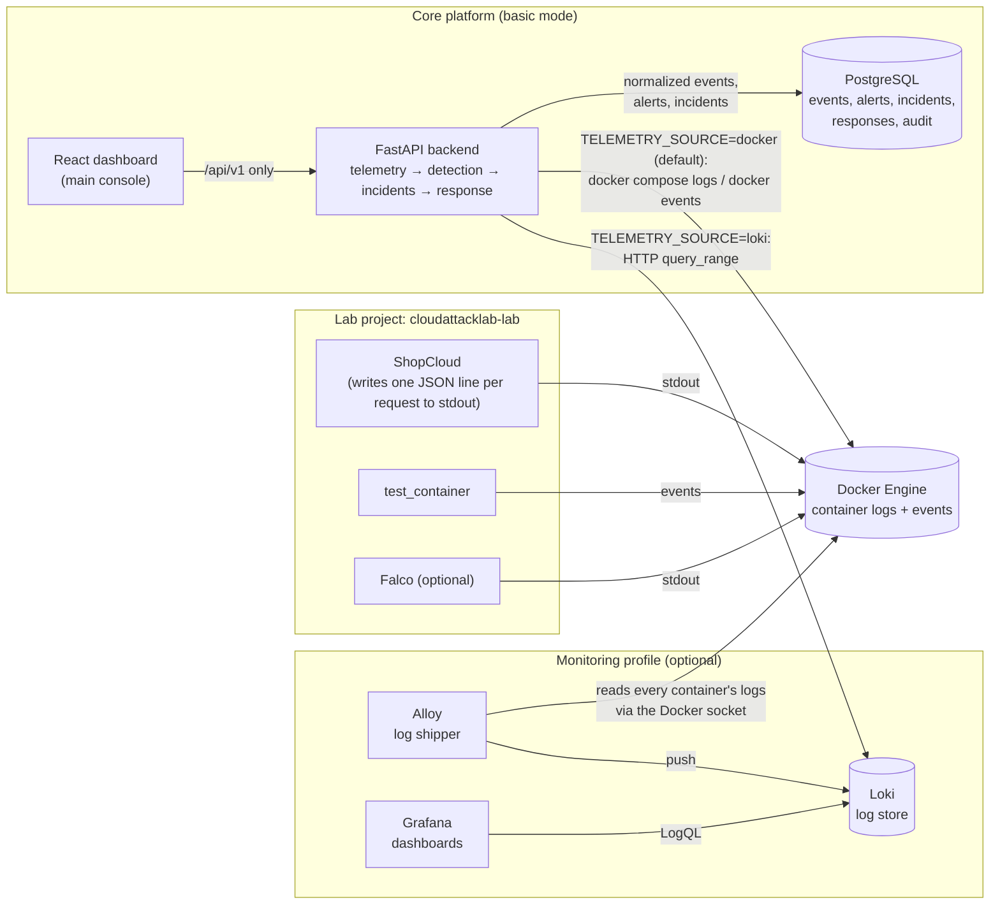
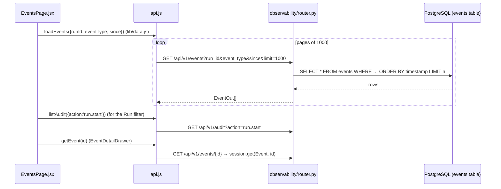
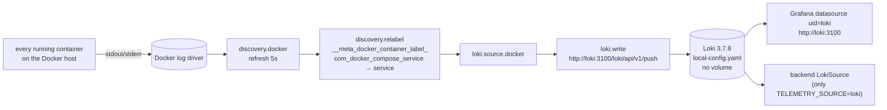

# Telemetry, logging, Loki and Grafana: architecture investigation

| | |
|---|---|
| Investigated | `main` at `d058a7a` (after PR #18 was merged), 19 November 2026 |
| Method | Read-only code and configuration tracing. No files other than this report were changed, no containers were started, and no scenario was run for this report. Runtime evidence is quoted from the existing evaluation records of 17 November 2026 (`evaluation/results/2026-11-17/`, `docs/evaluation-results.md`). |
| Status markers | ✅ **Implemented**: verified in code. 🟡 **Partial**: works, with a limitation stated. ⬜ **Not implemented / planned**. ❓ **Not verified**: could not be confirmed from code alone. |

---

## Contents

1. [Core application dependencies](#1-core-application-dependencies)
2. [Main console versus Loki logs](#2-main-console-versus-loki-logs)
3. [One attack scenario end to end](#3-one-attack-scenario-end-to-end-authentication_abuse)
4. [Responsibilities of each component](#4-responsibilities-of-each-component)
5. [Basic mode versus full monitoring mode](#5-basic-mode-versus-full-monitoring-mode)
6. [Preparing for the evaluation](#6-preparing-for-the-evaluation)
7. [Evidence index and accuracy notes](#7-evidence-index-and-accuracy-notes)
8. [Overall verdict](#8-overall-verdict)

---

## The big picture



In one sentence: **the backend is the security pipeline and PostgreSQL is its system of record. Loki and Grafana are an optional, parallel log-observability layer.** The backend can also use Loki as an alternative input, but only when `TELEMETRY_SOURCE=loki` is set.

---

## 1. Core application dependencies

### 1.1 What the Compose files say

| Evidence | What it shows |
|---|---|
| `docker-compose.yml`, `postgres`, `backend`, `frontend` | No `profiles:` key, so they always start. `backend.depends_on` lists only `postgres` (`condition: service_healthy`). `frontend.depends_on` lists only `backend`. |
| `docker-compose.yml`, `loki`, `alloy`, `grafana` | Each has `profiles: ["monitoring"]`, so they start only with `--profile monitoring` or `COMPOSE_PROFILES=monitoring`. |
| `docker-compose.yml`, comment above `loki` | "Not needed to run scenarios, detect or respond: with TELEMETRY_SOURCE=docker (the default) the backend reads ShopCloud's logs straight from Docker." |
| `docker-compose.yml`, backend `environment` | `TELEMETRY_SOURCE: ${TELEMETRY_SOURCE:-docker}`, `LOKI_URL: ${LOKI_URL:-http://127.0.0.1:3100}`. The default is `docker`. |
| `.env.example`, `# --- Telemetry` | `TELEMETRY_SOURCE=docker`, with the comment "loki (needs the monitoring profile). With loki there is no fallback: if Loki cannot be read, the run fails." |
| Local `.env` (only the key was read, not secrets) | `TELEMETRY_SOURCE=docker` |

Nothing in Compose makes a core service wait for or need Loki, Alloy or Grafana.

### 1.2 What the backend does at start-up and in its health check

| Evidence | What it shows |
|---|---|
| `backend/app/main.py`, `lifespan()` → `run_startup_checks()` | The only start-up work. |
| `backend/app/startup.py`, `run_startup_checks()` | Configures logging, checks lab target URLs (`check_lab_targets`) and warns about default credentials. **No Loki or Grafana call.** The docstring says these checks "only log; they never stop the backend". |
| `backend/app/main.py`, `GET /api/v1/health` | Runs `SELECT 1` against PostgreSQL only. |
| `backend/app/config.py`, `_telemetry_source()` | Only validates that `TELEMETRY_SOURCE` is `docker` or `loki`; it does not contact Loki. |

### 1.3 Every place the backend talks to Loki

A search for `loki` and `grafana` in `backend/app/` finds exactly these:

| Location | When it runs | Effect |
|---|---|---|
| `telemetry/factory.py`, `make_source()` / `make_service_source()` | Only if `settings.telemetry_source == "loki"` | Returns a `LokiSource` instead of `DockerLogSource`. |
| `telemetry/loki.py`, `LokiSource.collect()` / `check()` / `_query()` | Only when a `LokiSource` was created | `GET {LOKI_URL}/loki/api/v1/query_range` with `{service="<service>"}`. |
| `lab_manager/router.py`, `get_telemetry_status()` (part of `GET /api/v1/labs/{id}`) | Each time a lab's detail is read | If the source is not `loki`, it returns `source=docker` without contacting Loki. If it is `loki`, it calls `LokiSource.check()` with a 2 s timeout and reports `reachable: true/false`; it never fails the request. |
| `scenario_engine/service.py`, `_run_in_background()` | At the start of every run | Calls `feed.source.check()` on every feed. If one raises, the run fails before any traffic is sent, with "Telemetry source 'loki' is not available: …". |

**The backend contains no Grafana code at all.** Grafana does not appear in `backend/app/`.

### 1.4 The frontend

| Evidence | What it shows |
|---|---|
| `frontend/src/api.js` | "The one place the dashboard talks to the backend." Every call goes to `/api/v1/...`. None goes to Loki (`:3100`) or Grafana (`:3000`). |
| `frontend/nginx.conf` | Proxies only `/api/` to `127.0.0.1:8000`. |
| `frontend/src/lib/describe.js`, `telemetryState()`; `components/domain/HealthStatusPanel.jsx`; `pages/SettingsPage.jsx` | The only Loki-related UI. It shows the backend's `telemetry` field: "docker (the lab container's logs)", "Loki at … (reachable)" or "loki unreachable". |
| Search for `grafana` in `frontend/src` | No matches. The dashboard has no link to Grafana and does not embed it. |

### 1.5 Answers

| Question | Answer | Evidence |
|---|---|---|
| Is Loki required for the backend to **start**? | **No.** Whatever the setting, start-up and `/health` never contact Loki. | §1.2 |
| Is Grafana required for the backend or frontend to work? | **No.** No code in either references Grafana. | §1.3, §1.4 |
| Can basic mode operate without both? | **Yes, when `TELEMETRY_SOURCE=docker`, the default.** All three scenario types collect from Docker (`DockerLogSource`, `DockerEventSource`). Detection, incidents, responses, reports and the dashboard read only PostgreSQL. | §1.1, §2.1 |
| What stops if **Loki** is unavailable? | With `TELEMETRY_SOURCE=docker`: only Grafana's panels (no data) and log search in Loki. With `TELEMETRY_SOURCE=loki`: every application run and observation run fails before it starts. A container run also fails when `FALCO_ENABLED=true`, because the Falco feed is a `LokiSource` and `check()` runs for every feed, required or not. The lab detail shows "loki unreachable". | `service.py` `_run_in_background()`, `_telemetry_feeds()` |
| What stops if **Grafana** is unavailable? | Only the Grafana dashboard. Loki keeps receiving logs from Alloy, and the backend can still query Loki. | `monitoring/`; no Grafana references in the backend |
| Hidden dependencies that contradict basic/full mode? | **One configuration trap, no code dependency.** See below. | |

**Hidden dependency (configuration only):** `TELEMETRY_SOURCE=loki` in `.env` together with basic mode makes runs fail. The design is intentional and fail-closed: "never falls back to Docker" (`telemetry/loki.py` docstring). Nothing prevents or warns about this combination before a run: `scripts/setup.sh`, `scripts/start.sh` and `scripts/status.sh` do not read `TELEMETRY_SOURCE`. The warning appears only in the dashboard's "Telemetry source" tile and in the failed run's error message. This does not contradict the architecture: basic mode is defined with `TELEMETRY_SOURCE=docker`, and the README's mode table says so (`README.md`, "Basic and full monitoring mode").

---

## 2. Main console versus Loki logs

### 2.1 Events & Telemetry page: complete data flow



| Question | Answer | Evidence |
|---|---|---|
| Endpoints called | `GET /api/v1/events` (paged), `GET /api/v1/events/{id}`, `GET /api/v1/audit?action=run.start` | `pages/EventsPage.jsx` (`useApi(() => api.listAudit(...))`, `loadEvents(...)`); `lib/data.js` `loadEvents()`; `api.js` `listEvents`, `getEvent`, `listAudit` |
| Where the backend reads them from | **PostgreSQL only** (`select(Event)`) | `observability/router.py` `list_events()`, `get_event()`; `response_manager/router.py` `GET /audit` |
| Reads Docker directly? | **No**, not when the page loads. Docker is read earlier, during a run, by the ingestor. | |
| Queries Loki? | **No**, not when the page loads. | |
| Reads application log files? | **No.** Nothing in the backend reads log files; ShopCloud logs to stdout only. | `shopcloud/shop/main.py` `write_log()` |
| A combination of sources? | **At ingestion time, yes.** The `events` table holds rows from three sources: `application` (ShopCloud logs, via Docker **or** Loki), `docker` (container events) and `falco`. The page itself reads one table. | `telemetry/normalize.py`, `telemetry/container.py` |

So the main console shows **normalized security events that the backend stored during scenario runs**. The page subtitle says the same: "Normalized events collected from ShopCloud's logs, Docker and Falco."

### 2.2 How rows get into the `events` table

Ingestion happens only inside a run, in `scenario_engine/service.py`:

1. `_telemetry_feeds(scenario)` picks the sources:
   - **application** scenarios: `make_source()`, i.e. ShopCloud logs from Docker or Loki;
   - **container** scenarios: `DockerEventSource`, plus a Falco `make_service_source()` when `FALCO_ENABLED`;
   - **observation** scenarios: all of the above.
2. `_collect_loop()` calls `TelemetryIngestor.ingest()` every `TELEMETRY_COLLECT_INTERVAL_SECONDS` (2 s). After the script ends it ingests once more. For late-arriving sources it calls `ingest_until_settled()`, which polls Loki until the record count stops growing (`LOKI_SETTLE_*`, 2 s and 20 s).
3. `TelemetryIngestor.ingest()` (`telemetry/ingest.py`) filters each line:
   - lines that are not JSON are skipped and counted (`invalid_json`);
   - `lab_reset` and `rate_limit_changed` are skipped as **platform bookkeeping**;
   - `normalize()` returns `None` for records without `request_id`, `event` or a timestamp (`skipped`);
   - records outside the run window (`started_at` to `until` plus a 3 s grace) are skipped (`outside_window`);
   - a `request_id` that is already stored is skipped (`duplicates`), **whichever source it came from**.

   Each remaining record becomes an `Event` row. `raw` holds a copy of the original record (`models.py`: `raw … # copy of the original record, as evidence`). `raw_event_reference` is `docker:shopcloud:<request_id>` or `loki:shopcloud:<request_id>`.

How the two ShopCloud log sources read:
- **Docker:** `lab_manager/docker_adapter.py` `logs()` runs `docker compose -f lab/docker-compose.lab.yml logs --no-color --no-log-prefix --since <t> shopcloud`.
- **Loki:** `telemetry/loki.py` `LokiSource._query()` sends `GET /loki/api/v1/query_range?query={service="shopcloud"}&start&end&limit=5000&direction=forward`. It pages up to 20 times and strips Docker's trailing newline.

The normalization is the same for both: `normalize()` docstring: "The mapping itself is the same for both."

### 2.3 The Loki pipeline



| Question | Answer | Evidence |
|---|---|---|
| Which services generate logs? | Every container's stdout/stderr. For this project: **ShopCloud**, one JSON line per `/api/*`, `/lab/*` and `/` request (uvicorn access logs are off: `--no-access-log` in `shopcloud/Dockerfile`); **backend** (`LEVEL logger: message` lines, plus uvicorn's own output); **Falco** (JSON alerts, when enabled); postgres, frontend (nginx), loki, alloy and grafana. | `shopcloud/shop/main.py` `log_requests` middleware and `write_log()`; `backend/app/startup.py` `configure_logging()` |
| How are they collected? | Alloy discovers containers through the Docker socket every 5 s and tails their logs through the Docker API. | `monitoring/config.alloy`: `discovery.docker`, `loki.source.docker` |
| What does Alloy do? | It is only a **shipper**: discover, label, forward. It doesn't parse, filter or drop anything. | `monitoring/config.alloy` (4 blocks, no `loki.process`) |
| Labels and metadata | **One custom label: `service`** = the container's Compose service name (`shopcloud`, `backend`, `falco`, `postgres`, …). No project, container-name or level label is set in the config. Whether `loki.source.docker` adds labels of its own by default was not checked against Alloy's documentation ❓. The log line itself is kept unchanged, so ShopCloud's JSON fields (`event`, `status`, `username`, `request_id`, …) can be parsed at query time with `| json`. | `discovery.relabel` rule; dashboard queries use `| json` |
| How do logs reach Loki? | HTTP push to `http://loki:3100/loki/api/v1/push` on the Compose network. | `loki.write "local"` |
| Which logs are in Loki? | Container output while Alloy runs, **for every container on the Docker host, including other projects** (no filter on the Compose project). **Not** Docker events (`ingest.py`: "Docker events themselves never reach Loki"). **Not** alerts, incidents, responses or audit rows, which live only in PostgreSQL. | `config.alloy` has no `keep`/`drop` rule |
| Persistence | **None beyond the container.** "These services keep no volumes: their data lasts as long as the container." `docker compose stop` keeps it; `down` or recreating the container loses it. No retention period is configured. | `docker-compose.yml` comment above `loki` |
| Logs written while Alloy was not running | ❓ Not verified. Whether `loki.source.docker` back-fills older container logs when it starts depends on Alloy's behaviour, which the configuration doesn't set explicitly. | |

### 2.4 Same records, overlapping, or separate?

**Answer: 2, overlapping records from a common source.** They are not identical and not separate.

| | Main console (PostgreSQL `events`) | Loki |
|---|---|---|
| ShopCloud request lines | ✅ **Only those inside a run's window**, minus bookkeeping events, deduplicated by `request_id`, normalized into the event schema. The original record is kept in `raw`. | ✅ **All of them**, including traffic outside any run, bookkeeping events (`lab_reset`, `rate_limit_changed`) and 404/405 lines, exactly as written. |
| Docker container events (`exec_start`, `start`, `die`) | ✅ As `source: docker` events | ❌ Not the events. ✅ Only an indirect trace: the backend logs one `{"event": "container_exec", …}` line per stored exec event, which Alloy ships as a backend log (`ingest.py`, near the end of `ingest()`). |
| Falco alerts | ✅ Only those about the run's test container (`make_falco_normalizer`) | ✅ All Falco output, while Falco runs |
| Backend, postgres, nginx, Grafana, Loki and Alloy logs | ❌ | ✅ |
| Alerts, incidents, risk scores, responses, audit | ✅ Separate tables | ❌ |
| Other Docker projects on the same host | ❌ | ✅ (Alloy has no project filter) |

The shared material is ShopCloud's JSON request log. The same `request_id` can be found in both places:
- in PostgreSQL: `events.raw_event_reference = 'docker:shopcloud:<id>'`, plus `events.raw.request_id`;
- in Loki: `{service="shopcloud"} | json | request_id="<id>"`.

The main console holds the curated, run-scoped **security event** view. Loki holds the raw, unscoped **operational log** view.

---

## 3. One attack scenario end to end: `authentication_abuse`

```mermaid
sequenceDiagram
    autonumber
    participant UI as Dashboard
    participant BE as Backend (ScenarioService)
    participant SC as ShopCloud
    participant DK as Docker logs
    participant AL as Alloy
    participant LK as Loki
    participant DB as PostgreSQL
    participant GR as Grafana
    UI->>BE: POST /labs/{id}/runs {scenario_id: authentication_abuse}
    BE->>BE: pre-flight (http_health, test_account lab_user); feed.source.check()
    BE->>SC: script: 20 × POST /api/login (wrong password, 1 s apart)
    SC->>DK: 20 × {"event":"login_failed","status":401,"request_id":…}
    par every 2 s while running, then settle
        BE->>DK: docker compose logs --since (TELEMETRY_SOURCE=docker)
        Note over BE,LK: or GET /loki/api/v1/query_range (TELEMETRY_SOURCE=loki)
        BE->>DB: INSERT events (authentication_failure, source=application)
    and only with the monitoring profile
        AL->>DK: tail container logs
        AL->>LK: push {service="shopcloud"}
    end
    BE->>DB: DetectionEngine.run_for_run → Alert (repeated_failed_logins)
    BE->>DB: attach_alerts → Incident + risk score
    UI->>BE: GET /events, /alerts, /incidents (reads DB)
    GR->>LK: count_over_time({service="shopcloud"} | json | event="login_failed" [1m])
```

| # | Step | Status | Evidence |
|---|---|---|---|
| 1 | Scenario execution | ✅ | `scenarios/authentication_abuse.yaml`: `type: application`, `target: shopcloud`, `attempts: 20`, `interval_seconds: 1`, `timeout_seconds: 60`. `ScenarioService.start_run()` creates the `ScenarioRun` and the `run.start` audit row, then starts `_run_in_background()` on a thread. `runner.execute_script()` runs `scenarios/scripts/authentication_abuse.py <base_url> '<params>'`. |
| 2 | ShopCloud receives failed logins | ✅ | The script's `send_login()` sends `POST /api/login` with `WRONG_PASSWORD`. `shopcloud/shop/main.py` `login()` calls `note(request, "login_failed", …)` and returns 401. After the `temporary_rate_limit` response is applied, it answers 429 (`login_rate_limited`). |
| 3 | Log generation | ✅ | The `log_requests` middleware calls `write_log()` and writes one JSON object per line to stdout. Fields: `timestamp, service, level, event, request_id, source_ip, method, path, status, username, message`. Passwords are never logged ("Never passwords or tokens"). |
| 4 | Log collection | ✅ | **Platform path:** `DockerLogSource.collect()` → `DockerAdapter.logs()` (default), or `LokiSource.collect()` (`TELEMETRY_SOURCE=loki`). **Monitoring path, independent:** Alloy, then Loki. |
| 5 | Event ingestion | ✅ | `TelemetryIngestor.ingest()` + `normalize()`: `login_failed` becomes `authentication_failure`, severity `low`, `source=application`, `resource=shopcloud`, `correlation_key=run:<id>\|ip:<source_ip>`. The rows go into the `events` table. |
| 6 | Detection | ✅ (after the run) | `DetectionEngine.run_for_run()` → `_evaluate()`. Rule `rules/repeated_failed_logins.yaml`: `event_type: authentication_failure`, `group_by: source_ip`. The scenario overrides the thresholds to `threshold: 10`, `window_seconds: 60`. `_first_window_reaching()` finds the first 60 s window with ≥ 10 failures. Detection runs **once, after collection stops**, not as a stream (`docs/known-limitations.md`). |
| 7 | Alert and incident | ✅ | `_build_alert()` creates one alert per run and group. `incidents/service.py` `attach_alerts()` groups related alerts (same resource and the same IP or username) into an incident and computes the risk score (`incidents/risk.py`). The response `temporary_rate_limit` requires approval (`requires_approval: true`). |
| 8 | Display in the main console | ✅ | Events & Telemetry (`GET /events`), Detection & Alerts (`GET /alerts`, `/alerts/{id}` with contributing events), Incidents (`GET /incidents/{id}` with timeline), Reports (`GET /runs/{id}/report`). All read from PostgreSQL. |
| 9 | Logs available in Loki | ✅ **only with the monitoring profile** | Alloy ships ShopCloud's stdout as `{service="shopcloud"}`. With `TELEMETRY_SOURCE=docker`, the backend does not use them. The 17 Nov evaluation recorded `environment_loki.json` with `reachable: true`, and 5/5 `authentication_abuse` runs with 20 application events each in the Loki phase (`docs/evaluation-results.md`, detection table). |
| 10 | Grafana visualization | 🟡 | Provisioned dashboard `monitoring/grafana/dashboards/lab-activity.json`, panel "Failed logins per minute": `sum(count_over_time({service="shopcloud"} \| json \| event="login_failed" [1m]))`, plus the "Latest ShopCloud events" logs panel. **Partial because** it shows raw log counts only: no alerts, incidents or run boundaries, no template variables, no Grafana alert rules, and no link from or to the main console. |

What is **not** implemented in this flow:
- streaming or real-time detection (detection runs after the run);
- detection or alerting inside Grafana or Loki;
- correlation of Loki logs with incident IDs;
- AI-assisted analysis and attack-chain visualization (version 2, per `README.md` and `docs/known-limitations.md`).

---

## 4. Responsibilities of each component

| Component | Does | Consumes | Produces | Code |
|---|---|---|---|---|
| **Frontend** (React, nginx) | Operator console: labs, scenarios, runs, events, alerts, incidents, responses, reports, settings | `/api/v1/*` JSON only | HTTP requests to the backend; no data of its own | `frontend/src/api.js`, `pages/*`, `nginx.conf` |
| **FastAPI backend** | Orchestrates everything: Lab Manager, Scenario Engine, telemetry ingestion, detection, incidents, risk, response, reports, audit | Scenario YAML, rule YAML, Docker (CLI through the socket), ShopCloud HTTP, optionally Loki HTTP | Rows in PostgreSQL; REST API; its own log lines (incl. `container_exec` JSON) | `backend/app/main.py` and modules |
| **PostgreSQL** | System of record | SQL from the backend | `labs`, `scenario_runs`, `events`, `alerts`, `alert_events`, `incidents`, `response_actions`, `audit_log` | `backend/app/models.py`, `alembic/versions/` |
| **ShopCloud** | Deliberately simple target web app (the "victim") | HTTP from scenario scripts, the response manager and the browser | JSON request logs on stdout; HTTP answers (401/403/429 …) | `shopcloud/shop/main.py` |
| **Docker logs and events** | Raw telemetry carrier | Container stdout; container lifecycle | `docker compose logs` text (ShopCloud, Falco); `docker events` JSON (test container) | `lab_manager/docker_adapter.py` `logs()`, `container_events()` |
| **Alloy** | Log shipper | Every container's logs via `/var/run/docker.sock` (read-only) | Loki push requests, labelled `service` | `monitoring/config.alloy` |
| **Loki** | Log store and LogQL query engine | Pushes from Alloy | `query_range` answers to Grafana and, optionally, the backend | `docker-compose.yml` `loki` (stock `local-config.yaml`) |
| **Grafana** | Log visualization | Loki datasource `uid: loki` | One provisioned dashboard, "CloudAttackLab - Lab activity" (5 panels, 10 s refresh, last hour) | `monitoring/grafana/provisioning/*`, `dashboards/lab-activity.json` |
| **Detection engine** | Threshold rules over a run's stored events | `events` rows for the run; `rules/*.yaml`; the scenario's `detection` section | `alerts` + `alert_events`, then incidents via `attach_alerts()` | `backend/app/detection/engine.py`, `rules.py`, `checks.py` |

---

## 5. Basic mode versus full monitoring mode

| | Basic mode (default) | Full monitoring mode |
|---|---|---|
| Command | `docker compose up -d` / `scripts/start.sh` | `docker compose --profile monitoring up -d` / `scripts/start.sh --monitoring` |
| Platform services | `postgres`, `backend`, `frontend` | the same + `loki`, `alloy`, `grafana` |
| Lab services (started by the backend) | `shopcloud`, `test_container` (+ `falco` with `FALCO_ENABLED=true`) | the same |
| Required for core functionality | postgres, backend, frontend, the lab | the same; **plus Loki only if `TELEMETRY_SOURCE=loki`** |
| Optional | Falco | Falco, Loki, Alloy, Grafana |
| Telemetry source for the security pipeline | `docker` | `docker` (default) or `loki` |
| Scenarios, telemetry, detection, incidents, risk, responses, reports, audit, dashboard | ✅ | ✅ |
| Raw log search across all containers (LogQL) | ❌ | ✅ (Loki, Grafana Explore) |
| Time-series charts of failed logins, 403s, 429s and exec events per minute | ❌ | ✅ (Grafana dashboard) |
| Logs of traffic outside scenario runs (e.g. `tools/benign_traffic.py`, manual browsing) | ❌ not stored | ✅ in Loki |
| Logs of the platform's own containers | Only via `docker compose logs` | ✅ searchable in Loki |
| Extra memory (from `docs/evaluation-results.md`, resource table) | — | Grafana ~362–405 MiB, Loki ~90–95 MiB (peak), Alloy not listed there |
| Extra run time | — | With `TELEMETRY_SOURCE=loki` only: about 4 s more per run (settle wait) |

**Features unavailable when monitoring is disabled:** the Grafana dashboard, LogQL search and raw-log retention for traffic outside runs. **No security-pipeline feature is lost.**

---

## 6. Preparing for the evaluation

### A. Simple explanation

> CloudAttackLab has two separate jobs.
>
> **Job 1, the security pipeline (always on).** We attack our own small web shop, ShopCloud, in a sandbox. The shop writes a log line for every request. During an attack run, the backend reads those lines from Docker, turns them into standard "events", saves them in PostgreSQL, runs detection rules, and raises alerts and incidents that you see in our dashboard.
>
> **Job 2, observability (optional).** If you turn on monitoring, Alloy copies every container's logs into Loki, a log database, and Grafana draws charts from them. This is how real operations teams watch raw logs. It isn't needed for detection; it gives a second, independent view of the same raw activity.
>
> Our dashboard shows **conclusions** (events, alerts, incidents). Grafana shows the **raw signal** (log lines over time).

### B. Detailed technical explanation for the guide

1. **Two Compose projects.** `cloudattacklab` holds the platform plus an optional `monitoring` profile. `cloudattacklab-lab` holds the target, which the backend starts and stops through the Docker socket.
2. **Pluggable telemetry source.** `TelemetrySource` is a `Protocol` with `collect(since)` and `check()`, and two implementations: `DockerLogSource` (`docker compose logs --since`) and `LokiSource` (`/loki/api/v1/query_range`, paged, `late_arriving = True`). `TELEMETRY_SOURCE` selects one in `telemetry/factory.py`. There is deliberately **no fallback**: if Loki is chosen and cannot be read, the run fails rather than silently switching evidence source.
3. **Ingestion is run-scoped and idempotent.** A collector thread reads every 2 s during the run, then settles. Records are filtered to the run window (+3 s grace), platform bookkeeping is excluded, and duplicates are dropped by `request_id` across sources. Every event keeps its original record (`raw`) and a reference (`<source>:shopcloud:<request_id>`). A stored event can therefore be traced back to the exact log line, in Docker or in Loki.
4. **Normalization** maps ShopCloud's `event` names to a shared `EventType` schema (`contracts/event.schema.json`), so detection doesn't depend on where a line was read.
5. **Detection** is a post-run sliding window over stored events: `group_by` fields, a threshold and a window, from rule YAML and overridden per scenario. Alerts are correlated into incidents (same resource, and the same IP or username) with an explainable risk score. Responses need approval, are verified, and are reverted by cleanup.
6. **Monitoring.** Alloy uses `discovery.docker`, relabels the Compose service name to `service`, and pushes with `loki.source.docker`. Loki stores the lines unparsed. Grafana parses them at query time (`| json`) for per-minute counts. The backend also logs one `container_exec` JSON line per stored Docker exec event, so Grafana can chart that too; Docker events themselves never reach Loki.
7. **Evaluation evidence.** 5/5 runs per scenario succeeded with `TELEMETRY_SOURCE=loki`, with the same event counts as Docker (20 application events for `authentication_abuse`). The settle wait added about 4 s per run (`docs/evaluation-results.md`).

### C. One- to two-minute answer: why Loki and Grafana when we already have a dashboard?

> Our dashboard and Grafana answer different questions.
>
> The CloudAttackLab dashboard is a **security console**. It shows only what the detection pipeline decided matters: normalized events from a scenario run, the alerts our rules raised, the incident they were grouped into, its risk score, and the response we approved. That data lives in PostgreSQL, and every event points back to its raw log line.
>
> Loki and Grafana are the **observability layer**, the way a real SOC or SRE team keeps raw logs. Alloy ships every container's logs, not just ShopCloud's and not just during attacks, into Loki. Grafana shows them over time. That gives us three things the console can't. First, we can look at traffic **outside** scenario runs, for example normal user traffic, which the console never stores. Second, we can independently check the pipeline: if the console says 20 failed logins raised an alert, the Grafana chart should show the same spike of 20 `login_failed` lines in that minute. Third, the backend can read its telemetry **from Loki instead of Docker**. We tested that: 5 out of 5 runs of every scenario were detected the same way, which shows our telemetry layer is decoupled from its source.
>
> We kept it **optional**, as a Compose profile, because detection doesn't depend on it. The core platform runs in about 190 MiB, and monitoring adds roughly half a gigabyte. So someone with a small laptop can still run every attack scenario, and turning monitoring on adds visibility, not functionality the platform depends on.

### D. Possible viva questions

1. **Does the platform work without Loki?**
   Yes. With the default `TELEMETRY_SOURCE=docker`, the backend reads ShopCloud's logs with `docker compose logs` (`DockerLogSource`). Neither start-up nor `/health` touches Loki (`startup.py`, `main.py`).

2. **Then why is there a `LokiSource` in the backend?**
   The telemetry source is pluggable (`telemetry/source.py` Protocol, `factory.py`). With `TELEMETRY_SOURCE=loki`, the same ingestion and detection code reads from Loki's `query_range` API. It's the path a real deployment would use, where the backend can't read container logs directly.

3. **What happens if `TELEMETRY_SOURCE=loki` and Loki is down?**
   The run fails before any attack traffic is sent: `_run_in_background()` calls `feed.source.check()`, and the error is "Telemetry source 'loki' is not available". There is no fallback to Docker, by design, so the evidence source is never ambiguous.

4. **Are the logs in your dashboard the same as in Loki?**
   They overlap but aren't the same. Both come from ShopCloud's JSON request logs. The dashboard stores only the run-window records, normalized, deduplicated and without bookkeeping, with the original in `raw`. Loki has every line from every container, unscoped and unnormalized. Alerts and incidents exist only in PostgreSQL.

5. **How do you avoid storing the same log line twice?**
   With deduplication by `request_id`, a UUID that ShopCloud generates for each request. `TelemetryIngestor` loads the request IDs already stored for the run or time window and skips repeats, even across sources (`docker:` vs `loki:` prefixes).

6. **Why does a Loki run take about 4 s longer?**
   Log shipping is asynchronous (container, Alloy, Loki). `LokiSource.late_arriving = True`, so after the script ends `ingest_until_settled()` polls every 2 s until the record count is unchanged twice, for at most 20 s (`LOKI_SETTLE_*`).

7. **What does Alloy do exactly?**
   Three steps: `discovery.docker` (every 5 s), `discovery.relabel` (Compose service label → `service`), and `loki.source.docker` → `loki.write` to `http://loki:3100/loki/api/v1/push`. It does no parsing or filtering.

8. **How does Grafana know a log line is a failed login?**
   It parses the JSON at query time: `{service="shopcloud"} | json | event="login_failed"`, wrapped in `count_over_time(...[1m])`. Loki doesn't index the JSON fields; only the `service` label is indexed.

9. **Does Grafana raise alerts?**
   No. No Grafana alert rules are provisioned. All alerting is in the backend's detection engine (`detection/engine.py`) and is stored in PostgreSQL.

10. **Do Docker events (`docker exec`) go to Loki?**
    No. Alloy ships container **logs**, not daemon events. The backend reads events with `docker events` (`DockerAdapter.container_events()`). For visibility, it writes one `{"event": "container_exec"}` line to its own log per stored exec event. That line does reach Loki, and Grafana's "Container exec events per minute" panel counts it.

11. **Is Loki data persistent?**
    No. The `loki` service has no volume: logs survive `stop` but not `down` or recreation. PostgreSQL (`pgdata`) is the durable store; Loki is a convenience view.

12. **Why does the backend reach Loki at `127.0.0.1:3100` but Grafana uses `http://loki:3100`?**
    The backend uses `network_mode: host`, so it sees Loki's published port on the host. Grafana and Alloy are on the Compose network and resolve the service name `loki`.

13. **How is detection done for `authentication_abuse`?**
    Rule `repeated_failed_logins`: `authentication_failure` events grouped by `source_ip`, with a threshold of 10 within 60 s (from the scenario's `detection` section). `_first_window_reaching()` is a two-pointer sliding window over the run's events, sorted by time.

14. **Is detection real-time?**
    No. It runs once, after the run's telemetry has been collected and settled (`_run_in_background()` → `run_for_run`). Streaming detection isn't implemented (`docs/known-limitations.md`).

### E. Does the implementation justify including Loki and Grafana?

**Yes, as an optional observability layer, with honest limits.** It is justified because:
- it's a real integration, not decoration: the backend can use Loki as its telemetry source, and this was measured (5/5 per scenario, same event counts and detection);
- it provides views the console can't: traffic outside runs, other containers' logs, and per-minute charts;
- it adds no hard dependency: basic mode works and the cost is opt-in;
- the source abstraction (`TelemetrySource`) shows the design would move to a centralized log store without touching detection.

It is limited because:
- Grafana is a single five-panel dashboard with no alerting, no run or incident correlation, and no link to the main console;
- Loki has no persistence or retention configuration;
- the default configuration doesn't use Loki for the security pipeline, so in a default "full mode" Loki is only read by Grafana.

Present it as "optional centralized logging and visualization, with a tested alternative ingestion path". Don't present it as "our SIEM" or "real-time monitoring".

### F. Inconsistencies, incomplete integrations and misleading text found

| # | Finding | Severity | Evidence |
|---|---|---|---|
| F1 | **Alloy ships every container on the Docker host, not only CloudAttackLab's**, and labels only by Compose service name. Another project with a service named `shopcloud` or `backend` would mix into the same Loki stream. With `TELEMETRY_SOURCE=loki` the backend would then read the mixed stream (the run window and `request_id` dedup limit the effect but don't prevent it), and Grafana's `{service="backend"}` panel would count foreign lines. | Medium (shared hosts) | `monitoring/config.alloy` has no project filter or project label; this host also has `smartlock-lab1` and `labshock` projects |
| F2 | **No warning for `TELEMETRY_SOURCE=loki` in basic mode.** Scripts don't check it; the problem shows only in the UI tile and as a failed run. | Low | `scripts/*.sh` don't read `TELEMETRY_SOURCE` |
| F3 | **With `TELEMETRY_SOURCE=loki` and `FALCO_ENABLED=true`, the container scenario also needs Loki**, even though the Falco feed is `required=False`, because `check()` runs on every feed before the run. The docs describe Falco as "extra evidence" but don't mention this. | Low | `scenario_engine/service.py` `_run_in_background()` check loop; `_telemetry_feeds()` |
| F4 | **Stale docstring:** `telemetry/__init__.py` says Docker logs "can be swapped for Loki later", but `LokiSource` is already implemented and evaluated. | Low (wording) | `backend/app/telemetry/__init__.py` |
| F5 | **Loki has no persistence and no retention.** Documented in a Compose comment only, not in the user-facing monitoring section of the README. | Low | `docker-compose.yml` comment above `loki` |
| F6 | **The Grafana "403 denials per minute" panel counts every ShopCloud 403**, including `/lab/*` requests with a bad lab-control token, not only `/api/orders` denials. The backend rule `repeated_access_denied` also matches `raw.status: 403` but groups by `username` and `raw.path`. Mostly equivalent in practice; worth knowing if asked. | Info | `lab-activity.json`; `shopcloud/shop/main.py` `lab_denied()`; `rules/repeated_access_denied.yaml` |
| F7 | **The "Container exec events" panel shows only exec events the backend stored during runs.** It counts backend log lines, not Docker events. An exec outside a run, or with monitoring off, is not shown. The panel description says so. | Info | `ingest.py` `log.info(json.dumps(event))`; panel description |
| F8 | **The dashboard and Grafana are not linked.** There's no Grafana URL or embed in the frontend, and Grafana needs its own login. | Info / UX | Search for `grafana` in `frontend/src`: no matches |
| F9 | **README feature row** "Monitoring and reporting … an optional Loki, Alloy and Grafana stack with a provisioned dashboard" is accurate. The README mode table correctly says telemetry comes from Docker in basic mode and from Docker or Loki in full mode. No misleading claim found there. | — | `README.md` |
| F10 | `docs/evaluation-results.md` lists containers as `monitoring-grafana` and `monitoring-loki`: the **old** project layout (before PR #18). It's historically correct, but the names no longer match the current containers (`cloudattacklab-grafana-1`). | Info | `docs/evaluation-results.md`, resource table |

---

## 7. Evidence index and accuracy notes

| Claim | File | Symbol |
|---|---|---|
| The telemetry source is selectable, default `docker` | `backend/app/config.py` | `Settings.telemetry_source`, `_telemetry_source()`, `TELEMETRY_SOURCES` |
| Source factory | `backend/app/telemetry/factory.py` | `make_source()`, `make_service_source()` |
| Docker log source | `backend/app/telemetry/source.py`; `lab_manager/docker_adapter.py` | `DockerLogSource`; `DockerAdapter.logs()` |
| Loki source, no fallback | `backend/app/telemetry/loki.py` | `LokiSource`, `QUERY_RANGE`, `parse_query_range()` |
| Docker events source | `backend/app/telemetry/container.py`; `docker_adapter.py` | `DockerEventSource`, `make_docker_event_normalizer()`; `container_events()` |
| Falco normalization | `backend/app/telemetry/container.py` | `make_falco_normalizer()` |
| Ingestion filters and dedup | `backend/app/telemetry/ingest.py` | `TelemetryIngestor.ingest()`, `PLATFORM_BOOKKEEPING`, `ingest_until_settled()` |
| Normalization mapping | `backend/app/telemetry/normalize.py` | `EVENT_TYPE_MAP`, `normalize()` |
| Run orchestration and fail-closed check | `backend/app/scenario_engine/service.py` | `_run_in_background()`, `_telemetry_feeds()`, `_collect_loop()`, `Feed` |
| Detection | `backend/app/detection/engine.py` | `DetectionEngine.run_for_run()`, `_evaluate()`, `_first_window_reaching()` |
| Incidents | `backend/app/incidents/service.py` | `attach_alerts()`, `related()` |
| Events API (PostgreSQL only) | `backend/app/observability/router.py` | `GET /events`, `GET /events/{id}`, `GET /alerts`, `GET /alerts/{id}` |
| Telemetry status in lab detail | `backend/app/lab_manager/router.py` | `get_telemetry_status()`, `GET /labs/{id}` |
| Health (DB only) and start-up (no Loki) | `backend/app/main.py`; `startup.py` | `health()`, `lifespan()`; `run_startup_checks()` |
| Backend log format | `backend/app/startup.py` | `configure_logging()` |
| ShopCloud log format | `shopcloud/shop/main.py`; `shopcloud/Dockerfile` | `write_log()`, `log_requests()`; `--no-access-log` |
| Scenario and rule | `scenarios/authentication_abuse.yaml`, `scenarios/scripts/authentication_abuse.py`, `rules/repeated_failed_logins.yaml` | |
| Compose modes | `docker-compose.yml` | `profiles: ["monitoring"]`, `depends_on`, backend `environment` |
| Alloy pipeline | `monitoring/config.alloy` | `discovery.docker`, `discovery.relabel`, `loki.source.docker`, `loki.write` |
| Grafana | `monitoring/grafana/provisioning/datasources/loki.yml`, `.../dashboards/dashboards.yml`, `monitoring/grafana/dashboards/lab-activity.json` | datasource `uid: loki`; 5 panels |
| Frontend API surface | `frontend/src/api.js`, `lib/data.js`, `pages/EventsPage.jsx`, `lib/describe.js`, `nginx.conf` | `listEvents`, `getEvent`, `listAudit`, `loadEvents()`, `telemetryState()` |
| Loki runtime evidence | `evaluation/results/2026-11-17/environment_loki.json`, `docs/evaluation-results.md` | phase 4 (`loki`) |

**What this investigation did not verify:**
- No live run was made for this report, to avoid adding rows to the database. Runtime behaviour is taken from code plus the 17 Nov evaluation records.
- Default labels added by `loki.source.docker` beyond `service`, and whether Alloy back-fills logs written before it started ❓ depend on Alloy's documented defaults, which weren't checked here.
- Loki's stock `local-config.yaml` (storage path, limits) is inside the image and wasn't inspected. The `PAGE_LIMIT = 5000` in `loki.py` assumes Loki's default `max_entries_limit_per_query`.

---

## 8. Overall verdict

| Question | Verdict |
|---|---|
| Does basic mode genuinely work without Loki and Grafana? | **Yes**, with `TELEMETRY_SOURCE=docker` (the default and the documented basic-mode setting). No start-up, health, API or frontend dependency on either exists in the code. |
| Are the main console's logs the same as Loki's? | **No: they overlap.** Both originate from ShopCloud's JSON request logs (the same `request_id`). The console stores a run-scoped, normalized, deduplicated subset as security events in PostgreSQL. Loki stores every raw line from every container. Alerts and incidents exist only in the console. |
| What exactly does Grafana add? | One provisioned dashboard over Loki: per-minute counts of failed logins, 403s, 429s and backend-recorded container execs, plus a live ShopCloud log panel, and ad-hoc LogQL through Explore. No alerting and no link to incidents. |
| Is the architecture technically justified? | **Yes, as optional observability plus an alternative, tested ingestion path.** The security pipeline is self-contained. Loki and Grafana add raw-log visibility and demonstrate a decoupled telemetry source, at an opt-in cost. |
| What to say confidently | "Detection, incidents and response run entirely in our backend over PostgreSQL. Loki and Grafana are an optional observability layer: they store and chart the raw logs of every container. Our backend can also read its telemetry from Loki instead of Docker, which we tested with the same detection results. The two views overlap on ShopCloud's request logs, but the console holds curated security events and Grafana shows the raw signal." |
