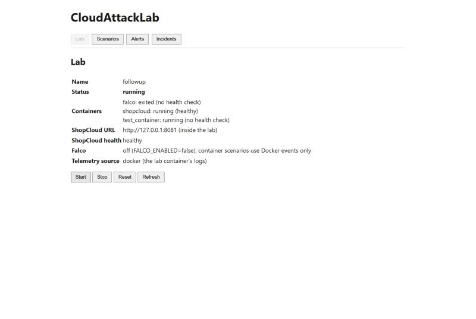
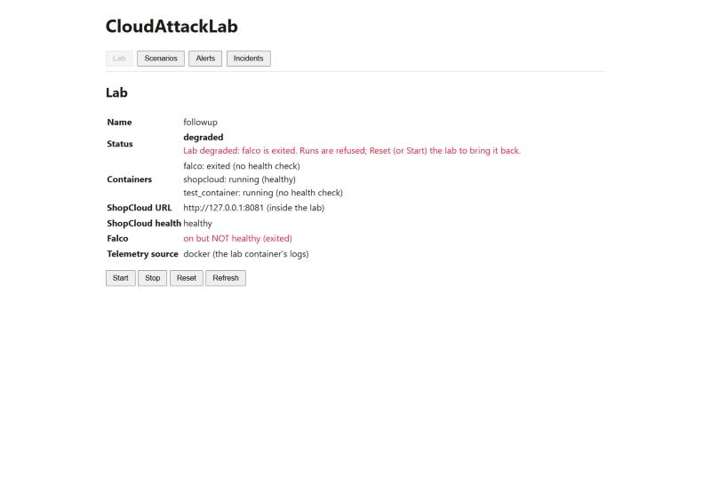
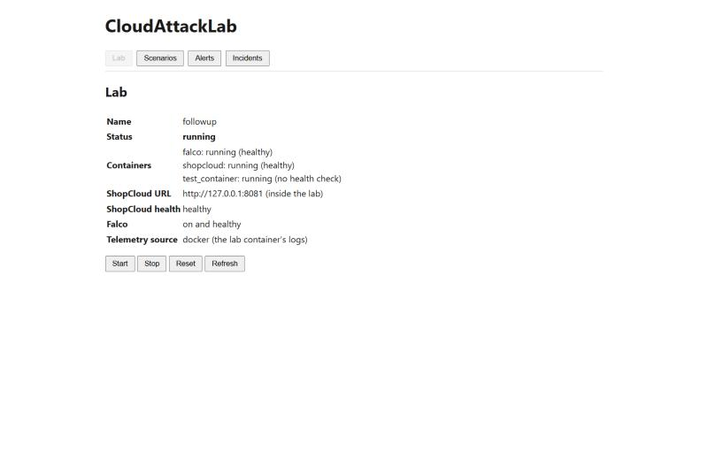

# Installing CloudAttackLab

This guide takes you from an empty machine to a running CloudAttackLab: the platform (database, backend, dashboard), the lab (ShopCloud and a test container), the monitoring stack (Loki, Alloy, Grafana) and, if your machine supports it, Falco.

**The short version.** After installing Docker in WSL (§2):

```bash
git clone https://github.com/SaiyamKamate/CloudAttackLabs.git
cd CloudAttackLabs
scripts/setup.sh            # add --monitoring for Loki, Alloy and Grafana
```

then open <http://127.0.0.1:5173>. `scripts/setup.sh` does §4 to §7 below for you; the rest of this guide explains each of those steps and how to do them by hand.

**How this guide was checked.** Every command in a grey box was run on the test machine described below on 17 November 2026, unless it is marked **Not run on the test machine**. Output shown is real output from that run, trimmed. On 18 November 2026 the project moved from a `cloudattacklab/` subfolder to the repository root, the monitoring stack became a Compose profile, and the `scripts/` were added. The commands changed by that update were run on the same machine that day, in two ways:

- **On the existing installation** (with its database): `scripts/setup.sh`, `scripts/start.sh --monitoring`, `scripts/status.sh`, `scripts/stop.sh`.
- **On a fresh clone**, to check the steps a new user follows: the branch was cloned into the Ubuntu home folder (no `.env`, no `node_modules`), and only the two Compose project names were changed (`cloudattacklab` to `calfresh`, `cloudattacklab-lab` to `calfresh-lab`) so that it could not touch the existing installation. In that clone `scripts/setup.sh` created `.env` with random passwords, built and started everything, created and started a lab; a scenario ran to an alert and an incident; `scripts/start.sh --monitoring` brought up Loki, Alloy and Grafana (login with the generated password worked); `scripts/stop.sh`, `scripts/start.sh --lab` and a second `scripts/setup.sh` (which left `.env` unchanged) worked; and `scripts/reset.sh` refused without a terminal, cancelled on "no", and on "delete" removed that project's containers, networks, volume and images. The existing installation's volumes, images and containers were compared before and after and had not changed.

What that fresh-clone check did **not** cover: installing WSL and Docker (§2; Docker was already installed); a machine that has never downloaded the base images (Docker's local cache was reused, so the first build was faster than on a new machine); cloning from GitHub (the branch was cloned from the local repository); and the real project names on an empty machine.

## 1. Requirements

### What the project guide recommends

| Resource | Recommendation (project guide, section 10) |
|---|---|
| CPU | A modern Intel Core i5 / AMD Ryzen 5 class processor or better |
| RAM | 16 GB recommended for development and a modest local lab |
| Disk | At least 30–50 GB free for images, dependencies, the database and logs; more as images and logs grow |
| Operating system | Linux, macOS, or Windows 11 with WSL 2, with Docker Desktop or Docker Engine |
| Network | Internet for the first downloads only. Scenarios only ever talk to the local lab |

### Supported setup for version 1.0

| | Supported (tested) | Not tested |
|---|---|---|
| Host OS | Windows 11 | Windows 10 with WSL 2 (expected to behave the same), macOS |
| Linux | Ubuntu inside WSL 2 | Other distributions, native Linux |
| Docker | Docker Engine and the Docker Compose v2 plugin, installed **inside** Ubuntu | Docker Desktop (needs host networking turned on), Podman |
| Shell | bash inside Ubuntu | PowerShell, Git Bash, cmd (the scripts refuse to run there) |
| Tools for the scripts | `curl` and `python3` inside Ubuntu (both come with it) | |

### What was actually tested

Only one setup has been tested: **Windows 11 with Docker Engine inside WSL 2**. Linux, macOS and Docker Desktop have not been tried. The platform should work on a native Linux Docker Engine for the same reasons it works in WSL 2, but nobody has checked. On macOS and on Docker Desktop, the backend and dashboard use host networking (`network_mode: host`), which Docker Desktop only supports when you turn it on, so expect to do some work there.

| Item | The test machine |
|---|---|
| Host | Windows 11 Home (10.0.26200), one laptop |
| Docker host | WSL 2, Ubuntu 26.04 LTS, kernel 6.18.33.2-microsoft-standard-WSL2 (has BTF, so Falco works) |
| Docker | Docker Engine 29.7.1 and Docker Compose 5.3.1, installed inside Ubuntu (no Docker Desktop) |
| CPU | Intel Core i7-12650H, 16 logical CPUs visible to WSL |
| RAM | 7,792 MiB visible to the WSL VM |
| Disk | 893 GB free on the WSL disk |
| Python | 3.14.4 inside WSL (only needed for the tools and tests, not to run the platform) |

How much the running platform used on that machine (from [the evaluation](evaluation-results.md#resource-consumption)): about 190 MiB of memory for the platform and lab alone, and about 810 MiB with the monitoring stack and Falco, half of it Grafana. Each container also has a memory limit in its compose file.

### Ports

Everything listens on `127.0.0.1` only, so nothing is reachable from other machines. These ports must be free:

| Port | Service |
|---|---|
| 5173 | Dashboard |
| 8000 | Backend API |
| 5432 | PostgreSQL |
| 8081 | ShopCloud (the lab target) |
| 3000 | Grafana |
| 3100 | Loki |
| 12345 | Alloy's status page |

## 2. Install Docker

**Not run on the test machine** (Docker was already installed). These are the steps for the setup that was tested.

1. In an administrator PowerShell on Windows 11, install WSL 2 with Ubuntu, then restart when asked:

   ```powershell
   wsl --install -d Ubuntu
   ```

2. Open Ubuntu and install Docker Engine and the Compose plugin by following Docker's guide for Ubuntu: <https://docs.docker.com/engine/install/ubuntu/>.
3. Let your user run Docker without `sudo`, then close and reopen the Ubuntu window:

   ```bash
   sudo usermod -aG docker $USER
   ```

Check that it works (this one was run):

```bash
docker --version
docker compose version
```

```
Docker version 29.7.1, build e9452d6
Docker Compose version v5.3.1
```

Run every command in the rest of this guide **inside Ubuntu (WSL)**, not in PowerShell. The `docker` command only exists there.

## 3. Get the code

```bash
git clone https://github.com/SaiyamKamate/CloudAttackLabs.git
cd CloudAttackLabs
```

Every command below is run from this folder, the repository root. (Before 18 November 2026 the project was in a `cloudattacklab/` subfolder; see [upgrading](#upgrading-from-the-old-layout) if you have such a checkout.)

If you keep the code on the Windows drive (for example `D:\Projects\...`), reach it from Ubuntu as `/mnt/d/Projects/...`. That works; see [troubleshooting](troubleshooting.md#vite-does-not-notice-saved-files-on-a-windows-drive) for the one thing it changes.

## 4. Create `.env`

**With the script.** `scripts/setup.sh` creates `.env` from `.env.example` when there is none, and fills `POSTGRES_PASSWORD`, `LAB_CONTROL_TOKEN` and `GF_SECURITY_ADMIN_PASSWORD` with random values. An existing `.env` is never changed; the script only lists the settings it does not set (they then use their defaults). If a database volume already exists, it leaves `POSTGRES_PASSWORD` at the published default, because the database keeps the password it was created with. Then it carries on with §5 to §7: it builds and starts the platform, waits until the backend, database and dashboard answer, and creates and starts a lab named `default` (skip that with `--no-lab`). It stops at the first failure, says which step failed and what to try; running it again is always safe.

**By hand.** All settings live in one file, `.env`, which git ignores. Create it from the example, **without overwriting one you already have**:

```bash
[ -f .env ] || cp .env.example .env
```

This copies `.env.example` to `.env` only when there is no `.env` yet. Running it a second time changes nothing (tested: a line added to `.env` was still there after a second run).

Then open `.env` and change at least these values:

| Setting | Why |
|---|---|
| `POSTGRES_PASSWORD` | Change it **before the first start**: the database keeps the password it was created with. To change it later you must delete the database volume (see [uninstall](#uninstall-completely)) |
| `LAB_CONTROL_TOKEN` | The shared secret between the backend and ShopCloud's `/lab/*` endpoints |
| `GF_SECURITY_ADMIN_PASSWORD` | Grafana's admin password. Required: the monitoring stack refuses to start without it |

The defaults (`change-me-locally`, `change-me-lab-token`, `lab-dev-token`) are published in this repository. They are acceptable only because every port is bound to `127.0.0.1`. While a default is in use, the backend logs a warning at startup (see step 6).

If you already have a `.env`, keep it and copy over only the settings you are missing from `.env.example`. A setting missing from `.env` falls back to the default in `docker-compose.yml`.

## 5. Start the platform

```bash
docker compose up -d --build
```

This is **basic mode**: it builds and starts three containers, `postgres`, `backend` and `frontend`. That is all the platform needs to run scenarios, collect telemetry, detect, correlate and respond; the monitoring stack is optional (§9). The first run downloads and builds images, which takes a few minutes; later runs take about 20 seconds. The end of the output:

```
 Container cloudattacklab-postgres-1 Healthy
 Container cloudattacklab-backend-1 Healthy
 Container cloudattacklab-frontend-1 Started
```

Later starts do not need `--build` unless the code changed (after `git pull`): `scripts/start.sh` starts without rebuilding and waits until everything answers; `scripts/start.sh --build` rebuilds first.

Check that all three are up (or run `scripts/status.sh`, which also checks the health endpoints and the lab):

```bash
docker compose ps --format '{{.Name}}\t{{.Status}}'
```

```
cloudattacklab-backend-1	Up 6 seconds (healthy)
cloudattacklab-frontend-1	Up Less than a second (health: starting)
cloudattacklab-postgres-1	Up 12 seconds (healthy)
```

## 6. Check the backend

```bash
curl -s http://127.0.0.1:8000/api/v1/health
```

```
{"status":"ok","database":"ok"}
```

Look at the backend's startup log for warnings:

```bash
docker compose logs backend | grep -i warning
```

With the default credentials you see:

```
WARNING cloudattacklab.startup: Default credential in use: LAB_CONTROL_TOKEN is the published default 'lab-dev-token'. ...
WARNING cloudattacklab.startup: Default credential in use: The database password is the published default 'change-me-locally'. ...
```

These warnings are expected on a lab machine; they go away once you set your own values in `.env` (and, for the database password, recreate the database).

## 7. Open the dashboard

Open <http://127.0.0.1:5173> in a browser on the same machine. On Windows the normal Windows browser works: WSL 2 forwards `127.0.0.1` ports to Windows (checked: the health endpoint and the dashboard both answered from Windows).

On a new installation the Lab page says "No lab yet." Click **Create lab**, then **Start**. The first start builds the ShopCloud image, so it takes longer than the later ones (about 9 seconds each on the test machine once the images are built). When it is ready the Lab page shows:



The [user guide](user-guide.md) walks through everything else on the dashboard.

## 8. Check ShopCloud

With the lab running, check that ShopCloud answers the way the platform expects. This needs only Python 3 (no extra packages):

```bash
python3 tools/check_shopcloud.py http://127.0.0.1:8081
```

```
...
PASS  reset restores the baseline (limit off)
PASS  reset clears old tokens (401)

14/14 checks passed
```

The script reads `LAB_CONTROL_TOKEN` the way Docker Compose does: from your shell, else from `.env`, else the default `lab-dev-token`. It resets ShopCloud's state at the end, so do not run it during a scenario run.

## 9. Start the monitoring stack (optional)

The monitoring stack is Loki (stores logs), Alloy (ships every container's logs to Loki) and Grafana (shows them). The platform works without it.

The three services are the `monitoring` profile of `docker-compose.yml` (**full monitoring mode**):

```bash
docker compose --profile monitoring up -d
```

or `scripts/start.sh --monitoring`, which also waits until Loki and Grafana answer. To make every `docker compose` command include the profile, set `COMPOSE_PROFILES=monitoring` in `.env`; the scripts honour it too.

Grafana needs `GF_SECURITY_ADMIN_PASSWORD` in `.env` (`scripts/setup.sh` puts a random one there). Without it Grafana exits at start and `docker compose logs grafana` says why. Basic mode never needs it.

Loki takes about 20 seconds to become ready. Until then it answers "not ready", which is normal:

```bash
curl -s http://127.0.0.1:3100/ready
```

```
Ingester not ready: waiting for 15s after being ready
...
ready
```

Check Grafana:

```bash
curl -s http://127.0.0.1:3000/api/health
```

```
{
  "database": "ok",
  "version": "13.2.2",
  ...
}
```

Then open <http://127.0.0.1:3000> and sign in as `admin` with the `GF_SECURITY_ADMIN_PASSWORD` from your `.env`. Grafana opens the provisioned dashboard **CloudAttackLab - Lab activity**: failed logins, 403 denials and 429 rate-limit hits per minute, container exec events per minute, and the latest ShopCloud log lines. The panels fill once you run scenarios.

**Partly checked.** The Grafana sign-in page was not used in this check (it needs your password). Instead, each panel's query was run directly against Loki after the scenarios in the [user guide](user-guide.md), and each returned data (25 failed logins, 9 denials with status 403, 3 rate-limit hits, 1 container exec). The November 2026 audit checked the panels in Grafana itself.

To make the backend read ShopCloud's logs from Loki instead of from Docker, set `TELEMETRY_SOURCE=loki` in `.env` and recreate the backend with `docker compose up -d backend`. With `TELEMETRY_SOURCE=loki` and Loki down, runs fail with a clear message; there is no fallback to Docker.

## 10. Turn Falco on (optional)

Falco watches system calls in the kernel and reports the container scenario's shell as extra evidence. It is off by default because it needs:

- a Linux kernel with BTF. Check:

  ```bash
  ls /sys/kernel/btf/vmlinux
  ```

  If this prints `/sys/kernel/btf/vmlinux`, your kernel has it. If it says "No such file or directory", leave Falco off.
- a privileged container (see [safety](safety.md#falco-is-privileged) for why), and about 512 MB of memory.

To turn it on, set `FALCO_ENABLED=true` in `.env`, then recreate the backend:

```bash
docker compose up -d backend
```

On the test machine the same setting was given in the shell instead, so `.env` was not edited:

```bash
FALCO_ENABLED=true docker compose up -d backend
```

`docker compose up -d backend` returns before the backend is ready, so wait a few seconds before calling the API.

Then open the Lab page. It now says **degraded** and "falco is exited", because the backend expects a Falco container that has not been started yet:



Click **Reset**. The lab is recreated with Falco, and after about 20 seconds the page shows "falco: running (healthy)" and "Falco: on and healthy":



To turn Falco off again, set `FALCO_ENABLED=false` (or remove the line), run `docker compose up -d backend` and reset the lab.

## 11. Stop everything

```bash
scripts/stop.sh
```

stops the lab (through the backend, so the dashboard's lab status stays right), then the monitoring stack and the platform, and checks that no CloudAttackLab container is left running. It removes nothing: containers, the database volume, `.env` and the images stay.

By hand, the same is:

```bash
docker compose -f lab/docker-compose.lab.yml --profile falco stop
docker compose --profile monitoring stop
docker ps --format '{{.Names}}' | grep cloudattacklab || echo none
```

The last command prints `none` when nothing is left running. `--profile falco` makes sure the Falco container is stopped too, if it exists.

Stopping the lab from the terminal by hand does not tell the backend. The next time the Lab page is opened, the backend compares its stored status with Docker and corrects it to `stopped` (see [troubleshooting](troubleshooting.md#the-lab-says-running-after-a-wsl-or-docker-restart)).

To start again later (after a reboot, for example):

```bash
scripts/start.sh --lab
```

(add `--monitoring` for the monitoring stack), or `docker compose up -d` and **Start** on the Lab page.

## Uninstall completely

**Not run on the test machine's installation**, because these commands delete data that was still needed (the evaluation's runs, alerts and incidents in the database). `scripts/reset.sh --images` was run on the renamed fresh clone described at the top of this guide, where it removed exactly that project's containers, networks, database volume and built images, and nothing else.

```bash
scripts/reset.sh --images
```

lists the containers and the volume it will delete, then asks you to type `delete`. It removes every CloudAttackLab container and network, the database volume and, with `--images`, the images built by the project. It keeps `.env`. By hand, the same is:

```bash
docker compose -f lab/docker-compose.lab.yml --profile falco down -v --rmi local
docker compose --profile monitoring down -v --rmi local
```

- `-v` deletes volumes: `cloudattacklab_pgdata` holds every lab, run, event, alert, incident, response and audit row. It cannot be recovered. It is the only volume either project has (PostgreSQL's data folder; no other image used here declares one), and every checkout of this repository on the same Docker host shares it, because they all use the project name `cloudattacklab`.
- `--rmi local` deletes the images built from this repository (`cloudattacklab-backend`, `cloudattacklab-frontend`, the lab's ShopCloud and Falco images). Images pulled from Docker Hub (`postgres`, `alpine`, `grafana/*`) are kept; remove them with `docker image rm` if you want the disk space back.

Check that nothing is left:

```bash
docker ps -a --format '{{.Names}}' | grep cloudattacklab
docker volume ls | grep cloudattacklab
```

Finally delete the folder you cloned. Your `.env` is inside it, so copy it somewhere first if you want to keep your settings.

## Fresh machine checklist

Tick each step on a new laptop. The section numbers point back to this guide.

- [ ] Machine has 16 GB RAM (recommended; the WSL VM on the test machine had 7.6 GB of it), 30–50 GB free disk, and a recent i5/Ryzen 5 or better (§1)
- [ ] Ports 5173, 8000, 5432, 8081, 3000, 3100 and 12345 are free (§1)
- [ ] WSL 2 with Ubuntu installed, and Ubuntu opens (§2)
- [ ] Docker Engine and Compose installed in Ubuntu; `docker --version` and `docker compose version` work without `sudo` (§2)
- [ ] Code cloned, and you are in `CloudAttackLabs` (§3)
- [ ] `scripts/setup.sh` ends with "CloudAttackLab is ready" (it covers the next four items and **Create lab**/**Start**), **or** by hand:
- [ ] `.env` created with `[ -f .env ] || cp .env.example .env` (§4)
- [ ] `POSTGRES_PASSWORD`, `LAB_CONTROL_TOKEN` and `GF_SECURITY_ADMIN_PASSWORD` changed in `.env` **before** the first start (§4)
- [ ] `docker compose up -d --build` finished, and `docker compose ps` shows three containers up (§5)
- [ ] `curl -s http://127.0.0.1:8000/api/v1/health` prints `{"status":"ok","database":"ok"}` (§6)
- [ ] `docker compose logs backend | grep -i warning` shows no "Default credential in use" warning (§6)
- [ ] Dashboard opens at http://127.0.0.1:5173 (§7)
- [ ] **Create lab** and **Start**; the Lab page shows `running` and ShopCloud `healthy` (§7)
- [ ] `python3 tools/check_shopcloud.py http://127.0.0.1:8081` prints `14/14 checks passed` (§8)
- [ ] Monitoring started with `scripts/start.sh --monitoring` (or `docker compose --profile monitoring up -d`); `curl -s http://127.0.0.1:3100/ready` prints `ready` (§9)
- [ ] Grafana opens at http://127.0.0.1:3000, you can sign in, and the "CloudAttackLab - Lab activity" dashboard is there (§9)
- [ ] Optional: `ls /sys/kernel/btf/vmlinux` finds the file; `FALCO_ENABLED=true` in `.env`; `docker compose up -d backend`; **Reset**; the Lab page shows "Falco: on and healthy" (§10)
- [ ] Run one scenario end to end with the [user guide](user-guide.md)
- [ ] `scripts/status.sh` ends with "The platform is up"
- [ ] Stop everything with `scripts/stop.sh` (§11); it ends with "Nothing from CloudAttackLab is running"

## Upgrading from the old layout

Checkouts from before 18 November 2026 have the project in a `cloudattacklab/` subfolder and the monitoring stack in its own Compose project. After `git pull`:

1. If you have a `cloudattacklab/.env` and no `.env` at the root yet, move it up: `mv cloudattacklab/.env .env`. Then delete the leftover `cloudattacklab/` folder (it only holds ignored files such as `node_modules`).
2. Run `scripts/start.sh --build` from the repository root. The Compose project name is unchanged (`cloudattacklab`), so the database volume `cloudattacklab_pgdata` and your labs, runs and incidents are kept; the backend and dashboard are recreated because their mounts now point to the new folders.
3. If you used the monitoring stack, remove the old project's containers (they hold no volumes) and start it as a profile:

   ```bash
   docker compose -p cloudattacklab-monitoring down
   scripts/start.sh --monitoring
   ```
