# User guide: the dashboard

This guide walks through one full session on the CloudAttackLab dashboard: start the lab, run each of the three attack scenarios, read an alert and its evidence, investigate an incident, request, approve and verify a response, view and download a report, clean up, close an incident and reset the lab. Section 13 connects a ShopCloud that runs on its own, outside CloudAttackLab, and runs an authorized experiment against it.

Before you start, install and start the platform with the [installation guide](install.md). The dashboard is at <http://127.0.0.1:5173>.

**About the screenshots.** They were taken on 19 November 2026 from the running dashboard on the test machine. That machine already had runs from earlier testing, so the lists are long and the lab is called `evaluation` rather than `default`. On a new installation the lists start empty. Event counts and risk scores should match what you see; the source IP (here `172.22.0.1`) depends on your Docker network. Falco was off, so the container scenario shows Docker evidence only.

## The dashboard at a glance

The sidebar on the left lists the pages, in four groups:

| Group | Page | What it is for |
|---|---|---|
| Operations | **Overview** | Environment health, counts of runs, alerts and incidents, recent activity |
| | **Labs & Environments** | The lab's status, health and containers. Create a lab; **Start**, **Stop**, **Reset**; **Open ShopCloud** |
| | **Target Management** | Register an independently running ShopCloud by URL, verify it, and authorize experiments against it ([section 13](#13-connect-an-independent-shopcloud-target-management)) |
| Simulation | **Attack Scenarios** | The scenario catalogue. Open a scenario to see its definition and checks, run it and follow the run |
| | **Experiment Runs** | Every run with its status, detection outcome and cleanup. Open a run for its report and **Cleanup** |
| Detection | **Events & Telemetry** | Every normalized event, with filters. Click a row for the raw record |
| | **Detection & Alerts** | Every alert, newest first. Click one for its supporting events and response |
| | **Incidents** | Every incident, newest first. Open one for the investigation workspace |
| Response | **Response Center** | Every response action by status; approve or reject from here too |
| | **Reports & Analytics** | Outcomes per scenario, the run history, and each run's report |

At the bottom of the sidebar are **Settings** (platform information and dashboard preferences) and the backend connection status. The top bar shows:

- **Lab**: the active lab. The dashboard works on one lab at a time; click it to switch if you have more than one. If none is selected, the dashboard picks a running lab, or the first lab.
- **API**: whether the backend answers.
- **Notifications** (bell): a run in progress, responses awaiting approval and open incidents.

**What refreshes by itself.** Backend health every 15 seconds, the active lab's status every 20 seconds, the notification counts every 30 seconds, and a run in progress until it finishes. Lists such as alerts and incidents load when you open the page; use **Refresh** to reload them.

## 1. Start the lab

Open **Labs & Environments**. On a new installation the page says "No lab yet": type a name (or leave it empty for `default`) and click **Create lab**. If you used `scripts/setup.sh`, a lab called `default` already exists and is running.

If the lab is not running, click **Start**. The backend starts ShopCloud and the test container and answers once every lab container is healthy. The first start builds ShopCloud's image, so it can take a minute; later starts take seconds.

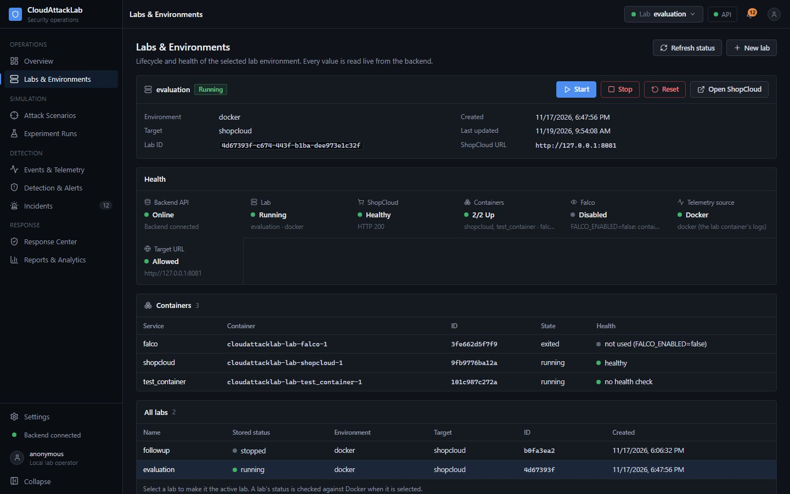

- **Status** `Running`. Other values: `stopped`, `degraded` (a lab container is down; the page says which), `starting`, `error`.
- **Health**: Backend API, Lab, ShopCloud (its health check), Containers, Falco, Telemetry source and Target URL. **Target URL** must say **Allowed**; if it is refused, runs are refused too (see [safety](safety.md#1-lab-only-targets)).
- **Containers**: `shopcloud` (the shop under test) and `test_container` (the target of the container scenario). `falco` appears even when Falco is off, as "exited" with "not used (FALCO_ENABLED=false)"; that is normal.
- **Open ShopCloud** opens the shop at <http://127.0.0.1:8081>.

**Refresh status** reads the lab again. Reading the lab also corrects its stored status, for example after a WSL or Docker restart (see [troubleshooting](troubleshooting.md#the-lab-says-running-after-a-wsl-or-docker-restart)).

## 2. Run `authentication_abuse` (failed logins)

Open **Attack Scenarios**. The catalogue lists the scenarios found in `scenarios/`: the three attack scenarios used below, and *Benign Baseline (observe only)*, which runs no attack and only watches the lab for ten minutes (it is for measuring false positives; see the [evaluation](evaluation-results.md#false-positives)).

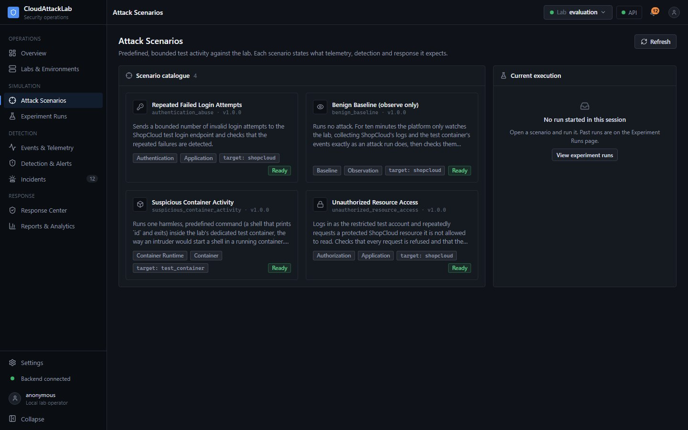

1. Click **Repeated Failed Login Attempts**. A panel opens with the scenario's definition: its script and fixed parameters, the telemetry and detection it expects, its response and its cleanup.
2. Check **Required environment status**. Every item should have a green tick. The last one, "Test account can log in", is checked by the backend when the run starts.

   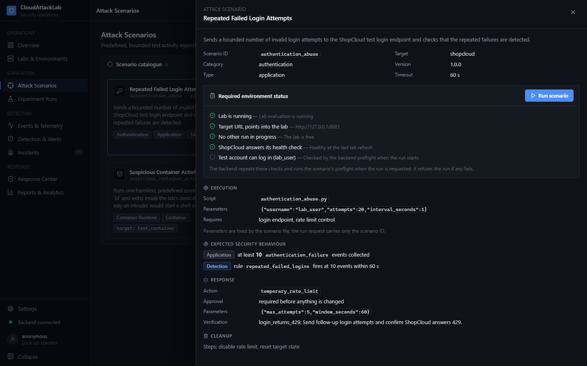

3. Click **Run scenario**, then **Run scenario** again in the confirmation dialog.

The script sends 20 logins for the test account `lab_user` with a deliberately wrong password, one per second. The **Current execution** panel follows the run through its steps (Pending, Running, then the final status). While it runs, no other run can start, because a lab runs one scenario at a time. After about 21 seconds the status becomes **Completed**, with **Cleanup** and **View report** buttons.

A run can end in four ways:

| Status | Meaning |
|---|---|
| `completed` | The script finished, the expected evidence was collected (here: at least 10 failed-login events) and no request went unanswered |
| `incomplete` | The script finished, but some expected evidence is missing or some requests got no answer. The reason is shown. Alerts that were raised are kept |
| `failed` | The script failed, timed out, or a telemetry source failed. Cleanup runs automatically |
| `cleaned_up` | Cleanup was run afterwards (shown as **Cleaned Up**) |

Detection runs once, when the script has finished, over all of the run's events. It is not a real-time stream.

## 3. Look at the events

Open **Events & Telemetry**. The newest rows are the run's 20 `authentication_failure` events from ShopCloud (source **Application**).

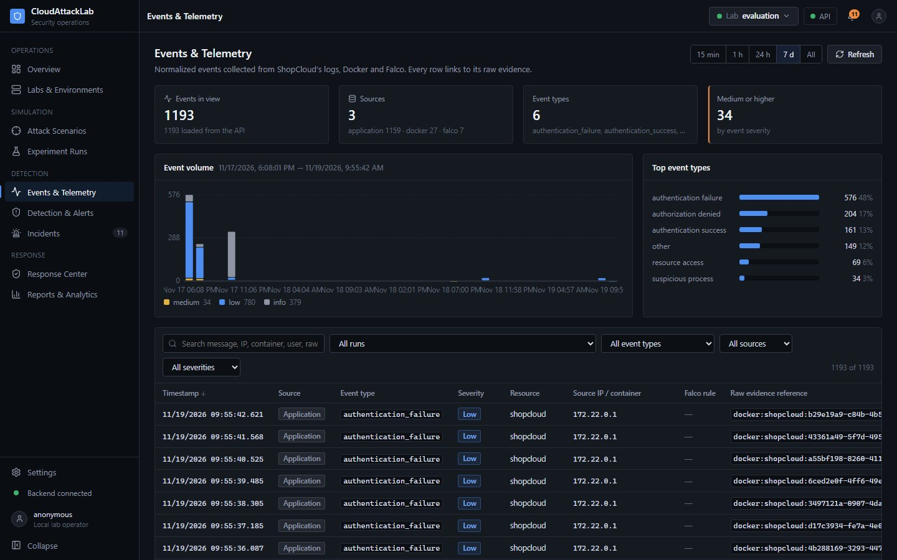

- The buttons at the top right choose the time range: 15 min, 1 h, 24 h, 7 d or All.
- The filters narrow the list by run, event type, source and severity; the search box searches messages, IPs, containers, users and raw records.
- Click a row to see the event's raw record. The **Raw evidence reference** column links each event to its original record: for ShopCloud events it is `docker:shopcloud:<request_id>` (or `loki:shopcloud:<request_id>` with Loki). The `request_id` is in ShopCloud's own log line, so you can find the original with `docker compose -f lab/docker-compose.lab.yml logs shopcloud`.

Every source IP is the same Docker gateway address. That is a known limitation, explained in [known limitations](known-limitations.md#every-source-ip-is-the-docker-gateway-address).

## 4. Read the alert and its evidence

Open **Detection & Alerts**. The newest alert is at the top.

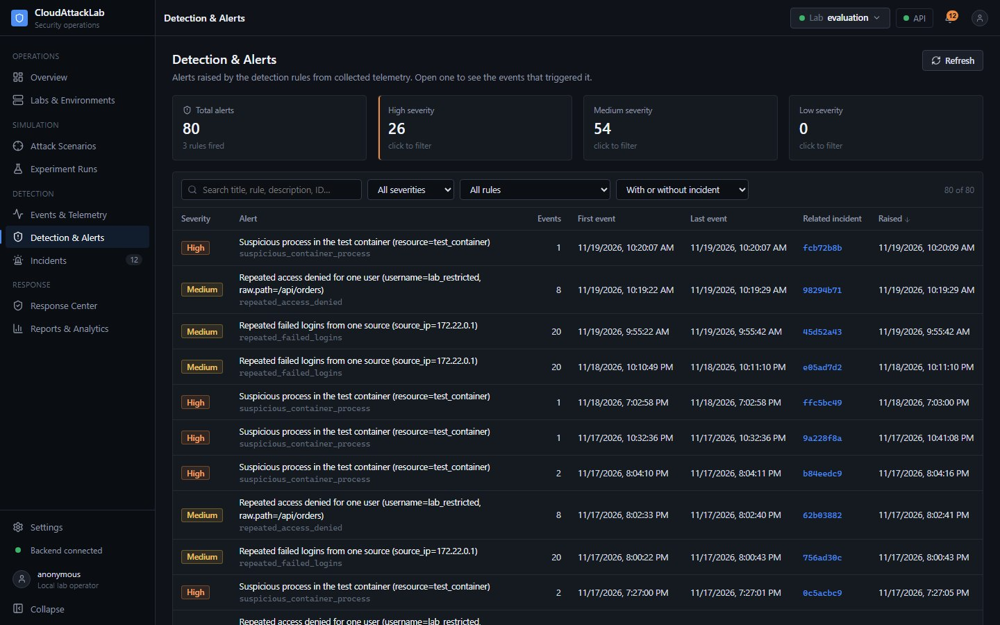

Click the newest **Repeated failed logins from one source** alert. A panel opens with:

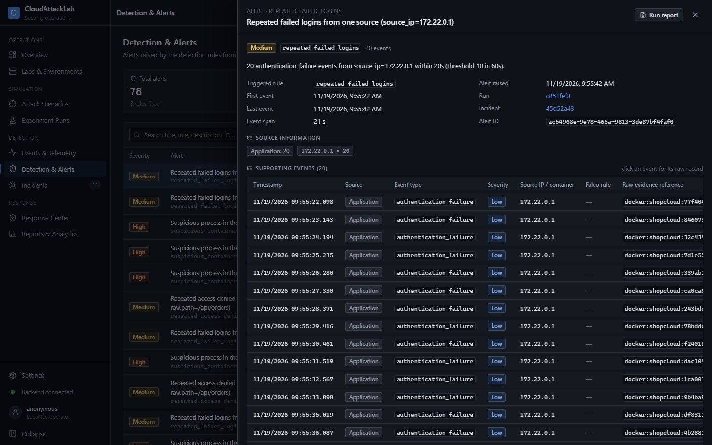

- The rule and the reason it fired: "20 authentication_failure events from source_ip=172.22.0.1 within 20s (threshold 10 in 60s)".
- The first and last event, the run and the incident (both are links).
- **Supporting events**: every event that counts towards the alert, each with its raw evidence reference. Click one for its raw record.
- Further down, **Related incident and response**, with the same **Response action** panel as on the incident page (next steps), and **Open incident investigation**.

**Run report** at the top opens the run's report.

## 5. Investigate the incident

Open **Incidents**. The newest incident is at the top, with its severity, status, risk score and number of alerts. The **All**, **Open** and **Closed** buttons and the severity filter narrow the list.

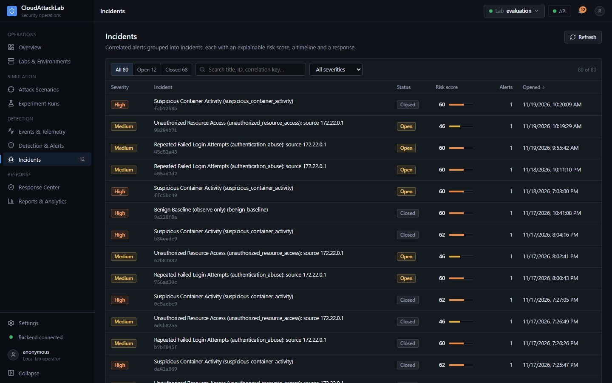

Click the newest *Repeated Failed Login Attempts* incident. The investigation page shows:

- At the top, a summary strip: **Execution** (the scenario and its times), **Telemetry** (20 events), **Detection** (1 alert), **Risk** and **Response**.
- **Attack timeline**: one list, in time order, of the scenario starting, every event behind the alert (the middle ones are folded; click "Show 18 more telemetry events" to unfold them), the alert firing, the incident opening, the scenario finishing, and later every response step and the cleanup. Each line links to its evidence (**open run**, **open event**, **open alert**) and to the API record.
- The other tabs: **Linked alerts**, **Supporting events** and **Context**.
- **Risk assessment**: the score with every factor written out.
- **Response action**: request, approve or reject a response (next step).

The risk score is a simple sum: 40 points for a medium-severity alert, 2 points for each event over the threshold (here 10, so 20 points, the maximum), 5 points for each extra correlated alert, minus 20 while a verified response is still applied. Before any response: 40 + 20 + 0 = 60. It is a rule of thumb for comparing incidents in this lab, not a prediction of loss.

## 6. Request, approve and verify a response

1. In the incident's **Response action** panel, click **Request response**, then **Request response** in the dialog. The response comes from the scenario file: for `authentication_abuse` it is `temporary_rate_limit`, at most 5 login attempts per 60 seconds. Its status is **Pending Approval** and nothing has changed in ShopCloud yet.

   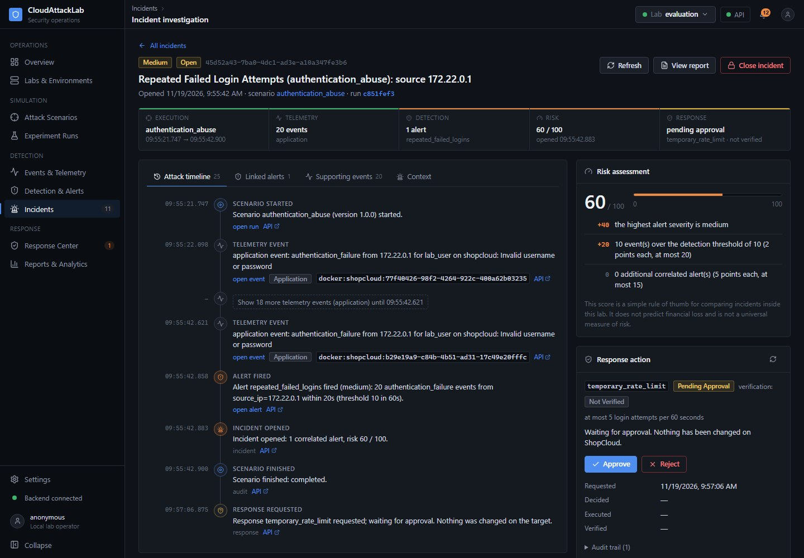

2. Click **Approve**, then **Approve and execute** in the dialog. (**Reject** leaves ShopCloud untouched.) Approving does three things in a row:
   1. **Executes** the action: the backend tells ShopCloud to turn the rate limit on.
   2. **Verifies** it: the backend sends 7 logins with a wrong password and expects the ones over the limit to be refused with `429`.
   3. Records the result. Here: "Verified: 2 of 7 follow-up logins were blocked with 429", with every status code ShopCloud answered.

   The panel shows **Verified** and **Passed**, the timeline gains the response steps, and the risk score drops from 60 to 40.

   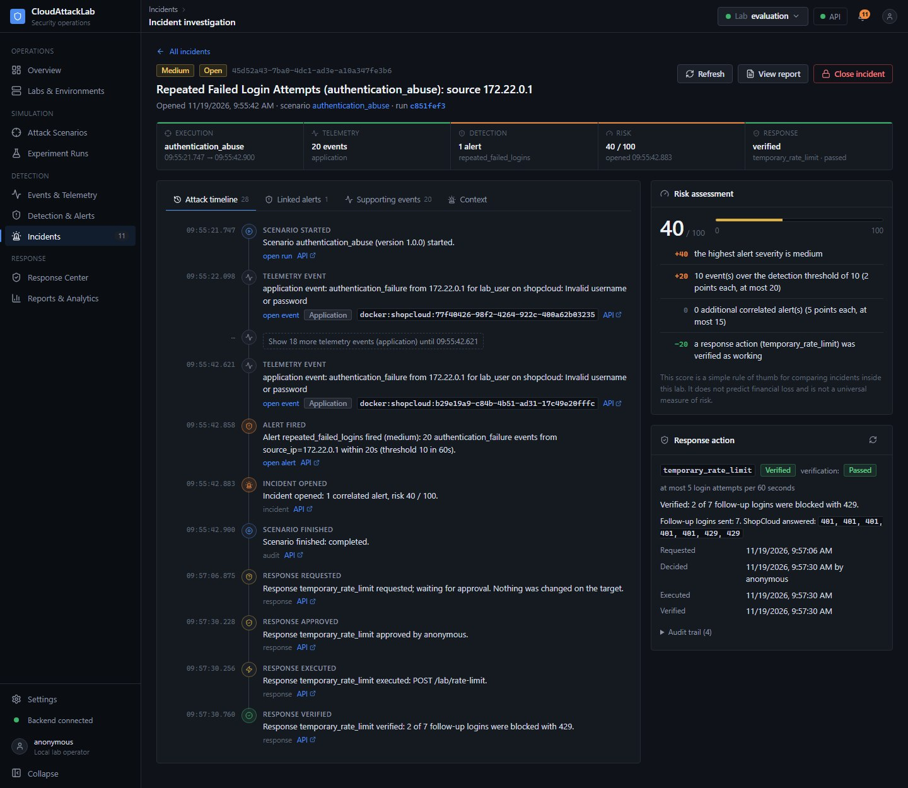

**Audit trail** at the bottom of the panel shows each step, who did it (`anonymous`, because there is no login) and what was sent.

You can do the same from the alert's panel (step 4) or from **Response Center**, which lists every response by status (**Pending approval**, **Approved**, **Executed**, **Verified**, **Failed**, **Rejected**, **Reverted**). Click a row there to open its response panel.

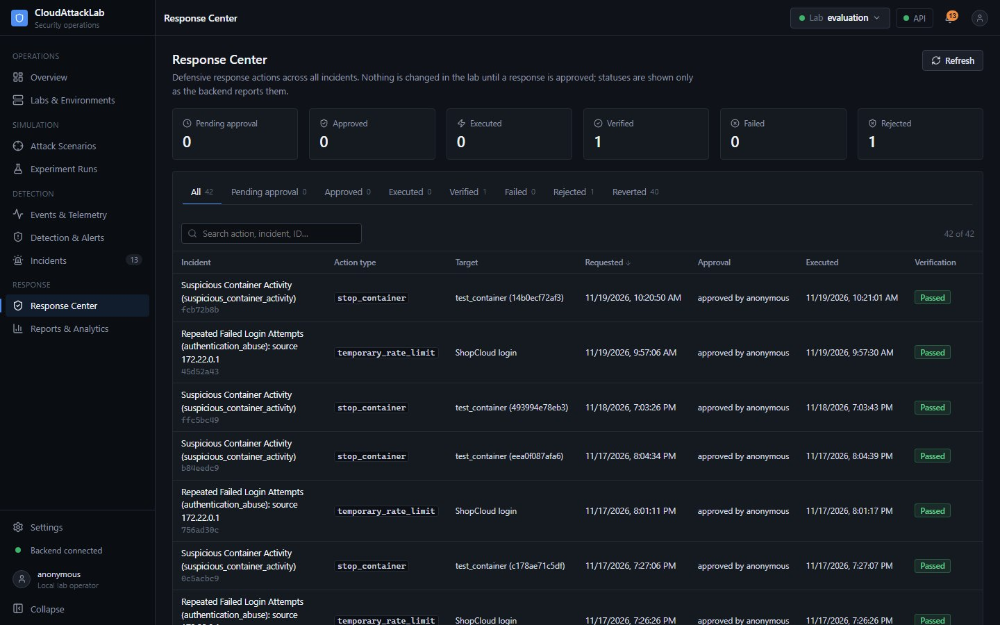

While the rate limit is on, **any** login to ShopCloud from this machine may get `429`, including yours with the right password. Cleanup (step 8) or Reset turns it off. See [troubleshooting](troubleshooting.md#a-manual-login-gets-429-after-a-test).

## 7. View and download the report

Click **View report** on the incident, **Run report** on an alert, or a run on **Experiment Runs** or **Reports & Analytics**. The report shows, for one run: the execution steps and times, the lab and scenario, the run's parameters, what the script reported, the telemetry expected next to what was collected, the alerts with the time from the threshold-crossing event to the alert, the incident and risk score, the response and its verification, and the cleanup status.

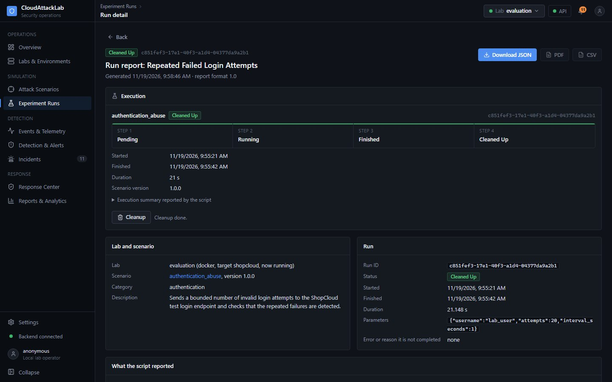

**Download JSON** saves the same report as `report-<scenario>-<run id>.json`. The same JSON is available from the API:

```bash
curl -s http://127.0.0.1:8000/api/v1/runs/<run id>/report
```

The **PDF** and **CSV** buttons are disabled: the backend only produces JSON reports. **Back** returns to the page you came from.

## 8. Clean up

Open the run (from **Experiment Runs**, or from **Current execution** on **Attack Scenarios** while you are still on that page) and click **Cleanup**, then **Run cleanup** in the dialog. For `authentication_abuse` it runs the scenario's two cleanup steps, `disable_rate_limit` and `reset_target_state`: the rate limit goes off and ShopCloud's data and sessions go back to their starting state. The run becomes **Cleaned Up**.

The response becomes **Reverted**, and the incident's risk score goes back up to 60, because the response no longer protects anything. The risk explanation says so.

Cleanup is refused while any run in the lab is still active.

**Experiment Runs** lists every run with its status, detection outcome and cleanup:

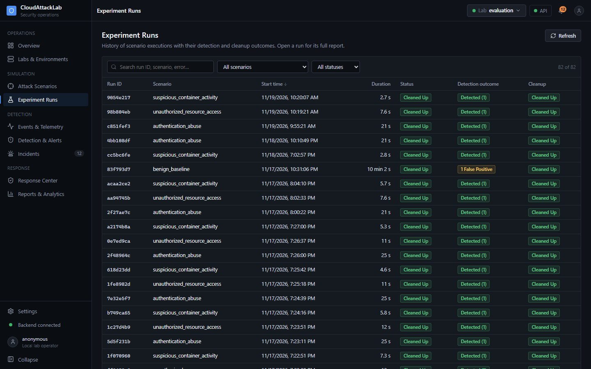

## 9. Run `unauthorized_resource_access` (denied access)

On **Attack Scenarios**, open **Unauthorized Resource Access** and click **Run scenario**, then confirm. The script signs in as `lab_restricted`, a user who may not read orders, and asks for `GET /api/orders` 8 times. All 8 must be refused with `403`.

After about 8 seconds the run is **Completed**. Because this scenario has no response action, the engine checks once more after the run and reports it in plain words: "Verification passed: access is still denied (GET /api/orders as lab_restricted returned 403)".

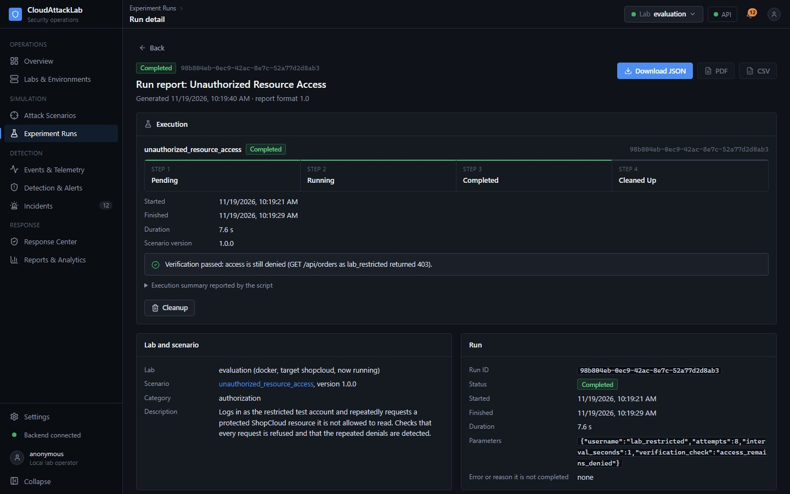

On **Detection & Alerts**, the new alert is `repeated_access_denied` with 8 events. The incident's risk score is 46: 40 for a medium alert plus 2 × 3 events over the threshold of 5. If any request had been allowed, the run would end `failed` with `"access_control_failed": true`.

Run **Cleanup** when you are done (`reset_target_state`).

## 10. Run `suspicious_container_activity` (a shell in a container)

This scenario runs one fixed, harmless command, `sh -c "id; : cloudattacklab-scenario-marker"`, inside the lab's test container, the way an intruder would start a shell. Docker reports it as an `exec_start` event, and Falco, when it is on, reports it too.

1. On **Attack Scenarios**, open **Suspicious Container Activity**, click **Run scenario** and confirm. It completes in about 3 seconds. The run report's "What the script reported" section shows the command and its output.
2. On **Detection & Alerts**, open the new **Suspicious process in the test container** alert (rule `suspicious_container_process`, severity **High**). With Falco off, as here, it holds one event, from Docker. With Falco on ([install, step 10](install.md#10-turn-falco-on-optional)) it holds two: one from Docker and one from Falco, whose rule is "CloudAttackLab marker process in test container".

   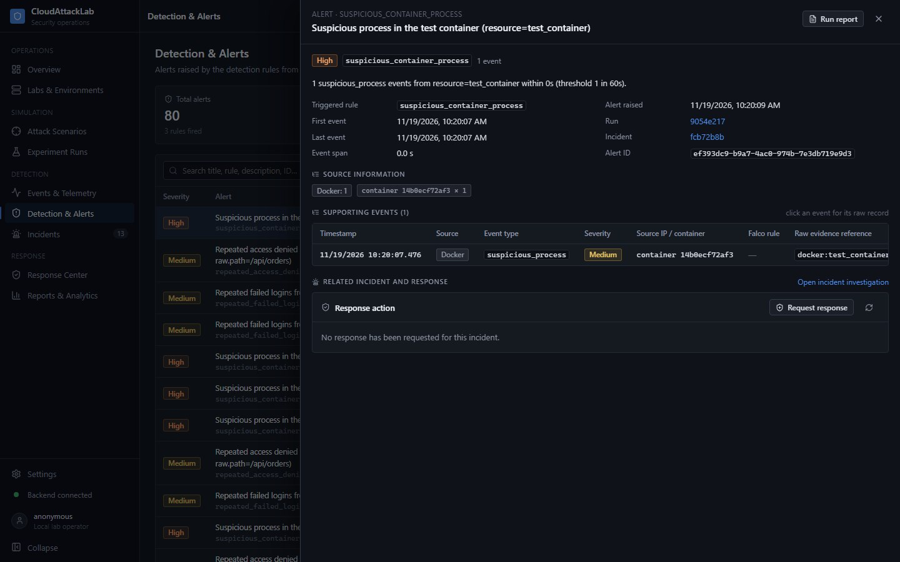

3. Open the incident, click **Request response** and confirm, then **Approve** and **Approve and execute**. The response here is `stop_container`: the backend stops the test container (and refuses any other container), then inspects it to confirm it is no longer running: "Verified: the test container cloudattacklab-lab-test_container-1 is no longer running".

   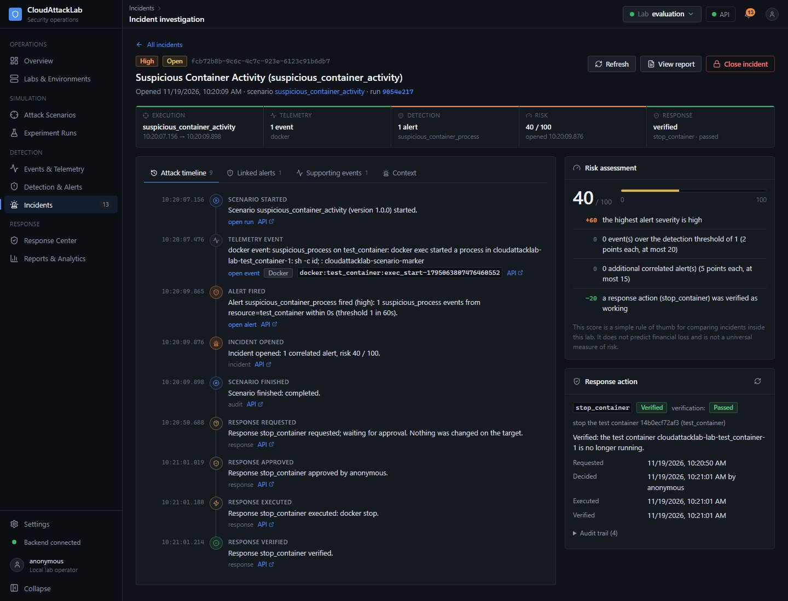

4. Run **Cleanup** for the run. Its step `recreate_test_container` creates a fresh test container, and the response becomes **Reverted**.

The incident's risk score is 60 with Docker evidence only (60 for a high-severity alert) and 62 with Falco on (Falco's extra event adds 2). While `stop_container` is applied it is 20 lower.

## 11. Close incidents

On an incident's page, **Close incident** (then **Close incident** in the dialog) marks it **Closed**. A closed incident takes no new response, and closing is refused while one of its responses is still waiting for approval. Closing is recorded in the audit log.

On **Incidents**, use **Open** and **Closed** to see each group.

## 12. Reset the lab

**Reset** on **Labs & Environments** (then **Reset lab** in the dialog) recreates every lab container and calls ShopCloud's own reset, so the lab is back at its starting point: original data, no sessions, rate limit off, a fresh test container (and Falco, if it is on). It also reverts any response that is still applied. Use it whenever you are not sure what state the lab is in, after changing `FALCO_ENABLED`, or when the lab is `degraded`.

Reset is disabled while a run is active, and takes a few seconds.

**Stop** stops the lab's containers but keeps them and their logs. Nothing in the database is deleted by Stop, Reset or Cleanup: runs, alerts, incidents, reports and the audit log stay. Only `scripts/reset.sh` deletes the database (see the [README](../README.md#stopping-and-resetting)).

## 13. Connect an independent ShopCloud (Target Management)

Sections 1 to 12 use the **bundled** lab, which CloudAttackLab starts itself. This section connects a ShopCloud that runs **on its own**, with its own Compose project, URL (<http://127.0.0.1:8090>) and data. It keeps running when CloudAttackLab is stopped. CloudAttackLab never starts, stops or looks inside it; it only talks to it over HTTP.

Registering a target, verifying it and authorizing an experiment are separate steps. Registration alone never allows attack traffic.

**Before you start**, start the standalone ShopCloud as described in [its README](../shopcloud/README.md#run-it-standalone), and keep its `shopcloud/.env` open: you need `INTEGRATION_KEY` and `LAB_CONTROL_TOKEN`.

### Register

Open **Target Management** (under Operations) and click **Register target**. Fill in:

| Field | Value |
|---|---|
| Name | For example `shopcloud-demo`. Lower-case letters, digits and dashes. `shopcloud` is reserved for the bundled lab |
| Application URL | `http://127.0.0.1:8090` |
| Integration key | `INTEGRATION_KEY` from `shopcloud/.env` |
| Control token | `LAB_CONTROL_TOKEN` from `shopcloud/.env` |

Click **Register**. The backend checks the URL against the lab address policy and **sends nothing** to it. The two secrets are stored and never shown again, in the dashboard, the API or the audit log.

Registration creates a lab called `<name> (external)`, which holds the target's runs, events, alerts and incidents. You can see it on **Labs & Environments**.

**Which URLs are accepted.** Only an IP address or `localhost` (host names are refused, so DNS can never redirect the target), inside `127.0.0.0/8`, on port `8090`, with no path. Cloud metadata addresses such as `169.254.169.254`, link-local, multicast and unspecified addresses, and CloudAttackLab's own ports (8000, 5173, 5432, 3000, 3100, 12345) are always refused. A refused URL is shown with the reason and recorded in the audit log as `target.register_refused`.

### Verify the connection and the telemetry

Each target is shown as a card with four steps:

1. **Registered.**
2. **Connection verified.** Click **Verify connection**. The backend sends `GET /health` and a signed handshake. ShopCloud must prove that it holds the integration key. The card then shows its instance (`shopcloud-standalone`), version and capabilities.
3. **Telemetry verified.** Click **Verify telemetry**. ShopCloud writes one test security event, and the backend reads it back through ShopCloud's signed event feed. This proves that the evidence path works before any attack traffic is sent.
4. **Authorized for a controlled experiment**: see the next step.

If verification fails, the step stays open and a message says why, for example "the target refused the integration key (HTTP 401)" or "the target has no integration API (HTTP 404); is INTEGRATION_KEY set on it?".

### Authorize an experiment

Click **Authorize** and choose:

| Field | Choices |
|---|---|
| Scenarios | The application scenarios (`authentication_abuse`, `unauthorized_resource_access`) |
| Valid for | 15, 30 or 60 minutes (60 is the maximum) |
| Maximum runs | 1, 2, 3 or 5 |
| Authorized by | Your name. There is no login, so this is recorded as you type it |

Tick the box confirming that the URL is a lab system you control, then click **Authorize experiment**. The button stays disabled until the box is ticked. The card shows **Authorized**, the runs used, and when the authorization expires.

A target has one active authorization at a time. It ends when it expires, when its runs are used up, or when you click **Revoke**.

### Run a scenario

Click **Use for a run**. This selects the target's lab and opens **Attack Scenarios**, which now shows "Target: … (registered, runs outside CloudAttackLab)". Open **Repeated Failed Login Attempts** and click **Run scenario**, as in [section 2](#2-run-authentication_abuse-failed-logins).

Before every run, the backend:

1. checks the stored URL against the address policy again;
2. repeats the handshake (the same application must still hold the key);
3. checks that an active authorization names this scenario and has a run left, and counts this run against it.

The script sends its 20 failed logins to `http://127.0.0.1:8090`. During the run, the backend collects ShopCloud's security events through the signed feed, not from Docker. Detection, alerts, incidents and reports then work exactly as in sections 3 to 7.

In **Events & Telemetry**, these events have references that start with `integration:shopcloud:`. The **run.start** entry in the audit log records the authorization, the URL and the ShopCloud instance.

If a run is refused, the message says why:

| Code | Meaning | What to do |
|---|---|---|
| `not_authorized` | No active authorization names this scenario: none, revoked, expired, or its runs are used up | Authorize again |
| `handshake_failed` | The application at the URL did not prove the key. The target's lab is set to `error` | Check ShopCloud and its `.env`, then **Verify connection** |
| `not_verified` | The telemetry has not been verified (for example after ShopCloud's instance changed) | **Verify telemetry** |
| `target_url_refused` | The stored URL no longer passes the address policy | Register a URL the policy accepts |
| `scenario_not_supported` | Container and observation scenarios cannot run against a registered target | Use the bundled lab for them |

### Respond, clean up and revoke

A response to the incident (for example **temporary_rate_limit**) is sent to the registered ShopCloud with its own control token. Approving it needs an active authorization for the scenario, because it sends traffic too, but it does not use up a run. **Cleanup** is always allowed: it turns the rate limit off and resets ShopCloud's data through `/lab/reset`.

**Revoke** stops any new run or response. A run in progress finishes.

### The target's lab

On **Labs & Environments**, the target's lab shows "Registered target" and has no **Start**, **Stop** or **Reset**: CloudAttackLab does not run that application. The lab's status is **Running** after a successful verification and **Error** after a failed one. Its health tiles show ShopCloud's own `/health` and the telemetry source "integration feed". There are no containers.

### Limits of this version

- Only ShopCloud can be registered, and only on approved local addresses. The address and port policy uses the backend's defaults (`TARGET_ALLOWED_CIDRS=127.0.0.0/8`, `TARGET_ALLOWED_PORTS=8090`, `TARGET_AUTHORIZATION_MAX_MINUTES=60`). These are not passed through `docker-compose.yml`, so setting them in `.env` has no effect unless you also add them to the backend's `environment`.
- A registered target cannot be deleted or renamed from the dashboard yet. Registering the same name again is refused, so pick a new name.
- The secrets are stored in plain text in PostgreSQL, with the same trust as `.env` on this machine.
- CloudAttackLab collects telemetry by reading ShopCloud's feed (pull). ShopCloud does not push events to CloudAttackLab in this version.

## Reports & Analytics

**Reports & Analytics** summarizes every recorded run: how many runs raised an alert, observation-run alerts (false positives), runs cleaned up, outcomes and alerts per scenario, and the full experiment history. Click a run in the history to open its report.

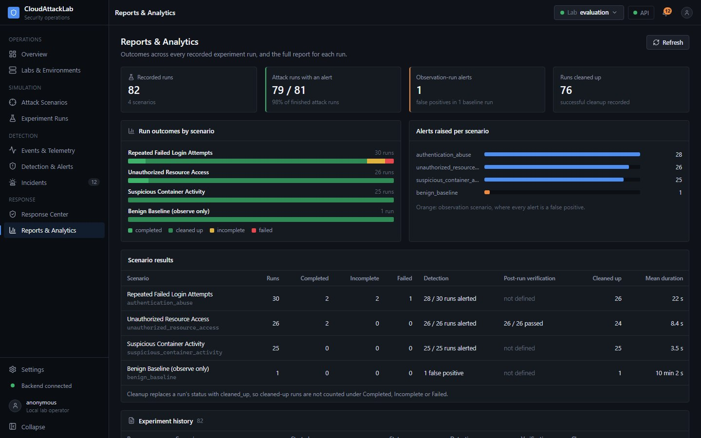

## What the dashboard does not do

- There is no login. Anyone who can open `127.0.0.1:5173` on this machine can run scenarios and approve responses. See [known limitations](known-limitations.md#no-dashboard-login).
- Most lists do not refresh by themselves; use **Refresh**. See "What refreshes by itself" above.
- Reports are JSON only: no PDF, no CSV and no sharing. **Settings** lists these as not implemented.
- Backend settings come from `.env` and cannot be changed in the dashboard.
